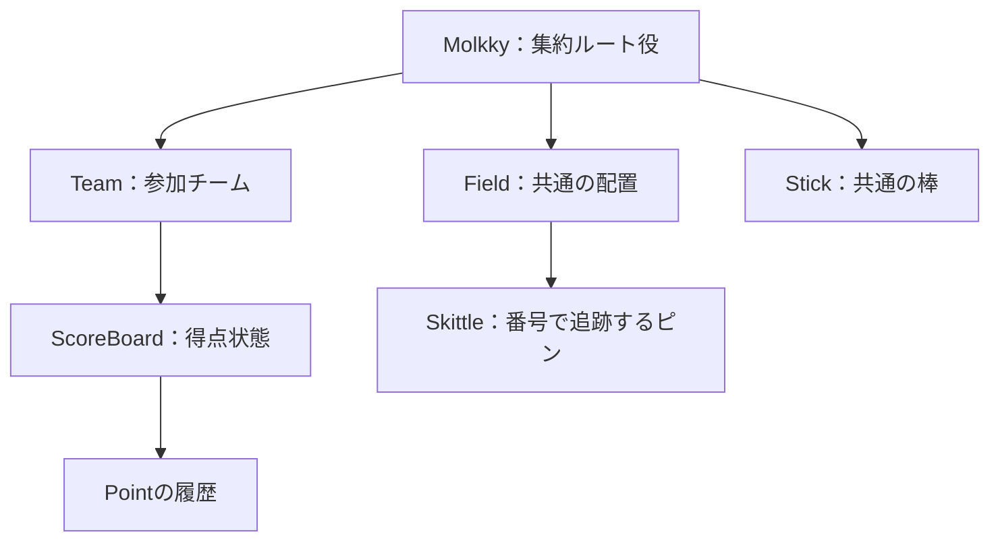
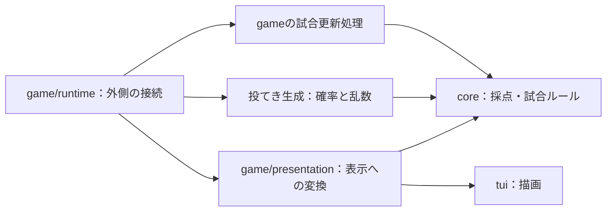
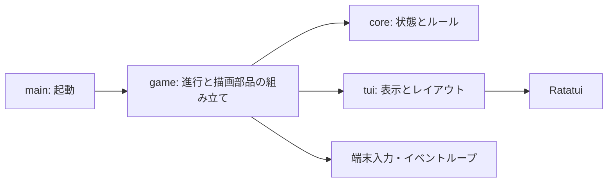

# Java版からRust版への移植

以下の過去の設計レビューは当時の記録です。現在の実装と検証結果は、先頭の実装記録とREADMEを参照してください。

## Displayの表現・hitの維持・動詞形の状態名（今回の設計レビュー・未実装）

- 入力：描画情報をint/2D/3Dなど任意の値にする案、モルックの公開操作としてhitを残す指定、状態名を前置詞なしの動詞形へ統一する指定。前回のhit削除提案は今回の指定で取り下げる。
- [x] AGENTS.md、現行CanvasDraw、Stick/Skittle、Molkky::throwと直前のレビューを確認する。
- [x] Displayの意味と型の制約、公開操作の責務、状態名の提案を記録する。
- [x] 記録だけを変更しgit diff --checkと文書差分を確認する。

### レビュー

- src/view/draw.rs:L3: shrink: 中・標準のstd::fmt::Displayを汎用描画インターフェースとして使わない。Displayは文字列の整形用であり、2D/3D型が実装しても画面描画の契約にはならない。表示データを保持するだけならTにtrait制約を付けず、描画操作は各rendererへ置く。
- src/core/models/skittle.rs:L6: yagni: 中・全core型へ表示用の型引数を先行伝播させない。現行のviewやgameのIDによる対応を使う。任意の値との合成が必要な箇所ではgame側にmodelとOption<V>を持つ型を用意できるが、全モデルの共通基底にはしない。
- src/core/services/molkky.rs:L20: shrink: hitを公開するドメイン操作として維持し、判定方式だけを渡された関数に任せる。薄い委譲でも用途に沿うAPI境界には意味があり、行数だけを理由に削除しない。新たなStrategy階層は不要。
- src/core/models/stick.rs:L3: shrink: 動詞原形に揃えるならStickStateはHold/Fly/Rest、SkittleStateはStand/Fallとする。命名のための共通State traitは追加せず、各enumで意味を定義する。

### 型と責務の補足（概念のみ）

- Rustの表記はフィールドがOption<T>、制約が必要な場合だけT: Traitとなる。ユーザーのDisplayが独自traitなら標準Displayとは別物であり、実際に共通化したい操作を先に決める。intと2D/3Dの値を保持したいだけなら共通traitは不要。
- coreのSkittle<T>が不透明なTを保持するだけなら、具体的な2D/3Dライブラリへの直接依存を必ず生むわけではない。前回の説明をこの点で補足する。ただし描画型ごとに別のSkittle型となり、採点などへ型引数が伝播することと、表示状態のライフサイクルをcoreが所有することが設計上の負担になる。
- 合成の一例はgame側のPresented<M, V> { model: M, display: Option<V> }。整数、2D、3DをそれぞれVに選べる。これは実装予定の共通基盤ではなく、必要な箇所で選べる案。同じ個体を複数viewに表示する場合は既存のIdと表示状態の対応付けを使い、coreを表示ごとに複製しない。
- Vはコンパイル時に決まるため、Optionは実行時にSome/Noneを切り替えるだけで2D/3Dの型を切り替える機能ではない。実行時の切り替えが実際に必要ならenum、共通の動的操作が必要ならtrait objectを検討する。今回から両方は作らない。
- hitの概念契約はhit(stick, skittles, judge) -> updated_skittles、judgeの境界はFnOnce(&Stick, &[Skittle]) -> Vec<Skittle>。状態を合成型へ持たせる場合には引数と戻り値もその具体型に合わせる。乱数源などは捕捉できる。ID・番号・個体集合の維持を契約とし、採点は今回StandからFallへ変化した個体を対象とする。hitを残すためだけの余分な処理は足さない。
- Holdは保持中、Flyは飛行中、Restは静止中、Standは直立、Fallは転倒済みと定義する。Fallを落下中の意味では使わない。関数hitは操作、enumは現在状態であり、同じ動詞系の命名でも役割を区別する。これらのenumは未実装。
- ソース・API・テストは変更しない。文書差分とgit diff --checkのみ確認し、Rustの再テストは実施しない。既存行数の削減は今回確定していない。

net: -0 lines possible.

## Shape・個体状態・hitの判定関数案（前回の設計レビュー・未実装）

- 入力：描画可能なcoreモデルへOptionのShapeを追加する案、Stick/Skittleへの状態追加、Molkky::throwをhitへ改名して判定関数へ委譲する案。最新の指定では判定関数は棒と個体一覧を受け、更新後の全個体一覧を返す。以前のfall案と区別する。
- [x] AGENTS.md、現行Stick/Skittle、Molkky::throw/calc_score、view、gameの個体IDと表示状態の対応を確認する。
- [x] 描画依存・状態の所有・関数委譲の必要性をレビューする。
- [x] 実装を変更せず記録の差分をgit diff --checkで確認する。

### 指摘と提案

- src/core/models/skittle.rs:L6: yagni: 高・core全体へShapeの型引数とOptionを伝播させない。描画側またはgameの合成オブジェクトへ描画情報を置き、既存のIdで対応付ける。Optionにしてもcoreから描画への型依存は残り、同じ個体を複数のviewで表す用途にも合わない。
- src/core/models/stick.rs:L3: yagni: 中・即時の抽選だけに飛行状態を先行追加しない。時間を進めるシミュレーションで必要になればHeld/InFlight/AtRestを合成側へ追加する。Thrownは投げた出来事の名称として使い、飛行中の状態と区別する。
- src/core/models/skittle.rs:L6: shrink: 中・状態の命名はStanding/Fallenが分かりやすい。独立したシミュレーション状態として持つか、ルールが参照するcoreの状態として持つかを決め、物理姿勢から算出する状態との二重管理を避ける。
- src/core/services/molkky.rs:L20: yagni: 中・判定関数を一度呼んで同じ結果を返すだけのhitは省略する。判定関数を直接呼び、ID集合の検証など共通の責務を担わせる場合だけ仲介関数を置く。

### Rustの表現と契約（提案のみ）

- Option<Shape: T>はRustの構文ではない。通常はT: Shapeという型制約を宣言し、フィールドをOption<T>とする。異なる実装を実行時に保持するならOption<Box<dyn Shape>>も可能だが、今回のcoreモデルには導入しない。CUIのために全モデルへNoneを持たせる必要はなく、CUIでは描画オブジェクト自体を作らずに済む。
- ScoreBoardは図形というより表/文字の表示データを作る対象であり、Stickの3D形状と同じShapeへまとめる必然性はない。現行のScoreBoardTuiなど、出力に合う表現を使う。
- 状態に応じたルールがcoreにあるならStanding/Fallenをcoreが所有してもよい。単に描画や物理運動のためならsimulation側でSkittleと状態を合成する。状態を持つことだけをDDDの条件にしない。不変更新では新しい個体のIdを発行せず、同じIdの新しい状態を返す。
- 棒のInFlight/AtRestは時間や物理エンジンの状態。判定関数がSkittlesだけを返す契約では棒の更新は返せないため、棒の状態遷移はシミュレーション側が別に所有する。棒の更新が実際に必要になった場合だけ戻り値の拡張を検討する。
- 判定関数には標準のクロージャ境界FnOnce(&Stick, &[Skittle]) -> Vec<Skittle>が使える。これは状態をSkittle自体に持たせた場合の概念上の型であり、合成する場合は具体的なシミュレーション型に置き換える。一覧をまとめて1回判定するのでFnOnceで足り、乱数源や物理世界はクロージャに捕捉できる。独自Strategy trait・fall_type enum・汎用コンテキストは作らない。
- hitという名前は「衝突対象を決める」のか「転倒まで解決する」のかをコメントと契約で明示する。接触と転倒は異なるため、転倒まで扱うならresolve_hitやresolve_knockdownも候補。今回の命名は提案として留め、現行throwの実装は変更していない。
- 更新後の全個体一覧をそのままcalc_scoreへ渡さない。採点用には今回StandingからFallenになった個体を取り出す。既にFallenだった個体を再び加点せず、投てき後に倒れた場所で立て直す状態遷移もシミュレーション/ゲーム進行側で扱う。全個体を返す契約ならIdの一意性・集合・得点用番号を維持し、変更対象を状態に限定する。

### 記録の検証

- レビュー記録のみ変更。Shape、状態enum、hit、判定関数の注入は未実装。Rustソース・テスト・依存関係は変更しないため再テストは実施せず、git diff --checkと文書差分を確認する。
- 既存コードの削除行数は確定していない。未追加の抽象を見送る行数は集計しない。

net: -0 lines possible.

## fallの命名とStick/Fieldの合成案（前回の設計レビュー・未実装）

- 対象と入力：Molkky::throwをfallへ改名し、Stick/FieldはIdだけを持ち、速度・確率・タイルマップ・3D物理世界は別の構造体で合成する案。現行のcore/services/molkky.rs、core/models/{stick,field}.rs、simulation/field.rs、gameの配置/表示合成、TUIの呼び出しを照合した。独立したthrow.rsは存在せず、対象はmolkky.rsのthrowメソッド。
- [x] 現行の投てき・棒・盤面・表示合成と参照元を確認する。
- [x] 命名・識別子の必要性・合成時の責務と所有を整理する。
- [x] レビュー記録だけを変更し、差分とgit diff --checkを確認する。

### 指摘（過度な抽象化・責務の観点）

- core/models/stick.rs:L3: shrink: 中・Stickが確率設定の入れ物になっている。確率をsimulation側の設定へ分離し、棒の同一性とは独立に扱う。速度・質量も物理シミュレーション側に置く。
- src/tui/controller.rs:L21: yagni: 中・現行の棒/盤面にはID照合の利用箇所がない。Idだけのcoreモデルの先行追加を見送り、持ち替え・保存/復元・複数盤面の対応付けなど、同じ個体を追跡する要件ができた時点で追加する。
- core/services/molkky.rs:L20: shrink: 低・現在は運動や投てき操作を扱わず、独立抽選で倒れる個体を返す。fallへの改名は妥当。StickがIdだけになった後も、未使用のStick引数を残さない。
- core/models/field.rs:L4: yagni: 中・FieldをIdだけの構造体に置き換える際、盤面の共通traitを別名で再建しない。採点には既存の&[Skittle]を渡し、個体集合・配置・生成は具体的なシミュレーション側で保持する。

### 提案する境界と合成

- 合成の方向には賛成する。DDDのEntityは同一性の継続が必要な対象であり、Idだけの型でも成立し得るが、名前が現実の物体であることだけではcoreへEntityを置く理由にならない。現在の得点/勝敗判定は棒や盤面のIdを参照していない。
- fallは「倒れる個体を決定する」操作として扱う。throw(stick, skittles)がスキットルを投げるという意味になるわけではないが、現状の抽選だけを表す命名としてfallが合う。物理エンジンで棒を発射する操作まで実装する場合、その操作にはthrowという名前を使える。
- 確率モデルの現在の最小形はfall(skittles, probability, rng)で足りる。これは概念上の引数であり実装変更ではない。確率の0〜1・NaN/無限大の拒否は、既存Stickから移した設定の生成境界に残す。Idから確率を導出する処理や、使わない棒の参照は追加しない。
- 速度・質量・衝突判定・確率モデルはsimulation、TUIの表示座標や描画はview、両者の接続はgameが担当する。3Dの物理座標と描画座標は区別する。GUIかTUIかによって物理方式を決めず、同じシミュレーション結果を別の描画へ渡せるようにする。
- 同一性が必要になった場合の合成例（概念のみ）は以下。TileFieldとPhysicsFieldは異なる実装の例であり、今から両方を作る提案ではない。

```text
simulation::StickBody    { stick: core::Stick, velocity, mass }
simulation::RandomFall   { probability }
simulation::TileField    { field: core::Field, skittles, tile_map }
simulation::PhysicsField { field: core::Field, skittles, physics_world }
```

- 合成により全ドメインモデルを各描画オブジェクトへ複製しない。Skittle集合は選択した実装/セッションが一度だけ所有し、物理ボディや複数の表示状態は既存のSkittle::id()で対応付ける。現行FieldをIdだけへ置換しても、Field::skittles()の役割を消失させず、合成側の個体集合から採点対象を取得する。
- 現在の確率方式と未実装の物理方式を束ねる汎用trait・巨大な引数enum・共通Worldは追加しない。必要になった具体的な方式を実装し、倒れたSkittleを既存calc_scoreへ渡す。物理世界の姿勢/速度などの更新はその実装側が保持し、得点サービスへ持ち込まない。

### 記録と検証範囲

- 今回は設計レビューのみ。ソース・テスト・APIの変更、fallへの改名、ID追加、設定型や物理世界の実装は行っていない。レビュー記録だけをgit diff --checkで確認するため、Rustの再テストは実施しない。
- 行数削減が確定する変更は今回ない。命名変更と責務の移動を削減に数えず、未追加の型を見送る分も既存行数の削減には含めない。

net: -0 lines possible.

## 超過時に得点履歴を25点へ圧縮（前回の変更）

- 要求：apply_pointを削除し、was_resetをis_resetへ改名する。生成時のelse if Self::is_reset(total)で50点超過を判定し、履歴を[25]へ置き換える。
- 不変条件：50点ちょうどで勝利、超過で25点、3連続0点で失格。履歴の途中で勝利/失格になった後の記録を拒否し、addは元の得点表を変更しない。newに渡した全記録は順に検証し、補正後も残りの記録を処理する。
- historyは全投てきの記録ではなく、直近の補正からの計算用履歴になる。25は補正後の基準値で、1投の得点ではない。totalは正規化済み履歴の単純合計とする。TUIの投数は呼び出し側で別管理し、履歴の圧縮で巻き戻らないようにする。
- 公式ルールの取得先https://www.molkky.com/molkky-rules/とhttps://www.molkky.jp/rule/は、両方とも接続プロキシの403で参照できなかった。今回のルール確認は上記の既知の得点規則と実装・テストの照合とし、公式サイトの再確認済みとは扱わない。
- [x] 変更前の全テストを実行する。
- [x] 超過時の履歴[25]・補正後の継続/失格/勝利・不変性のRedを確認する。
- [x] apply_pointを撤去し、is_resetによる生成時の履歴正規化を実装する。
- [x] TUIの投数と履歴表示、API例・READMEを更新する。
- [x] test/build/fmt/Clippy・TUI操作・差分を確認する。

### 実装とルールの確認

- newは入力を順に検証し、else if Self::is_reset(total)の分岐で合計を25点、計算用履歴を[Point(25)]にする。その後の記録も処理する。合計の途中計算はi64のままとし、加算時のi32オーバーフローを避ける。正規化済み履歴のtotalは単純合計とした。
- 49点は継続、50点ちょうどはWon、51点以上は25点に戻る。超過した投てきは正の得点なので直前の連続0点を中断し、補正後に3連続0点なら25点のまま失格となる。補正後の再超過・50点到達と、勝利/失格後の記録拒否を生成・追加の両方で確認した。採点の0本/1本/複数本、最後の生存者の勝利、手番の循環・失格スキップは既存テストで維持した。
- 履歴の[25]は補正後の基準値を示し、全投てきの履歴としては使わない。history().len()による投数計算を撤去し、Controllerでチームごとの投数を保持してTeamTuiへ渡す。表示列名も「得点履歴」とした。再開時は得点表と投数を初期化する。
- Resetは直前の計算が補正だったことを示す状態。history()だけをnewへ戻して[25]から再生成するとCalculatedになるため、履歴だけでResetまで復元できるとはしない。得点・末尾の連続0点・勝利/失格は維持される。READMEにこの制約を記載し、新たな復元APIや全投てきログは追加しない。

### Red・Green・最終確認

- 変更前のcargo test --lockedは127件成功（/tmp/reset-history-baseline.log）。
- Red：履歴の置き換え・補正後の継続を期待するscoreの6ケースが、旧履歴を保持するため失敗した（/tmp/reset-history-red.log）。TUIの新規テストも履歴件数5対1で失敗した（/tmp/reset-history-tui-red.log）。
- Green：scoreの19件が成功した後、TUIで履歴件数を投数とした誤表示を再確認した（/tmp/reset-history-tui-counter-red.log）。チーム別投数を使用側へ追加し、5投目の補正後も6投目へ進み、行の投数も5→6になることを確認した。全テスト初回で残っていたTeamの旧「生の点数を保持する」期待値は、新しい履歴契約[25]へ更新した。
- 最終cargo test --lockedは130件成功（core65・バイナリ26・CLI1・simulation4・doc34）、失敗・無視0件（/tmp/reset-history-final-tests.log）。テスト本体はtests以下で対象と同名のファイルに置き、検証の無効化やignoreは追加していない。
- cargo build --locked、cargo fmt --check、cargo clippy --locked --all-targets -- -D warnings、git diff --checkは成功。apply_point/was_reset/must_useがsrcに残っていないこと、モデルに可変selfがないことも確認した。
- 100列×30行の擬似端末で右矢印・Space投てき・R再開・Space投てき・Q終了を実行し、終了コード0・panicなし・第1投・得点履歴の見出し・25.0%表示を確認した（/tmp/reset-history-tui.log）。初回のログ検証は日本語の間に挿入されたANSIカーソル制御で失敗したため、制御文字を除いて検証した。製品の実行失敗ではない。
- coreへ端末入出力を追加していない。依存関係・ロックファイル・Javaは変更していない。

## 個体IDの重複検証をMolkkyへ移動（前回の変更）

- 対象：Skittleに同居していたvalidate_unique_ids。単体の状態ではなく個体集合の制約を検証するため、core/services/molkky.rsへ移す。
- 公開API・重複拒否・同番号の別個体を許可する振る舞いを変えない。ArrayFieldの生成時も同じ検証を使い、servicesからクレート内部にだけ再公開する。
- [x] 既存テストで変更前の振る舞いを確認する。
- [x] 関数と参照元を移し、投てき・採点・Field生成の重複拒否を維持する。
- [x] 既存テスト・build・fmt・Clippy・差分を確認する。
- 振る舞いを変えない移動のため、新たなRed用テストは追加せず、既存テストで変更前後を確認する。

### Refactorと検証結果

- 関数本体は変更せず移動し、modelsからの再公開を削除した。servicesからの再公開はpub(crate)に限定し、利用者向けAPIやMolkkyのtraitメソッドは増やしていない。
- 変更前後のcargo test --lockedはともに127件成功、失敗・無視0件。採点・投てき・ArrayField生成での同ID拒否と同番号の別個体の許可を既存テストで確認した（/tmp/id-validation-baseline.log、/tmp/id-validation-final-tests.log）。
- cargo build --locked、cargo fmt --check、cargo clippy --locked --all-targets -- -D warnings、git diff --checkは成功。関数の配置とimportだけの変更なので、TUIの手動操作は実施していない。テスト・依存関係・得点ルール・モデルの不変性は変更していない。

## Teamのturnとチーム参照を返すcore APIへの簡略化（前回の変更）

- Teamに非公開のturn: boolを追加し、初期値false・turn()/with_turn(bool)で不変に参照/更新する。with_score_boardとcloneでIdとturnを保つ。
- next_team(&teams)はturn=trueのチームの共有参照を返す。順番の計算・終了/失格判定・更新は行わない。judge_game(&teams)はScoreState::Wonのチームの共有参照を返す。曖昧な複数手番・複数勝者は拒否する。
- record_pointを削除し、利用側がScoreBoard::addとTeam::with_score_boardを直接利用する。手番の切り替えはTUI側へ移し、activeインデックスの重複保存を廃止する。coreへ入出力・描画・制御ループは置かない。
- 既存の最後の生存者の勝利はcoreのWon検索から分離し、呼び出し側のgameで維持する。ScoreStateをWonへ書き換えない。
- [x] 変更前の全テストを確認する。
- [x] Teamのturnと、手番/勝者のチーム参照を返すAPIのRedを確認する。
- [x] coreと利用側を更新し、手番循環・失格スキップ・終了後の操作停止・得点更新を確認する。
- [x] README/API例とテスト配置を更新し、test/build/fmt/Clippy・TUI操作・差分を確認する。

### 実装と責務

- Team::turn()はboolを返し、with_turnは新しいTeamを返す。ID・名前・得点表を保ち、with_score_boardもturnを保つ。複数のチームを並べたときの手番初期化は使用側が行う。
- Molkky::next_team(&[Team]) -> Option<&Team>はturnだけを検索する。失格・Won・並び順を見ず、入力を書き換えない。フラグがなければNone、複数なら拒否する。judge_gameも共有参照を返し、Wonの検索に限定する。チームID重複・複数Won・空の参加者の検証は従来どおり維持した。
- record_pointと互換ラッパーを撤去した。TUIは選択されたTeamのScoreBoard::addとwith_score_boardを直接呼び、投てき後の循環・失格者のスキップを行ってwith_turnで全フラグを更新する。終了時は全フラグをfalseにする。Controllerのactiveフィールドは廃止し、描画用の位置だけを必要時にIDから導出する。
- game/progress.rsのwinning_teamは呼び出し側アプリの終了条件として、coreのWon検索と従来の最後の生存者の勝利を組み合わせる。coreのjudge_gameがCalculatedの生存者を返すことはなく、ScoreBoardの状態も変更しない。
- coreへ入出力・端末・操作ループを追加していない。次チームの計算や終了後の入力停止は呼び出し側へ移した。フラグ選択であるnext_teamのNoneを、coreが判定した試合終了と同一視しない。

### Red・Green・最終確認

- 変更前のcargo test --lockedは146件成功（/tmp/team-turn-baseline.log）。
- Red：Team::turn/with_turn未実装のE0599を確認（/tmp/team-turn-red.log）。チーム参照の取得テストを先に書き、next_teamの引数変更のE0061と戻り値の型不一致E0308も確認した（/tmp/team-selection-red.log）。
- Green：フラグ選択・Won検索・返却参照の同一性・同名チームのID保持・フラグ/得点表の不変更新・複数手番/勝者の拒否を検証した。デフォルト実装・採点・投てきの既存検証は維持した。
- 廃止したrecord_pointや「現在indexから次を計算する」APIに対するテストは、現行core契約に合わせて整理した。範囲外indexの拒否など存在しなくなった入力の検証は削除し、得点履歴・補正・失格・終端後の追加拒否・不変性はScoreBoard/Teamの既存テストで維持した。coreの手番から終了を推測するケースはフラグ選択の検証へ変更した。
- 呼び出し側では、既存TUIテストの循環・失格スキップ・全失格・最後の生存者・共有Field・終了後の操作停止を維持した。新たに50点勝利後の停止/手番解除、25点補正後の次手番と通知も検証した。game/progress.rsで単独参加・複数生存・全失格・最後の生存者・50点到達を確認した。
- 最終cargo test --lockedは127件成功（core63・バイナリ25・CLI1・simulation4・doc34）、失敗・無視0件。従来より19件少ないのは、廃止したcoreの記録/順番計算/終了判定のテストを整理し、新しい契約と使用側の検証へ移した結果であり、ignoreによる減少ではない（/tmp/team-turn-final-tests.log）。
- cargo build --locked、cargo fmt --check、cargo clippy --locked --all-targets -- -D warnings、git diff --checkは成功。初回Clippyで日本語テスト名中のWonの大文字表記が警告となったため、日本語表記へ直して再確認した。新しい追加確認は実装後に成功したもので、最初のRedとは区別する。
- 100列×30行の擬似端末で右矢印・Space投てき・R再開・Q終了を実行。第1投・青チームの手番マーカー・25.0%表示、panicなし、終了コード0を確認（/tmp/team-turn-tui.log）。差分描画のため「青の投てき」の全文が再出力されず最初の文字列検証は失敗したが、描画された手番行のマーカーで確認した。製品の不具合とは扱わない。
- coreにrecord_point・標準入出力・端末依存・must_useがないこと、モデルに可変selfがないこと、Controllerにactiveの重複保存がないこと、テストがtests以下で対象と同名であることを確認した。READMEとAPI例も参照返却・直接の得点更新・明示的な手番設定へ更新した。
- ScoreBoardの状態/検証・個体ID・得点ルール・依存/ロック・Javaは変更していない。

## ScoreBoardの生成時検証・状態保持とGameStatus撤去（前回の実装）

- ScoreState（Calculated/Reset/Disqualified/Won）をScoreBoardに保持する。new(history)で履歴を先頭から検証・状態判定し、addも同じ経路を通す。history/total/stateを公開し、is_winner/is_disqualified/was_resetは内部判定とする。evaluate_total/validate_for_gameは削除する。
- 追記に合わせGameStatusとgame_status.rsを廃止する。judge_gameは勝者のOption<usize>を返し、next_teamは勝者あり・全失格ならNoneで終了を示す。チーム単位のScoreStateへ、最後の生存による試合勝利を書き戻さない。
- 既存ルール（50点ちょうど勝利・超過25点・3連続0点失格・最後の生存者勝利）と不変更新、must_useを付けない方針を維持する。得点の総和ではなく各投てきの補正を適用したtotalを返す。
- [x] 変更前の全テストを実行する。
- [x] 新しい状態・履歴復元・生成時拒否のRedを確認する。winnerの戻り値は既存テストの移行と継続判定で検証する。
- [x] 実装と既存テストを移行し、補正・失格・勝敗・不変性を維持する。
- [x] 公開API例・README・利用側を更新し、test/build/fmt/Clippy・TUI操作・差分を確認する。

### 実装・判断

- ScoreBoardはscore_historyとScoreStateを非公開に保持し、new(Vec<Point>)で履歴を順に1回走査する。各投てきの前に直前がWon/Disqualifiedでないことを検証し、50点到達・3連続0点の後の履歴を拒否する。Defaultはnew(Vec::new())、addは履歴を複製してnewを呼ぶため、検証を迂回しない。
- historyは共有スライス、totalは各投てきの補正を反映した合計、stateはCopyなScoreStateを返す。合計値は保存せず要求どおり履歴から計算する。clone・addでも元の状態は変えない。
- is_winner/is_disqualified/was_resetは非公開の判定へ変更し、走査中に計算した値を利用する。apply_pointを生成時とtotalで共有し、was_resetはその内部から使う。evaluate_totalとvalidate_for_gameを削除し、Molkky側での履歴再検証も削除した。
- ScoreState::Resetは直近の25点補正であり、次の通常投てき（0点を含む）でCalculatedへ戻る。Wonは50点到達のみを表す。最後の生存者が勝利した場合も、そのチームの得点状態をWonへ変更しない。
- GameStatusとgame_status.rs、および再公開を削除した。judge_gameはSome(勝者のindex)またはNoneを返す。Noneは継続中・全失格の両方を含むため、継続可否はnext_teamで判定する。next_teamは勝者ありならNone、全失格でも候補がなくNone。record_pointとTUIの終了ガードも同じ継続判定を使う。
- チーム一覧の空・ID重複・複数の50点到達チームの拒否はMolkky側に維持した。ScoreBoardの有効性とチームを横断する制約を混同しない。利用側のvalue/is_*等はtotal/stateへ移行した。Point::valueは変更しない。

### Red・Green・最終確認

- 変更前のcargo test --lockedは140件成功（/tmp/score-states-baseline.log）。
- Red：履歴からの復元・状態・total・生成/追加時の不正履歴拒否を確認する2テストを実装前に追加し、ScoreState未実装のE0432、newの引数のE0061、total未実装のE0599を確認した（/tmp/score-states-red.log）。GameStatus撤去後の戻り値は既存テストの移行で確認したもので、独立したRedとは数えない。
- Green：初回の移行テストでは、従来judge_gameで拒否していた2ケースがScoreBoard::addで先に失敗したため、アサーションの対象をチーム生成を含む範囲へ移した。終了・失格後の拒否と元履歴保持の検証内容は維持し、テスト名も生成時の拒否に合わせた。
- 空履歴・49点・50点・超過補正・補正後通常計算・3連続0点・正の点数での中断・繰り返し補正を確認した。新たに補正後の0点で状態だけがCalculatedへ戻ることと元の状態/clone/履歴の不変性も確認した。
- 継続中と全失格終了の両方がjudge_gameではNoneとなる一方、next_teamではSome/Noneで区別できるテストを追加した。最後の生存チームの状態がCalculatedのままであることも確認した。これら追加確認は実装後に成功したもので、事前のRedとは区別する。
- 最終cargo test --lockedは146件成功（core88・バイナリ20・CLI1・simulation4・doc33）、失敗・無視0件。cargo build --locked、cargo fmt --check、cargo clippy --locked --all-targets -- -D warnings、git diff --checkは成功（/tmp/score-states-final-tests.log）。
- 100列×30行の擬似端末で右矢印・Space投てき・R再開・Q終了を実行。第1投・25.0%表示、panicなし、終了コード0を確認した（/tmp/score-states-tui.log）。
- GameStatus/validate_for_game/evaluate_total/must_useがソースにないこと、状態setter・可変selfを導入していないこと、viewにcore依存を追加していないこと、テストがtests以下で対象と同名であることを確認した。
- READMEとAPI例を更新し、ScoreBoardの状態を直接変更できないcompile_fail例も追加した。new()はnew(history)へ変更し、空の生成にはDefaultを利用できる。GameStatus・ScoreBoard::value・公開のis_winner/is_disqualified/was_resetの互換ラッパーは残さない。
- Field・乱数投てきの方式・得点ルール・依存/ロック・Javaは変更していない。must_useを再導入していない。

## must_useの撤去とScoreBoardの状態保持案（前回の変更・設計レビュー）

- 作業範囲：プロジェクトで付与したmust_use属性は撤去する。ScoreBoardの状態保持・生成時検証・公開APIの変更は設計レビューのみとし、今回の実装へは含めない。
- [x] 変更前の既存テストを確認する。
- [x] 全ソースのmust_use属性と、それを必須とするAPI例の検証を撤去する。
- [x] 状態保持案の責務・生成経路・状態の意味・確認計画を記録する。
- [x] 既存テスト・build・fmt・Clippy・差分を確認する。

### ScoreBoardの状態保持案のレビュー（未実装）

- 対象：core/models/score.rs、Molkkyの判定・記録、game/presentationの得点・通知。履歴と状態を非公開フィールドに持ち、生成経路を一本化すれば、ScoreBoard自身が有効性を保証する設計にできる。
- 中・score.rs:L69（変更前）: shrink: validate_for_gameの独立した事後検証を、履歴を受け取る生成処理へ統合する。現在のnew()は空履歴しか作らないため、new(score_history)等の検証する入力を持つ生成経路が必要。addも新しい履歴を同じ生成処理へ通し、Clone/Defaultを含め不正な状態を作る経路を残さない。外部のMolkky側の再検証を外せるのは、その保証が成立した後。
- 低・score.rs:L48,52,59（変更前）: shrink: is_winner/is_disqualified/was_resetは非公開化可能だが、newから呼ぶたびに履歴を再計算する形にはしない。残すなら、生成処理で一度走査した合計・連続0点数・超過判定を受け取る内部判定とする。簡単な条件ならnewへ直接書いてもよい。
- 低・score.rs:L63（変更前）: shrink: evaluate_totalは関数として削除できるが、totalでの履歴計算は必要。現在の25点補正を表すapply_pointは、生成時の検証とtotalの計算で共有し、補正規則を二重に書かない。

### 状態の意味と公開API案

```rust,ignore
pub enum ScoreState {
    Calculated,
    Reset,
    Disqualified,
    Won,
}
```

- ResetedはResetとする。Calculatedは空履歴または通常の直近結果、Resetは直近の投てきで25点補正、Wonは50点到達、Disqualifiedは3回連続0点を表す。Resetは終端ではなく、次の通常投てきでCalculatedへ戻る。WonとDisqualifiedは終端で、その後の追加履歴を拒否する。
- Wonはチームの50点到達に限定する。最後の生存チームとしての勝利は0点でも起こるため、ゲーム全体の勝者は引き続きMolkky::judge_gameが決める。ScoreStateだけでゲーム全体の勝敗を表そうとしない。
- history() -> &[Point]、total() -> i32、state() -> ScoreStateを問い合わせの公開APIとする。stateはCopy可能な値として返し、状態のsetterは設けない。valueはtotalへ置き換え、公開is_winner/is_disqualified/was_resetの利用側はstateで判定する。
- 生成の中心をnew(score_history: Vec<Point>)にする案なら、空履歴はnew(vec![])でCalculated・0点となり、addは履歴を複製してnewを呼ぶ。既存new()の引数・Defaultや、復元APIの扱いは実装時に揃える。
- 履歴とstateは同じ事実の保存になるため、各生成時に履歴から必ずstateを導出する。totalは要求どおり履歴から算出し、合計の保存フィールドは追加しない。

| 最後の有効な投てきの結果 | 合計 | 状態 |
| --- | --- | --- |
| 通常加算・空履歴 | 補正を反映した合計（空は0） | Calculated |
| 加算直後が50点を超える | 25 | Reset |
| 加算直後が50点ちょうど | 50 | Won |
| 直近3回のPointが連続して0 | 合計は維持 | Disqualified |

- 「50以上」を一括で処理せず、50超過と50ちょうどを区別する。失格の条件は合計が0であることではなく、3回のPointが連続して0であること。
- totalは単なるsumではなく、各投てきの超過補正を順に適用する。例えば[12,12,12,12,3]は51ではなく25、さらに1点を加えた履歴なら26。
- newは最後の状態だけを見ず、履歴の各時点を先頭から検証する。[10,10,10,10,10,1]は最後の計算結果を25点にして受理せず、50点到達後の記録として拒否する。[0,0,0,1]も同様に失格後の履歴として拒否する。

### 状態保持案を実装する際の確認計画（未実装）

- [ ] 空履歴でCalculated・0点、通常加算、50点到達、超過補正を確認する。
- [ ] Resetの次の通常投てきでCalculatedとなり、複数回の補正もtotalへ反映されることを確認する。
- [ ] [5,0,0,0]が合計5のままDisqualifiedとなり、正の点数で連続0回数が中断されることを確認する。
- [ ] Won/Disqualifiedに達した後の0点・正の点数を、追加時と履歴復元時の両方で拒否する。
- [ ] addで元の履歴・状態が変わらないことと、Molkky/表示側がstate/totalを使うことを確認する。

### 今回のmust_use撤去と検証結果

- ソースの属性4か所（ScoreBoard::add、Team::with_score_board、Molkky::record_point、relocate_skittles）を削除した。API文書内のunused_must_useを必須とするcompile_fail例2件も、ユーザーが不要とした契約に合わせて削除した。他の振る舞いの検証は維持する。Rustや依存ライブラリ側の属性・lint設定は変更していない。
- 変更前のcargo test --lockedは142件成功（/tmp/score-state-review-baseline.log）。変更後は140件成功（core84・バイナリ20・CLI1・simulation4・doc31）、失敗・無視0件（/tmp/score-state-review-tests.log）。2件の差は上記API例の削除による。
- cargo build --locked、cargo fmt --check、cargo clippy --locked --all-targets -- -D warnings、git diff --checkも成功。src/testsにmust_use属性やその必須化設定が残っていないことを確認した。属性撤去とレビューのみのため、今回はTUIの手動操作や新しい振る舞いのRedは行っていない。
- ScoreState、生成時検証、公開APIの変更はすべて提案であり、score.rsはmust_use属性以外を変更していない。状態設計の削減行数は未計測。今回のソースの純減は属性4行。

net: -4 lines possible.

## 投てきのMolkky統合とultra簡略化（前回の変更）

- 最新の指定：throw関数をstick・skittles・乱数源の3引数にしてMolkkyへまとめ、無駄を点検する。
- Molkky::throw(&self, &Stick, &[Skittle], &mut dyn RngCore)へ独立抽選を直接記載した。関数型・コールバック・新たなStrategyは追加せず、既存ThrowStrategy/ThrowOutcome/RandomThrow/throw_stickと対応する2つのソースファイルを削除した。
- 投てき結果はVec<Skittle>だけとし、現在の方式で更新しないFieldの複製・アクセサ・分解・InfallibleのResultを廃止した。棒と個体は共有参照のまま、渡された乱数源だけを更新する。
- デフォルトの投てきがStickを直接受けるため、確率設定のStickをcore/modelsへ移してsimulationへの逆依存を避けた。coreは乱数源の契約RngCoreと抽選処理を使うが、乱数源の生成・端末・座標は引き続き利用側に置く。
- [x] 変更前の全テストを確認する。
- [x] Molkky::throwのRedを確認する。
- [x] 投てき・設定のテストを新しい対象と同名のファイルへ統合し、ID重複拒否・確率境界・再現性・入力不変を維持する。
- [x] molkky.rsの簡略化、利用側・API文書を更新してtest/build/fmt/Clippy・TUI操作・差分を確認する。

### molkky.rsの点検結果

- 削除：Fieldを複製して同じ状態を返す結果型、結果を取得・分解するメソッド、処理を包むStrategy構造体と関連型Error、確率方式で失敗しない処理のResult。乱数投てきは入力のfilterだけで表せる。
- 簡略化：record_pointで同じ添字を繰り返し参照していた箇所をteams.get(...).expect(...)の1回にし、得たTeamから新しい値を生成する。範囲外の拒否は維持する。
- 維持：入力のID重複検証、履歴検証、複数勝者の拒否、単独参加と最後の生存者の区別。これらは必要なルールであり、短くするために削らない。
- 維持：record_point末尾のself.judge_game(&updated)。結果は捨てるが更新後の検証と上書きした判定を実行するため、不要な呼び出しとは扱わない。判定結果のキャッシュや新しい中間状態型も追加しない。
- 既定throwは入力の個体をコピーして選ぶだけなので、対象外個体の生成や個体集合の変更を検査する仲介が不要になる。採点側のID重複検証は維持する。throw自体を上書きする場合の実装契約を検査する別レイヤーは追加しない。

### Red・Green・最終確認

- 変更前のcargo test --lockedは144件成功（/tmp/throw-ultra-baseline.log）。
- Red：最新の3引数指定に合わせ、dyn Molkky経由でthrowを使うテストを実装前に追加し、未実装のE0599を確認した（/tmp/throw-direct-red.log）。
- Green：デフォルトthrowを実装し、既存確率方式の5テストとStickの2テストをtests/coreへ移した。投てきのID重複拒否もtests/core/services/molkky.rsへ統合した。旧tests/core/services/throw.rsとtests/simulation/random_throw.rsは削除した。
- 旧投てき契約のField更新・エンジンエラー伝播のテストは、未実装の物理エンジンに備えた契約自体を廃止したため削除した。個体集合の追加・消失・対象外の結果を作る偽Strategyのケースも、外部判定結果を受ける入口の廃止に合わせて整理した。入力不変・同番号の別個体・同ID拒否・確率0/1・同じシードの再現性は維持する。単なるテストの無効化やignore追加は行っていない。
- 最終cargo test --lockedは142件成功（core84・バイナリ20・CLI1・simulation4・doc33）、失敗・無視0件。cargo build --locked、cargo fmt --check、cargo clippy --locked --all-targets -- -D warnings、git diff --checkも成功（/tmp/throw-direct-final-tests.log）。
- 100列×30行の擬似端末で右矢印・Space投てき・R再開・Q終了を実行。第1投・25.0%表示、panicなし、終了コード0を確認した（/tmp/throw-direct-tui.log）。
- 旧抽象型と関数がソースに残っていないこと、モデルに可変selfがないこと、viewへcore依存を追加していないこと、テストの配置と対象ファイル名が一致することを確認した。
- READMEとAPI例を更新した。Stickはsimulation::Stickからcore/models・core直下・crate直下のStickへ移行し、投てきはSimpleMolkky.throw(...)へ変更する。全メソッドはdyn Molkkyでも利用可能。
- 物理エンジンの実装・世界状態更新・エラーや非同期の共通化は追加しない。Fieldの生成契約、既存の採点・勝敗ルール、依存/ロック・Javaは変更していない。
- プロダクトソース（src）の差分は追加24行・削除102行、純減78行。文書・テストはこの集計に含めない。

## 採点・試合判定のMolkky traitへの直接統合（前回の変更）

- 要求：関数への委譲ではなく、Molkky traitのデフォルト実装へ処理を直接書き、judge.rs/scoring.rsを削除してmolkky.rsへまとめる。
- core/services/molkky.rsにcalc_score・judge_game・next_team・record_pointをデフォルトメソッドとして置く。現行の得点・補正・失格・勝敗・入力検証・不変更新を維持する。next_team/record_pointはself.judge_gameを呼ぶ。
- 状態を持たないSimpleMolkkyを既定の利用型として用意する。ScoreBoardが持つ得点履歴・合計・補正の規則はそのまま再利用する。Fieldや投てき方式をtraitへ含めない。投てきの関数型への縮小案は今回の範囲外で、throw.rsは変更しない。
- 自由関数の互換ラッパーは残さず、利用側はMolkky traitとSimpleMolkkyを使う。TUIと表示用合成は同じルール実装で判定する。
- [x] 変更前の全テストを確認する。
- [x] 空のtrait実装の既定ルールと、上書きした判定が記録・次チーム判定へ反映されることのRedを確認する。
- [x] 実装と既存テストをmolkky.rsへ統合し、全ルールの検証を維持する。
- [x] 利用側・API文書を更新し、test/build/fmt/Clippy・TUI操作・差分を確認する。

### 設計・Red/Green・最終確認

- デフォルトメソッドの本体はmolkky.rsへ直接記載し、judge.rs/scoring.rsおよび再公開を削除した。SimpleMolkkyは空のimplで全デフォルトを使う。旧Molkky構造体と異なり、trait/既定実装はチーム・Field・Stickを所有しない。
- calc_scoreは個体IDの重複検証と0/1/複数本の採点、judge_gameはチームID・履歴・勝者の検証と試合判定を実行する。50点超過の25点補正・3連続0点の判定・履歴追加は既存ScoreBoardの実装を使い、処理を複製していない。
- next_team/record_pointはself.judge_gameを利用する。TUIのControllerはSimpleMolkkyを保持し、その同じ参照をgameの表示用合成へ渡す。上書きした判定を表示にも反映するテストを追加した。任意の得点・失格ルール全体を設定可能にする変更は今回行わない。
- 変更前のcargo test --lockedは140件成功（/tmp/molkky-defaults-baseline.log）。
- Red：空のimplで既定ルールを使うテストと、judge_gameの上書きが記録・次チーム判定へ反映されるテストを先に追加し、Molkky未実装のE0432を確認した（/tmp/molkky-defaults-red.log）。
- Green：traitと直接の既定実装を追加して2テストが成功。旧judge/scoringのテスト本体はtests/core/services/molkky.rsのjudging/scoringモジュールへ移し、既存のアサーションを維持した。その他の呼び出しも自由関数からSimpleMolkkyのメソッドへ更新した。
- 新しい表示テストと空のimplを説明するAPI例は実装後に追加して成功したもので、事前のRed確認済みとは数えない。compile_fail例のimportも更新し、削除した自由関数の未解決importだけで通る状態にはしない。
- 最終cargo test --lockedは144件成功（core79・バイナリ20・CLI1・simulation11・doc33）、失敗・無視0件。cargo build --locked、cargo fmt --check、cargo clippy --locked --all-targets -- -D warnings、git diff --checkも成功（/tmp/molkky-defaults-final-tests.log）。
- 100列×30行の擬似端末で右矢印・Space投てき・R再開・Q終了を実行。第1投・25.0%表示、panicなし、終了コード0を確認した（/tmp/molkky-defaults-tui.log）。削除したファイル/自由関数が存在しないこと、テストのファイル名・配置が対象と一致することも確認した。
- 公開APIはMolkky traitをimportしSimpleMolkkyや利用側の空implからメソッドを呼ぶ形へ変更した。READMEと実行可能なAPI例を更新した。過去のレビュー中のjudge.rs/scoring.rsへのリンクは変更前コミットのソースへ向けた。
- throw.rs・Field・物理エンジン・モデルの内部構造・依存/ロック・Javaは未変更。記録済みの投てき関数型への縮小案は引き続き未実装。

## 現行ルールをデフォルトにするMolkky trait案（前回のレビュー・直接統合は上記）

- 入力：judge/scoringをMolkky traitへまとめ、過度な抽象化を避けるため、現在実装しているシンプルなルールをデフォルト提供する提案。繰り返しの指定により、「最初の実装」への巻き戻しではなく、現在のルールを対象とする。今回は設計レビューで、ソースの置換は行わない。
- 対象：core/services/judge.rs、scoring.rs、core/models/score.rsとTUI/presentationの呼び出し。結論は「試合ルールの契約として限定すれば可能。ただしtraitの追加自体は抽象化を増やし、デフォルト実装だけで過度な抽象化を防ぐものではない」。差し替えが不要なら、現行の具体的な関数の方が少ない構成で済む。

### Ponytailの所見と責務

- 中・services/mod.rs:L5: yagni: 単に関数名を束ねるためだけのtraitは委譲層を増やす。導入する場合は採点と試合判定のルール契約に限定し、Field生成・投てき・描画・入出力まで含めた総合インターフェースにしない。
- 低・models/score.rs:L44: shrink: 合計・25点補正・履歴の妥当性・失格判定をtraitへコピーしない。ScoreBoardの振る舞いと不変更新を再利用する。モデルが既に持つ業務規則を外へ移す必要はない。
- Molkkyは状態を持つ旧構造体の復活ではなく、ルールの操作を表すtraitとする。Team一覧・Field・Stickを所有させず、Factory/Repository/汎用RuleConfig/新たなStrategyクラスは追加しない。具体的な既定の利用名が必要なら、状態を持たないSimpleMolkkyを1つ用意する。

### 最小の設計例（未実装）

既存ルールを再利用する最小例。これは委譲を増やす案でもあるため、複数の利用側へ同じ契約を渡す用途があるかで導入を判断する。

```rust,ignore
pub trait Molkky {
    fn calc_score(&self, knocked_over: &[Skittle]) -> Point {
        scoring::calc_score(knocked_over)
    }

    fn judge_game(&self, teams: &[Team]) -> GameStatus {
        judge::judge_game(teams)
    }
}

pub struct SimpleMolkky;
impl Molkky for SimpleMolkky {}
```

- この2メソッドだけなら、現行の採点と判定をそのまま提供する窓口になる。traitを実装する型は必要なメソッドだけ上書きできるが、任意のルール変更が他の処理へ自動反映されるわけではない。
- ルールの上書きを実際に使うなら、next_team/record_pointも同じMolkkyのjudge_gameを呼ぶように揃える。現在のjudge.rs:41,55,66は自由関数を直接呼ぶため、traitの外側にそのまま残して判定だけ差し替えると利用するルールが分かれる。TUI/presentationも同じルール実装を利用する必要がある。これは導入時の整合性条件であり、今回その変更を実施したものではない。
- 目標点や失格条件自体を将来変更する場合は、ScoreBoardの固定ルール・検証や表示の定数も対象になる。今回のtraitだけで、あらゆる変則ルールが変更可能になるとは扱わない。

### デフォルトとして維持する現在のルール

- 0本は0点、1本は番号、複数本は本数。同番号でも別IDなら別個体として採点し、同IDの二重カウントを拒否する。変則構成で本数が13以上でも本数として採点する。
- 50点ちょうどで勝利し、超過すると25点へ戻す。生の得点履歴は残す。
- 3回連続0点で失格。2チーム以上の参加で残り1チームならそのチームが勝利する。単独参加は参加しただけで勝利せず、全チーム失格はFinished { winner: None }。
- 終了後・失格チーム・存在しないチームへの記録、不正履歴、チームIDの二重登録、複数の50点到達チームを拒否する。元の履歴とチームは変更しない。

### 今回の範囲と導入時の確認

- [ ] traitを導入する場合、現在の全ルール・入力検証・不変更新のテストを既定実装にも適用する。
- [ ] 判定を上書きした場合、記録・次チーム選択・表示も同じ判定を利用することを確認する。
- [ ] 投てき方式やFieldの型をMolkkyの型引数・関連型として増やさずに利用できることを確認する。
- 実装・テスト・依存は変更せず、テスト/buildは再実行しない。git diff --checkを行い、AGENTS.mdに従いレビュー記録のみcommit/pushする。trait追加に伴う削減は見込まず、削減見積もりは0行。

net: -0 lines possible.

## 投てき契約を関数型へ縮小する案（2026-10-28・レビューのみ）

- 入力：throw.rsの複雑さを見直し、Strategy実装を見送り、`type Throw = fn(stick, skittles, その他必要な引数) -> fallen_skittles`という契約に絞る提案。追記により第3引数は方式を示すfall_typeに固定せず、必要な引数という意図を確認した。
- 対象：core/services/throw.rsの54行、simulation/random_throw.rs、Controllerの呼び出し。今回は設計レビューであり、既存Strategyの削除・置換は行わない。以下は未実装。
- 結論：倒れた個体を採点へ渡す共通契約という目的には、関数型で十分。前回は未実装の物理方式とField更新まで共通化しており、現在の確率方式だけの利用に対して抽象が大きかった。

### 指摘（優先度順）

- 中・throw.rs:L5: shrink: ThrowOutcomeと生成・取得・分解のメソッド群。採点に必要なVec<Skittle>だけを返す。現在の確率方式ではFieldを複製して返しているだけなので、Field更新を契約から外せる。将来の物理状態更新は、その機能を実装するときにシミュレーション側で設計する。
- 中・throw.rs:L28: yagni: 関連型ErrorとField型を持つThrowStrategy。明示的な引数を受ける関数型へ縮小する。エラーが実際に発生する方式を接続する時点で、その操作のResultを設計する。
- 低・throw.rs:L35: shrink: throw_stickによる実行の仲介。関数ポインタを利用側で直接呼べる。現在の重複ID・対象所属の検証は具体実装または結果を受け付ける境界で維持し、型別名を作るだけで検証できるとは扱わない。Field自体を返さない契約なら前後Fieldの集合比較は不要になる。

### 最小の契約案と制約

```rust,ignore
pub type Throw<S, C> = fn(&S, &[Skittle], &mut C) -> Vec<Skittle>;
```

- Sはその方式に必要な棒・投てき入力、Cは乱数源などの実行コンテキスト。単一方式だけならS/Cを具体型で固定してもよく、差し替え用途がなければ型別名自体を置かず普通の関数で足りる。Sを型引数とすることで、現在の確率設定だけを持つsimulation::Stickをcoreの共通入力へ固定しない。
- Rustのfn型は引数の数・型が固定される。「その他必要な引数」を可変個数として表せるわけではなく、選択した入力型やコンテキストで表現する。異なるS/Cの関数は同じ変数へそのまま代入できないが、現段階でそれを可能にする共通enumやtraitを作る必要はない。
- fnポインタは環境を捕捉するクロージャを保持できない。乱数源やエンジンの実行状態を明示的に渡し、グローバル状態へ隠さない。乱数源は更新されるため、この関数は厳密な純粋関数ではないが、入力のSkittleは共有参照のままにできる。
- 返却する個体は入力のIDを保つ。対象外の個体や同じ個体の二重カウントを拒否する処理は残す。現在のcalc_scoreはID重複を検証するが、元の投てき対象との所属照合は行わないため、代わりになるとは扱わない。
- Vec<Skittle>は採点に十分だが、物理世界の更新・失敗・非同期進行まで表すものではない。それらは実際の機能を接続する時点で別途扱う。今回それに備えた結果型・trait・モード分岐は追加しない。

### 今回の検証と削減見積もり

- 静的レビューのみ。実装・テスト・依存は変更せず、テストとbuildは再実行しない。文書のgit diff --checkを行い、AGENTS.mdに従い記録のみcommit/pushする。
- 保守的な削減見積もりはThrowOutcomeの型とimplの21行を関数型別名1行へ置き換える差の20行。仲介trait・具体実装・呼び出し側の縮小は含めず、入力・結果の検証を省略する削減としては数えない。実際の置換後の行数は未計測。

net: -20 lines possible.

## Skittleの個体識別とField・投てきのStrategy化（前回の実装・見直し案は上記）

- Skittleに既存Idを追加し、番号は得点用として扱う。同番号の別個体は許可し、同IDの二重登録・二重採点は拒否する。番号範囲1〜12は維持する。
- coreにはField（ピン集合への参照）、FieldGenerator（関連型のField生成）、ThrowStrategy（任意のFieldから一投の結果を生成）の契約を置く。座標型や物理エンジンへの依存は置かない。
- 投てき結果は新しいFieldと倒れたピンを返す。入力Fieldは共有参照とし、物理世界の位置更新も新しいスナップショットで返せるようにする。乱数源はStrategy内部で更新する。エンジンの失敗は関連Error型のResultで返す。
- 現在の配列Field・標準生成・確率投てき・確率設定Stickはsimulationへ移す。実物の物理エンジンは今回追加せず、座標付きFieldと決定的な投てきのテスト実装で差し替えを検証する。
- 表示上の位置対応は番号からIdへ変更し、coreとviewを接続するgameで管理する。同じ12番が2本あっても別々に配置・移動できるようにする。
- [x] 変更前の全テストを確認する。
- [x] 同番号の別個体と同ID拒否、新しいStrategy APIのRedを確認する。
- [x] 配列・座標付きFieldとStrategyの交換、入力不変性、失敗伝播・不正結果拒否を確認する。
- [x] TUI・ドキュメント・既存テストを更新し、全チェックと対話操作を確認する。

### 公開API・不変条件

- Field::skittlesは共有スライスを返すだけの契約。FieldGeneratorは関連型Fieldとgenerateを持ち、具体的な配列・座標・世界状態を強制しない。生成Strategyの設定は実装側で保持する。
- ThrowStrategy<F>::throw(&mut self, &F) -> Result<ThrowOutcome<F>, Error>で一投全体を計算する。Trait自体はFieldのCloneを要求しない。確率実装RandomThrowだけが入力の状態を複製するためCloneを要求する。
- throw_stick(&field, &mut strategy)は入力と出力FieldのID重複、出力個体集合の変更、倒れた個体の二重カウントと対象外個体を検証する。失敗はエンジンの関連Error型をそのまま伝播し、実装が契約に違反する不正な個体集合は既存APIの検証方針と同じpanicで拒否する。
- ThrowOutcomeはFieldと倒れた個体を非公開フィールドに持つ。field()/knocked_over()で参照し、into_partsで所有権を利用側へ移す。物理結果を採点する際もSkittleのIDを作り直さない。
- 同じField型に対するStrategyはdyn ThrowStrategy<F, Error = E>でも切り替え可能。異なるField型の選択は関連型・ジェネリクスを使う利用側で行う。TUIのモード切り替え画面や物理エンジン本体は追加していない。
- StandardFieldGenerator/ArrayField/RandomThrow/Stickの具体実装はsimulationへ分離した。旧Field構造体とcore::Stick、旧throw_stickの3引数APIは廃止しており、READMEと実行可能なAPI例を更新した。
- 変則構成で13本以上になることに対応し、Pointは非負の得点とした。複数本の点数はi32へのチェック付き変換を行い、合計加算はi64で行って50点超過の25点補正を維持する。ピンの番号そのものは1〜12を維持する。

### Red・Green・最終確認

- 変更前のcargo test --lockedは133件成功（/tmp/strategies-baseline.log）。
- Red：Skittle::idを使う同番号の別個体のテストを先に追加しE0599を確認（/tmp/strategies-id-red.log）。FieldGeneratorと独自の座標付きFieldを使うテストで未実装のE0432/E0404を確認（/tmp/strategies-api-red.log）。その他のStrategy検証は実装後に追加して成功したものであり、事前のRed確認済みとは数えない。
- Green：同番号の別個体は採点可能とし、既存の同番号拒否テストを新仕様へ更新した。同じ個体をコピーした重複は引き続き拒否する。UUID導入後の等値検証は入力の個体または番号の一覧を使い、毎回新規生成した別個体と比較しない形へ更新した。
- 配列Fieldの4テストと確率・設定のテストはtests/simulationへ移した。入力重複拒否は独自Fieldにも適用するcore/services/throwのテストで維持した。標準配置の表示テストは位置対応の移動先に合わせてtests/game/placementへ移した。無視・空のテストは追加していない。
- 座標付きFieldの生成とdyn FieldGenerator、座標更新を返すdyn ThrowStrategyを検証した。これは接続用の決定的な代用品であり、実際の衝突計算を検証したものではない。失敗の伝播、入力不変、対象外・二重カウント・追加/消失/作り直した個体の拒否も確認した。
- 表示位置をgame::FieldLayoutへ移し、Idをキーにした。別個体の12番2本を片方だけ移動し、異なる位置で描画データへ合成できることを確認した。viewにはcoreへの依存を追加していない。
- 最終cargo test --lockedは140件成功（core77・バイナリ19・CLI1・simulation11・doc32）、失敗・無視0件。cargo build --locked、cargo fmt --check、cargo clippy --locked --all-targets -- -D warnings、git diff --checkは成功。ログ：/tmp/strategies-final-tests.log。
- coreに乱数・simulation・Position・端末への依存がないこと、viewにcore依存がないこと、モデルに可変selfがないこと、テスト本体がtests以下で対象と同じファイル名であることを確認した。
- 100列×30行の擬似端末で右矢印・Space投てき・R再開・Q終了を実行。第1投・確率25.0%の表示、panicなし、終了コード0を確認（/tmp/strategies-tui.log）。
- 依存関係・ロック・Javaは未変更。物理エンジンの具体実装、任意の得点ルールの差し替え、番号範囲自体の拡張は今回の範囲外。

## TeamのUUID識別子と名前の値オブジェクト（今回の変更）

- 要求：チーム一覧で個体を識別するUUIDのId型と、文字入力制約を持つName型を導入する。両型はcore/modelsに置き、Teamの非公開フィールドとして保持する。
- IdはUUID v4を生成し、clone・得点表の差し替え後も同じ値を保つ。同名の別チームは別ID。チーム一覧に同じIDを重複登録した場合は判定時に拒否する。手番の位置と個体IDは区別し、既存のindexを使う進行APIは維持する。
- Nameの制約はユーザーの回答により「1〜30文字・制御文字不可」に確定した。前後の空白を除去し、日本語・内部の空白・記号を許可する。文字数はUnicodeスカラー値で数え、書記素クラスタ・表示幅の制限にはしない。制御文字はtrimより前に検証し、先頭末尾の改行やタブも拒否する。
- [x] 変更前の全テストを確認する。
- [x] Id生成とTeamのID保持・重複拒否についてRed/Greenを確認する。
- [x] Nameの制約を確定し、境界・不正入力とUIでのエラー処理を検証する。
- [x] ドキュメント・既存テストを更新し、test/build/fmt/Clippy・差分を確認する。

### 設計・Red/Green・最終確認

- Id(Uuid)とName(String)は非公開フィールドの値オブジェクト。IdはCopy/Eq/Hash/Displayを備えUUID v4を生成する。UUIDは既存ロック内のuuid 1.29.0をv4機能のみで直接依存に追加し、自作のUUID生成は行わない。ロックの変更はrust_molkkyの依存一覧へのuuid追加のみ。
- Team::newは文字列から検証済みNameを受け取るAPIへ変更した。id()はId、name()は&Nameを返し、文字列はas_str()/Displayで取得する。with_score_boardとcloneは同じIDを維持する。名前を比較して個体を判定せず、IDで検索できることを並べ替え後も確認した。
- Name::newはResult<Name, NameError>を返す。Empty/TooLong/ControlCharacterを区別する。旧仕様の空文字許可テストは新仕様へ置き換え、空文字・空白だけの拒否はtests/core/models/name.rsで検証する。同名チームの許可は維持する。
- 変更前のcargo test --lockedは121件成功（/tmp/team-values-baseline.log）。
- Red：Id未実装・uuid未導入のE0432/E0433（/tmp/team-id-red.log）、Name/NameError未実装のE0432（/tmp/team-name-red.log）、Team::id未実装のE0599（/tmp/team-identity-red.log）を確認した。重複IDのテストも実装前に追加したが、この段階はコンパイル失敗であり、重複検証だけの実行失敗を確認したとは記録しない。
- Green：Id/Name/Teamを実装し、既存の呼び出しをName::newへ更新してテストを成功させた。新規テストは対象と同名のtests/core/models/id.rs・name.rs・team.rs、services/judge.rs、tests/main.rsへ配置した。
- CLIのテストで、mainのResultエラーがDebug表現となりNameError::Emptyだけを表示することが判明した。io::Errorへ表示用文字列を渡して修正し、空白のみ・31文字・改行を含む名前に対し日本語の理由が表示され、panicや端末初期化へ進まないことを確認した。これは実装後の検証で判明したもので、最初のRedとは区別する。
- API例のName import不足によるドキュメントテスト失敗を修正した。compile_fail例はTeamへの未検証文字列、Nameの直接生成、Idの直接生成の拒否も検証する。
- 最終cargo test --lockedは133件成功（core82・バイナリ19・CLI1・doc31）、失敗・無視0件。cargo build --locked、cargo fmt --check、cargo clippy --locked --all-targets -- -D warnings、git diff --checkも成功。ログ：/tmp/team-values-final-tests.log。
- 100列×30行の擬似端末で「 赤 」と「赤」の同名チームを指定して起動し、右矢印・Space投てき・R再開・Q終了を実行。正規化した名前の表示、第1投、終了コード0を確認した（/tmp/team-values-tui.log）。
- READMEとAPIドキュメントを更新した。手番のインデックスをIDへ置き換える変更やUUIDの保存・復元APIは今回追加していない。Teamの値と履歴は引き続き不変更新であり、Javaは未変更。

## throw_stickの確率・物理方式への分離案（2026-10-28・設計レビューのみ）

- 対象：src/core/services/throw.rs、Stick、calc_score、Controllerの投てき処理。確率方式に加えて物理方式を利用する場合の改修相談。実装は変更しない。
- 中・throw.rs:L6: shrink: 現在のthrow_stickはStickの確率とRngに依存する独立抽選。これをsimulationのsimulate_random_throw等として具体的に残し、物理方式は別関数として実装する。共通化するのは採点へ渡す倒れたSkittleの番号集合。単に汎用名の関数で包み直す必要はない。
- 中・stick.rs:L3: yagni: 確率設定と、物理エンジンの棒の質量・速度・形状を一つの型へ詰め込まない。入力と所有状態は方式ごとに用意し、applicationで選択する。現在のStickは内容に即して確率方式の設定として扱う案。
- 将来のthrow_stickへpin単位のFnMut(&Skittle)->boolを渡すだけでは、ピン同士の衝突や連鎖、棒の軌道などを自然に扱えない。物理方式は一投全体の世界状態を進め、その確定結果を番号へ変換する。
- 物理方式が返す世界状態・アニメーション情報などはsimulation/presentationへ渡す。採点側が受け取る番号リストには物理エンジンの型を含めない。物理座標と画面座標の変換は別の責務。

### 接続案（未実装）

```rust,ignore
// 利用する方式でこの行だけが変わる。物理方式なら世界全体から結果を得る。
let knocked_over = simulate_random_throw(&settings, &targets, &mut rng);
// let knocked_over = simulate_physics_throw(&mut world, &launch).knocked_over;

let point = calc_score(&knocked_over);
let updated = record_point(&teams, active, point);
```

- どの方式でも、採点対象はルール上倒れたピンの番号であり、単なる衝突検知と同一視しない。番号範囲・重複と、対象集合がある場合はその集合への所属を検証する。calc_scoreは現在、範囲が検証されたSkittleと重複検証を使うが、対象集合との照合は行わない。
- まず具体的な関数を呼べば十分。共通の進行処理を差し替えてテストする必要が生じた場合は、一投全体を実行するFnOnce() -> Vec<Skittle>等をapplicationへ渡す。終了・記録先の検証は結果生成より先に行う。非同期エンジンなら投てき開始・進行・確定結果の受け付けを分け、無理に同期の関数型へ合わせない。
- 実際に複数エンジンの状態・操作を同じ利用側から扱う必要が生じた時点でtraitを検討する。最初からGenericStick/GenericFieldや巨大なEngine traitは作らない。エンジンの失敗は採点結果0点とは区別し、必要ならResultで利用側へ返す。

### 今後の確認計画と今回の範囲

- [ ] 既存の確率0/1・シード再現性・入力不変性・重複拒否を移動後も維持する。
- [ ] 異なる方式で同じ番号集合を返した場合に、採点・試合判定が一致することを検証する。
- [ ] 終了後はシミュレータを呼ばず、記録も世界状態も更新しないことを検証する。
- [ ] 物理結果の重複番号・対象外番号・エンジン失敗を境界で扱い、履歴を部分更新しないことを検証する。
- 今回は静的な設計レビューのみ。コード・テスト・依存は変更せず、テストとbuildは再実行しない。git diff --checkを確認し、AGENTS.mdに従い記録のみcommit/pushする。純減は移動先や実エンジンが未確定のため、保守的に0行と見積もる。

net: -0 lines possible.

## Molkkyの削除とjudgeサービスへの集約（今回の変更）

- Molkkyの所有・委譲を廃止し、チーム一覧・Field・Stickを利用側が個別に保持する。既存の得点ルールと不変更新を維持する。
- GameStatusはInProgressとFinished { winner: Option<usize> }に整理する。終了という共通点をまとめ、Some(index)は勝者あり、Noneは全員失格による勝者なしを表す。状態はチーム履歴から導出し、重複保存しない。
- judge.rsにjudge_game、次チーム判定next_team、記録可能性を検証して新しいチーム一覧を返すrecord_pointを集約する。履歴追加と採点規則は引き続きScoreBoard/calc_scoreが担う。
- [x] 変更前のテストを実行する。
- [x] 新しい状態・関数のテストでRedを確認する。
- [x] Molkkyのテストをjudge.rsへ移し、終了後・失格・不正履歴・補正・不変性の検証を維持する。
- [x] UIとドキュメントを更新し、テスト・build・fmt・Clippy・差分を検証する。

### Red・Green・最終確認

- 変更前のcargo test --lockedは119件成功（core74・バイナリ19・doc26）。ログ：/tmp/judge-baseline.log。
- Red：next_team・record_point・GameStatus::Finishedを使う2テストを先に追加し、関数未実装のE0425と列挙子未実装のE0599で失敗することを確認した（/tmp/judge-red.log）。
- Green：judge.rsに関数を実装し、旧Molkkyのテストをtests/core/services/judge.rsへ移した。型に依存する構築テストは判定時の入力検証に置き換え、終了後の更新拒否・失格・超過補正・元データ不変のアサーションを維持した。
- Field/StickをMolkky内で差し替える1テストは所有モデル廃止により削除した。分離後の共有Field/Stickは既存Controllerテストと、独立保持を検証するAPIドキュメントの実行例で確認する。2つのcompile_fail例も削除したAPIのimport失敗で通すことを避け、記録結果の破棄禁止と共有参照の更新禁止に変更した。
- next_teamの無効インデックス・勝者なし終了・50点での終了・循環の追加確認は実装後に成功したもので、Red確認済みとは数えない。
- 最終cargo test --lockedは121件成功（core76・バイナリ19・doc26）、失敗・無視0件。cargo build --locked、cargo fmt --check、cargo clippy --locked --all-targets -- -D warnings、git diff --checkは成功。ログ：/tmp/judge-final-tests.log。
- 100列×30行の擬似端末で起動し、右矢印・Space投てき・R再開・Q終了を実行。第1投・確率25.0%の表示と終了コード0を確認した（/tmp/judge-tui.log）。
- README・実行可能なAPI例を更新した。Molkkyの廃止とGameStatusの列挙子変更は公開APIの変更であり、旧呼び出し側はチーム一覧とjudge_game/record_point/next_teamへ移行する。旧APIの別名やラッパーは残さない。
- GameStatus自体を保存して履歴と同期する仕組みは追加しない。Controllerは毎回チーム一覧から判定し、presentationも判定結果から勝者とバナーを組み立てる。Field/Stickの型と確率方式は今回移動・変更していない。Javaと依存関係は未変更。
- 過去の記録内の削除済みMolkkyソースへのリンクは、変更前コミットのソースへ向けた。記録の内容は当時の設計として残す。

## 現在のMolkkyの設計説明とPonytailレビュー（2026-10-28・実装変更なし）

- 対象：src/core/models/molkky.rs全93行とjudge_game、TUI・presentation側の呼び出し。直前の分離案は未実装であり、現在もteams・field・stickの3メンバを所有する。
- 役割は「試合の更新入口」と「共通の投てき条件の保管」の兼務。DDDでは試合の集約ルートに近い設計だが、手番はControllerが管理しているため試合進行全体を内包してはいない。

| メソッド | 現在の責務 |
| --- | --- |
| new / private from_parts | newで既定Field/Stickを生成し、from_partsでjudge_gameを呼んで全チームの履歴・参加者・勝者の整合性を検証する。判定結果自体は保存しない。 |
| teams / field / stick | 所有データへの共有参照を返す。呼び出し側へ可変参照を公開しない。 |
| with_field / with_stick | 指定した値を差し替えた新しいMolkkyを返す。履歴やFieldのコピー処理を伴う。既存チームは変えず、from_partsの再検証は行わない。 |
| status | judge_gameを呼んで現在のGameStatusを導出する。 |
| result | statusから勝者のインデックスだけをOptionへ変換する。Noneは進行中と勝者なし終了の両方を含む。 |
| is_finished | statusがInProgress以外かを問い合わせる。 |
| record_point | 終了後・存在しないチーム・失格チームへの記録を拒否し、対象のScoreBoardへ追加した新しいチーム一覧を作ってfrom_partsで再構築する。 |

- 採点はcalc_score、履歴追加・合計値・補正はScoreBoard、チーム一覧からの勝敗判定はjudge_gameが担う。Molkkyのrecord_pointはそれらの計算を重複実装せず、試合単位の更新制約を守る入口である。ScoreBoard::addと役割が異なるため、単に重複メソッドとはいえない。
- 現在はrecord_pointに任意のteam_indexを渡せる。TUIのactive・次チーム選択・失格スキップはController側にあり、Molkky単独では手番を保証しない。これは現在の責務分担の説明であり、今回のバグ指摘や仕様変更ではない。

### 簡略化候補（優先度順・未実装）

- 中・molkky.rs:L6: shrink: Field/Stickの保管と差し替えを試合ルールから分離する。投てき方式を選ぶapplication/simulation側へ所有を移し、Molkkyはチームと試合の制約を扱う。移動先のコードは必要なのでファイル単体の減少を全体の純減とは数えない。
- 低・molkky.rs:L79: shrink: 全チームをenumerate/map/分岐で作り直す処理。既存のインデックス検証を残してVecをcloneし、対象要素だけ代入する。局所変数のmutは元のselfを変更しないため、外から見た不変更新は維持できる。現在12行の構築部分はおおむね3行に短縮可能。
- 低・molkky.rs:L55: shrink: result/status/is_finishedは同じ判定の別表現。中心をstatusに据え、presentationでstatusを一度受け取って勝者とバナーへ利用できる。公開APIや利用箇所があるため、短いメソッドという理由だけで3つすべてを削除することは勧めない。
- new/from_partsの分離は検証入口を共有する目的があり、削除自体を目標にしない。Field/Stickを外した後、teamsだけを受け取る検証済みコンストラクタへ統合する余地はある。判定フラグのキャッシュや汎用traitを追加する必要はない。

### 検証・変更範囲

- コード・テスト・依存は変更していない。静的な責務と呼び出し関係の確認のみで、テスト・buildは再実行しない。文書のgit diff --checkを行い、AGENTS.mdに従って記録のみcommit/pushする。
- 削減見積もりはrecord_point内の局所的な書き換えだけを対象とした概算。Field/Stickの移動や公開API削除による行数変化は含めない。

net: -9 lines possible.

## 複数UI・物理シミュレーションに向けたドメイン設計レビュー（2026-10-28・設計のみ）

### 対象・結論

- 入力：MolkkyがField/Stickを所有することで、TUI・GUI・CUIや物理エンジンへの拡張が制限されるのではないかという相談。coreのモデル・サービス、tui/controller、gameの合成・配置、viewのFieldLayoutを静的に確認した。
- Molkkyという試合モデルをドメインに置くこと自体は妥当。問題は試合の不変条件と投てき結果の生成方式を同じ所有単位へ集めること。採点・試合進行、シミュレーション、描画を分け、共通化するのは倒れたピンの番号という結果にする。
- UI方式と投てき方式は独立に選べる。GUIでも手入力、CUIでも物理シミュレーションを利用できる。画面ごとのFieldやStickを共通の巨大な型やtraitへ押し込まない。

### 指摘と優先度

- 中・src/core/models/molkky.rs:4: shrink: record_pointはField/Stickを参照してルールを判断せず、保存・コピーするだけ。試合モデルから外し、必要なシミュレーション状態と試合をapplicationで合成する案を推奨。Molkky自体や記録前の検証は残す。
- 中・src/core/models/stick.rs:1、src/core/services/throw.rs:6: yagni: 倒れる確率と独立抽選を全実装共通のルールとして扱わない。Stickは現在の内容ならシミュレーション条件へ移し、throw_stickも確率による結果生成としてsimulationへ移す。
- 中・src/tui/controller.rs:94: 次チーム選択と失格スキップが端末制御にある。複数UIが同じ試合を進める場合は、順番の規則を試合モデルへ、入力から結果生成・試合更新への接続をapplicationへ分ける。キー解釈と描画呼び出しはTUIに残す。
- 低・src/core/models/field.rs:3: Fieldは現在、座標を持たずピン集合の重複を検証する型。現状でTUIに依存しているとはいえない。採点だけなら不要であり、ピン集合が必要な用途だけで使う。競技上のピン集合が共通ならdomainに残す選択も可能。
- src/core/models/skittle.rs:15は番号だけの値オブジェクトであり、そのまま再利用できる。物理状態を追加せず、simulation側の物体と番号で対応づける。実在物を表す名前でも、必ずEntityや物理オブジェクトにする必要はない。

### 責務と依存方向の提案（すべて未実装）

| 配置案 | 内容・責務 |
| --- | --- |
| domain/models | SkittleまたはSkittleNumber、Point、ScoreBoard、Team、GameStatus、Molkky。番号・得点・履歴・参加チーム・手番と試合更新の制約を保持する。 |
| domain/services | calc_score、judge_game。結果の採点とチーム横断の勝敗判定。複数の値を使うだけでサービスにする必要はなく、モデルで自然に表せない規則を置く。 |
| simulation | 確率・乱数、物理空間の位置・速度・質量・衝突形状、シミュレーション用のField/Stick。倒れたピン番号を返す。確率方式と物理方式で別の状態・関数を使える。 |
| application | 結果の受け付け、必要ならシミュレーションの実行、採点、試合更新を接続する。試合とシミュレーションの状態を必要に応じて別々に所有する。端末や画面のAPIは使わない。 |
| presentation（tui/gui/cui） | 入出力、表示用の座標・選択状態・文言・描画。シミュレーションの世界座標から画面座標への変換もここで行う。 |

- domainはsimulation・application・presentationに依存しない。simulationは必要ならdomainの番号型を利用し、applicationが両者を接続する。presentationはapplicationを呼び、試合・シミュレーションのスナップショットを表示する。
- 物理シミュレーションそのものが製品の中核なら、それも独立したドメインモデルになり得る。ここでは採点・試合のドメインと別モジュールとして区切る提案であり、物理座標を常にインフラや描画に分類する主張ではない。
- 現在のgame/placementは表示だけをランダム移動するためpresentationの責務。将来、座標が衝突と採点結果へ影響する場合は世界状態をsimulationへ移す。現在の画面座標をそのまま物理状態として再利用しない。

### 最小の公開APIと不変条件

以下は方向を示すシグネチャ案であり、現在の公開APIではない。

```rust,ignore
fn calc_score(knocked_over: &[Skittle]) -> Point;
fn judge_game(teams: &[Team]) -> GameStatus;

// 完全な試合進行を扱う場合。内部でcalc_scoreとjudge_gameを利用する。
impl Molkky {
    fn record_throw(&self, knocked_over: &[Skittle]) -> Result<Self, GameError>;
}
```

- calc_scoreとScoreBoardはMolkkyなしでも利用可能にする。低レベルの採点部品と、試合全体の整合性を守る入口を両立する。
- Molkkyは参加者と履歴を保持する。全UIで手番を守る場合はactive_teamも保持し、現在のチームに記録して失格者を飛ばす。終了後・失格チームへの記録を拒否し、50点超過の25点補正・3連続0点・複数参加時の最後の生存者の勝利を維持する。
- 手入力もシミュレーションも最終的に番号リストを渡す。番号範囲・重複を検証する。有限のピン集合を扱う場合は、その集合に含まれる番号であることも境界で確認する。外部入力エラーはUIが扱えるResult等へ変換する案とし、既存panic APIの互換性は実装時に判断する。
- 入力を変更せず新しい試合状態を返す。確率・物理の結果生成は乱数や世界状態に依存してよいが、採点と試合更新へ渡す結果は確定値にする。
- 最初は具体的な関数をapplicationから呼べばよい。異なるシミュレータを実際に差し替える必要が生じた段階で、その操作境界だけをtraitや関数引数にする。全モデルへの共通trait、Repository、Factory、汎用ルールエンジンは追加しない。

### 将来の実装時の確認計画

- [ ] 変更前後で既存の採点・補正・失格・勝敗・不変性テストを維持する。
- [ ] 同じ番号列を手入力・確率・物理の各経路から渡した場合、同じ試合状態になることを確認する。
- [ ] 手番と失格スキップ、終了後の記録禁止がUIなしで検証できることを確認する。
- [ ] 描画や画面座標を変更しても採点結果が変わらず、物理方式では世界状態を表示とは独立して更新できることを確認する。
- [ ] 採点単体を利用するクライアントがMolkky・Field・Stickを生成する必要がないことを確認する。

### 今回の検証・変更範囲

- 設計レビューのみ。ソース・テスト・依存は変更せず、上記案は未実装。テスト・buildは再実行しない。文書はgit diff --checkで確認する。
- 責務の移動が中心なので、新たな抽象化による行数削減は見込まない（保守的な純減見積もり0行）。AGENTS.mdに従いレビュー記録のみcommit/pushする。

net: -0 lines possible.

## ラッパー削除（今回の変更）

- 対象：直前のレビュー候補からController::renderを除いたPointTui、throw_count_label、Controller::throwを削除する。表示内容・投てき動作・coreの公開APIを維持する。
- PointTuiは標準の整数文字列化へ置換し、投数はTeamTui::rowで文字列化する。通常の投てきは呼び出し側からthrow_with_rngへ乱数源を渡す。Controller::renderは維持する。
- [x] 変更前の既存テストを確認する。
- [x] ラッパーと登録・参照を削除し、投数の検証を行描画のテストへ移す。投てきテストの検証内容を維持する。
- [x] 全テスト・build・fmt・Clippy・差分を確認する。
- 振る舞いを変えないRefactorとして実施し、新しい振る舞いのRedは要求しない。
- 変更前後のcargo test --lockedはいずれも119件成功（core74・バイナリ19・doc26）、失敗・無視なし。ログは/tmp/wrapper-baseline.logと/tmp/wrapper-tests.log。
- cargo build --locked、cargo fmt --check、cargo clippy --locked --all-targets -- -D warnings、git diff --checkは成功。削除した型・メソッドへの参照がsrc/testsにないことを確認した。
- 投数8の表示はtests/view/team.rsの行描画で確認し、直近6投の書式検証は維持した。旧throwのテスト呼び出し7か所はConstantRngを直接渡すよう変更し、終了後の更新拒否・失格スキップ等のアサーションは維持した。
- Controller::renderの実装と利用は変更していない。core・依存・Java版も変更していない。今回の削除に対する実端末の手動操作確認は行っていない。

## 1か所から使われるラッパーのPonytailレビュー（当時の記録・上記3件は実装済み）

### 対象・根拠・数え方

- 入力：1回しか使われていないラッパー関数の洗い出し。Rustのsrc全体とtestsの呼び出し、Javaのmainソースを静的に確認した。
- 「1回」は実行回数ではなく、プロダクトコードの呼び出し箇所が1か所という意味。定義・import・再公開は数えず、テストの利用は分けた。公開ライブラリの外部利用数はリポジトリからは判断できない。
- 呼び出し元が1か所という理由だけでは削除を推奨しない。独自のルール、表示責務、入力検証、公開API、不変性を守るgetterは別に評価した。

### 指摘（優先度順・すべて未修正）

| 優先度 | 対象 | 本体の利用箇所 | 根拠・代替案 |
| --- | --- | --- | --- |
| 中 | src/view/point.rs:5,8 PointTui::new / label | 各1：src/view/score.rs:24。同じ式で生成し即座にlabelを呼ぶ。直接のテスト呼び出しなし | PointTuiはi32を保持しto_stringするだけ。`.map(i32::to_string)`へ置換すれば型・2メソッド・mod登録が不要。表示の独自仕様が加わった時点で再検討する。 |
| 低 | src/view/score.rs:18 throw_count_label | 1：src/view/team.rs:29。テストでも1か所 | `self.history.len().to_string()`だけのラッパー。呼び出し側の`self.board.history.len().to_string()`へ展開できる。ただし得点表の書式をScoreBoardTuiに集める方針なら残してよい。 |
| 低・保留 | src/tui/controller.rs:75 throw | 1：同ファイル55。テストでも7か所 | throw_with_rngへrand::rngを渡すだけ。55行目で直接渡せるが、テスト側の呼び出しも更新が必要。通常操作と乱数注入を分ける便利メソッドとして残す理由がある。 |
| 低・維持寄り | src/tui/controller.rs:107 render | 1：同ファイル38。テストでも1か所 | compose_gameとframe.render_widgetを接続するラッパー。drawクロージャへ展開できるが、画面全体の描画入口を名付け、実画面とテストで共有する用途がある。削除の優先度は低い。 |

### 残す判断

- ScoreBoardTui::value_labelは本体1か所・テスト1か所だが、現在値と目標値の書式を定義する。Position::table_labelも本体1か所・テスト1か所だが、座標の桁揃えを定義する。単なる委譲より表示ポリシーとしての意味がある。
- ScoreBoard::was_resetは本体1か所だが得点評価結果の問い合わせであり、公開API。validate_for_gameは本体1か所だが履歴検証そのものを実装しており、ラッパーではない。
- StickTui::positionはcanvasへの薄い委譲だが、本体で2か所から使われるため今回の条件外。Molkky::status等も複数の呼び出し元がある。
- calc_score・judge_game・throw_stick、配置・合成・表生成関数は、呼び出し元が少なくても業務規則やまとまった処理を実装する。今回の薄いラッパー候補には含めない。Java版にも今回優先して削る薄いラッパーは見当たらない。

### 検証と削減見積もり

- rgで定義と呼び出しを検索し、対象のソース・テストを読んで同名メソッドを区別した。呼び出し回数の実測や外部利用の調査は行っていない。
- 実装とテストは変更していない。文書の差分をgit diff --checkで確認する。テスト・buildはレビューのみのため再実行しない。
- 上位2件だけなら、srcで約15行削減可能（point.rs 11行、mod登録1行、throw_count_label 3行。import・mapの置換は行数同等。空行・テスト修正は見積もり外）。Controllerの2件はこの見積もりに含めない。

net: -15 lines possible.

## coreのモデル・サービス分離とTUI controller化（今回の実装）

### 範囲・設計・完了条件

- core/modelsにSkittle・Stick・ScoreBoard・Team・Molkky・Field・GameStatusを置く。Entity/Value Objectを無理に同じ分類へ押し込まず、ドメインモデルとしてまとめる。従来のcrate直下/core直下のモデル名は再公開する。
- core/servicesにjudge_game・calc_score・throw_stickを置く。judge_gameは進行中・勝者あり・勝者なし終了を返し、空入力・不正履歴・複数勝者を拒否する。Molkkyも同じサービスを使い、終了後の更新を拒否する。
- Positionはcoreの型・公開API・モデルのメンバから削除する。Fieldは位置を持たないピン集合を表す。共通Field/Stickの所有、不変な履歴更新と既存の採点・失格・勝敗ルールは維持する。
- Stickは投てき条件として0〜1の倒れる確率を持つ。既定値は0.25とし、番号ごとに独立して抽選する簡略モデルを採用する。表示位置は確率に影響しない。物理競技の再現や公式確率という意味ではない。
- tuiは入力・操作制御のControllerにする。描画はviewへ移し、coreを参照しない表示値からWidget/CanvasDrawで描く。gameの関数でcoreとviewを合成する。Position・初期配置・倒れたピンの表示移動は表示側の状態として扱う。
- 矢印キーは棒の表示位置を変える。Space/Enter・R・Q等と、失格チームのスキップ・終了後の操作停止を維持する。テスト本体はtests以下へ移し、対象ファイル名と一致させる。

### テスト計画

- [x] 変更前の全テストを実行する（ログ：domain-refactor-baseline.log）。
- [x] judge_gameのRedを確認し、50点・最後の生存・全失格・単独参加・不正入力を実装する。
- [x] 採点・履歴・番号検証・不変性を維持してmodels/servicesへ移す。coreにPositionやUIへの依存がないことを確認する。
- [x] 確率0/1・不正確率・乱数の再現性・入力不変性を検証する。
- [x] viewをcoreなしで描画し、gameの合成・表示移動と投てき判定の独立性を検証する。
- [x] Controllerの終了・失格スキップ・共通状態・キー操作を検証する。
- [x] ドキュメントテスト・README・API変更を更新し、全テスト・build・fmt・Clippy・対話起動・差分を確認してcommit/pushする。

### Red・Green・Refactorの記録

- 変更前のcargo test --lockedは114件成功（core81・TUI10・ドキュメント23）。
- Red：tests/core/services/judge.rsの7ケースを追加し、GameStatus/judge_game未実装のE0432を確認した。
- Green：GameStatusとjudge_gameを実装し、50点・最後の生存・全失格・単独参加・不正入力の7ケースが成功した。
- Refactor：models/servicesへモデルと関数を移し、Molkkyの構築・status/result/is_finished・終了後の記録拒否を同じ勝敗サービスへ統一した。Pointの内部生成時の範囲検証も維持した。
- coreから位置の型・getter・with_position・距離式・表示移動を削除した。旧距離モデルの検証は新しい仕様へ更新し、座標・整数境界・移動・元の値の保持の検証をview/gameへ移した。位置が違う同一番号の拒否は、位置を持たない番号の重複・コピーの拒否として維持した。
- Stickの確率0/1・NaN/無限大/範囲外・シード再現性・入力不変性と、表示をピンへ重ねても必ず倒れないことを確認した。これらの追加テストは実装後に最初から成功したもので、Red確認済みとは扱わない。
- 初期表示は投てき側から2・3・4・3本の並びへ変更し、倒れたピンだけを表示上で移動する。番号の集合とcoreの得点は表示移動で変わらない。
- viewのテストはcoreを構築せずに描画する。gameが補正・失格・勝利等の判定結果を表示値へ変換する。以前の補正通知は維持し、得点表の描画はview/score.rsへ集約した。
- 既知の3チーム時の得点表の可視性も、チーム数に応じた高さと勝者行の選択へ変更し、最後の生存チームが0点でも勝者行を表示するテストを追加した。
- 最終cargo test --lockedは119件成功（core74・game/tui/view19・ドキュメント26）。失敗・無視0件。削除した距離モデルのテストと、移動・分割・追加したテストを区別している。ドキュメントテストは正常利用12件・compile_fail14件。
- cargo build --locked・cargo fmt --check・cargo clippy --locked --all-targets -- -D warnings・git diff --checkは成功。
- coreにPosition/tui/view/ratatui/crosstermへの依存がないこと、viewにcore依存がないこと、coreに可変selfメソッドがないこと、src内にテスト本体がないこと、testsの対象ファイル名が一致することを確認した。
- 実際の擬似端末（100列×30行）で起動し、右矢印・Space投てき・R再開・Q終了を操作した。終了コード0、確率25.0%と第1投・再開時の案内を確認した。最初の出力検証はANSI装飾を含む文字列の比較で失敗したため、装飾を除去して確認した。製品の動作不良とは扱わない。
- READMEとtests/api.mdを更新した。従来のモデル名・関数名の再公開は維持するが、coreのPosition/位置API・距離由来のfall_probability・coreのrelocate_skittlesは廃止し、Stick::newは確率を受け取る。依存・ロックファイル・Java版は変更していない。
- 以前の設計レビューは当時の記録として残し、移動した参照リンクを現在のファイルへ合わせた。

## 勝敗判定をドメインサービスの関数として分離する案（2026-10-26・設計のみ）

### 対象と判断

- 入力：coreに勝敗判定関数を置き、全チームの状態を使うドメインサービスとして分離する提案。直前の判定オブジェクトをMolkkyのメンバにする案から、状態を持たない関数へ具体化する。これまでの実装しないという範囲を維持する。
- Ponytailのentry-ponytailからponytailへ進み、通常の関数で表現する。判定器のインスタンス、保持するメンバ、専用traitや差し替えの仕組みは追加しない。
- 判断：全チームの得点・参加資格から試合状態を返す関数は、ドメインサービスとして分離できる。複数オブジェクトを参照するだけで必ずサービスになるわけではなく、Molkkyに直接置く設計も成立する。今回は勝敗規則を独立した入力・出力で説明・検証するための分離として妥当。
- 根拠：[Molkky::result/is_finished](https://github.com/segfau-yama/tddbc-sendai/blob/1158399/rust_molkky/src/core/models/molkky.rs)は全チームを参照し、50点到達・最後の生存チーム・全チーム失格を判定する。個々の得点・資格は[ScoreBoard](src/core/models/score.rs)が履歴から返す。

### 関数の入力と結果

- 配置候補はcore/judge.rs、関数はjudge_game、入力は読み取り専用の&[Team]とする。Molkky全体・Field・Stick・描画・乱数・手番には依存させない。
- 出力は試合状態の値GameStatusとする。現在のOption<usize>だけでは進行中と勝者なし終了を区別できないため、判定を一本化する場合は次の3状態を表す。

```rust
// 型と委譲の形を示す設計例。既存コードへの実装ではない。
enum GameStatus {
    InProgress,
    Won { team_index: usize },
    FinishedWithoutWinner,
}

impl Molkky {
    fn status(&self) -> GameStatus {
        judge_game(&self.teams)
    }
}
```

judge_gameの想定するシグネチャは`judge_game(teams: &[Team]) -> GameStatus`。同じ有効なチーム状態には同じ結果を返し、入力や外部状態を変更しない。GameStatusは判定結果の値であり、判定処理を実行するオブジェクトや、Molkkyへ重複保存する現在状態とは区別する。

| 入力条件（有効な試合状態） | 結果 |
| --- | --- |
| 50点に到達したチームが1つある | Won。そのチームのインデックス |
| 50点到達がなく、2チーム以上の参加から失格せず残ったチームが1つ | Won。最後の生存チームのインデックス |
| 全チームが失格 | FinishedWithoutWinner |
| 上記以外 | InProgress。1チーム開始で未到達・未失格の場合も含む |

入力のteamsには元の参加チームを失格分も含めて渡す。失格チームを除いたリストでは、2チーム以上から最後の1チームになった場合と、最初から1チームだった場合を区別できなくなる。

### Molkkyとサービスの責務

- judge_game：既存の得点到達・失格の問い合わせを使い、全体の勝者と終了状態を決める。50点到達の事実と、最後の生存による勝利は区別する。
- Molkky：有効な集約を構築し、得点記録と試合状態の更新窓口を持つ。終了後の記録拒否ではサービスの判定結果を利用する。規則の計算を委譲しても、集約の不変条件を守る責任はMolkkyに残る。
- ScoreBoard：現在得点・得点到達・失格等の個々の状態を返す。判定の分離を理由に同じフラグをTeamやMolkkyへ追加保存しない。現在のis_winnerという名称の見直しは前回提案のまま未実装。
- Runtime/TUI：Molkkyを通じて得た試合状態を使って操作・表示を行う。同じ勝敗条件を別途組み立てない。

既存のMolkky::resultはstatusから勝者のOptionを取り出し、is_finishedはstatusがInProgressかどうかを見る形へ委譲できる。この場合、外部へ公開する現在の問い合わせAPIも維持できる。

関数はまずcore内部の有効なチーム状態に対して利用する。空のチーム集合、50点到達後・失格後の追加履歴、複数の50点到達チームの拒否は、現在のMolkky構築時の検証を維持する。判定だけを独立した公開APIにする場合は、生の入力も検証する契約を決める必要があり、最初の勝者だけを返して不正入力を隠さない。

### DDDと依存方向

ドメインサービスは「領域の意味を持つ処理」という役割であり、Serviceという構造体を必要としない。今回のjudge_gameは状態を持たない関数、その結果のGameStatusは値として表現できる。依存はMolkky→judge_game→Team/ScoreBoardとなり、同じcore内のドメイン処理として完結する。

この分離を行っても、Molkkyは引き続き集約ルート役であり、外側のアプリケーションが判定してから任意の内部状態を書き換える構造にはしない。試合モデルが自身の公開操作の中で判定を使う。

### 実装時の確認項目と今回の検証

- [ ] tests/core/judge.rs等、対象と同名のファイルに、50点到達、2チーム以上から最後の1チーム、全員失格、進行中、1チーム開始を検証するテストを置く。
- [ ] 失格チームを含む元の参加リストと、勝者のインデックスの対応が保たれることを確認する。
- [ ] Molkkyのresult/is_finishedと終了後の記録拒否が同じ判定結果に従い、既存の入力検証・不変性・勝敗の検証を維持する。
- [ ] 判定が履歴・配置・乱数源を更新しないことを確認する。判定結果のキャッシュや別のフラグの同期経路を追加しない。
- 今回は文書のみの変更。Rustコード・API・テスト・ディレクトリは変更せず、cargoテスト・Red/Green・TUI操作は実行しない。文書の差分とgit diff --checkは問題なし。ソース参照2件の存在と、提案の判定関数が未実装であることも確認した。

## 現在の実装をDDDの用語で読む学習メモ（2026-10-26・実装変更なし）

### 説明の対象

- 入力：DDD学習用に、現在の設計をDDDの概念へ対応付ける依頼。現在のRust実装を基準にし、前回までの改善案と区別する。
- 現状は「Molkkyを集約ルート役とし、不変な値と状態を持たないルール関数を組み合わせたドメインモデル」と解釈できる。DDDのために設けた専用IDや永続化の仕組みはなく、各分類はコードに現れる責務と意味からの読み取りである。
- coreには現在もField/Stick/Positionと確率モデルがある。gameフォルダ、独立したscoring.rs、座標を使わない投てきモデル等は提案段階であり、まだ実装されていない。

### DDDの概念とコードの対応

| 概念 | 意味 | 現在の対応と注意点 |
| --- | --- | --- |
| ドメインモデル | 対象領域の言葉・状態・ルールをコードへ表したもの | src/core/の型と関数。点数・得点・失格・勝者に加え、現在は位置と距離による投てきも扱う |
| エンティティ | 状態が変わっても同じ対象として追跡するもの | [Team](src/core/models/team.rs)は試合内のインデックスで区別され、得点が変わっても同じ参加チームとして扱う。名称の重複は許すため、名称は識別子ではない |
| エンティティとして読めるピン | 番号で同じピンを追跡するモデル | [Skittle](src/core/models/skittle.rs)は番号が同じなら移動後も同じピンとして扱う。ただしRustのPartialEqは番号と位置の両方を比べ、スナップショットの値の一致を表している |
| 値オブジェクト | 個体の識別より、値そのものに意味があるもの | [Point](src/core/models/score.rs)と[Position](src/view/position.rs)。5点という値や座標の値を読み、変更時は別の値を使う |
| 値として扱える得点状態 | 履歴に基づく状態をまとめて置き換えるもの | ScoreBoardはIDを持たず、履歴を加えた新しい値を返すため値オブジェクトとして説明できる。ただし現在はPartialEq未実装であり、概念上の分類。合計が同じでも履歴が違えば同じ得点状態とは限らない |
| 集約ルート | 関連する状態の更新窓口となり、集約の不変条件を守るもの | [Molkky](https://github.com/segfau-yama/tddbc-sendai/blob/1158399/rust_molkky/src/core/models/molkky.rs)。Team/ScoreBoard、共通Field/Stickを所有し、record_pointで終了・対象チーム・失格を検証する。明示的なGameIdはなく、1つのRuntimeが1試合を扱う |
| ドメインサービス | エンティティや値へ自然に属さない、領域の意味を持つ処理 | calc_scoreは倒れたピンから点数を得る関数。[throw_stick/fall_probability](src/core/services/throw.rs)と[relocate_skittles](src/game/placement.rs)も現在のシミュレーションのルール関数。サービス専用クラスは不要 |
| アプリケーションサービスの役割 | 1つの操作を実行するためにドメインの処理をつなぐもの | [Runtime::throw](src/tui/controller.rs)が投てき→採点→試合更新→配置更新→手番をつなぐ。ただし端末入力・描画呼び出しも同じRuntimeにあり、層が明確に分かれた実装ではない |
| プレゼンテーション | 利用者へ情報を表示し、操作を受け付ける部分 | MolkkyTui/FieldTui/SkittleTui/ScoreBoardTui等が表示を担当する。現在のビューはcoreへの共有参照を保持する |

Fieldはピンの配置と番号の一意性を表すドメインの構成要素であり、独立した集約ルートとして設計されているわけではない。Stickも現在は位置だけを持ち、個体として追跡するIDはないため、投てき条件の値として読める。実世界の物体であることだけでエンティティには分類しない。

### 集約を具体的に見る

下図は現在の型の所有・構成関係。Molkkyが集約ルート役を持つと解釈する場合の図であり、改善案の構造ではない。



集約は関連するオブジェクトを入れた箱というだけでなく、一緒に守る不変条件を持つ境界として考える。現在のMolkkyには、チームが1件以上であること、50点到達後や失格後の不正な履歴を持ち込まないこと、50点到達のチームが複数いないこと、終了後に得点を追加しないこと等の制約がある。

game.teams()[0].score_board().add(point)は新しいScoreBoardを返すだけで、既存のgameを変更しない。実際に試合へ反映する操作はgame.record_point(0, point)を通り、集約全体の条件を確認する。この点は不変なモデルと集約の更新窓口が両立する例である。

TeamやMolkkyを新しいRustの値として作り直しても、アプリケーション上は同じチーム・試合の次の状態として扱える。エンティティと値オブジェクトの違いを、可変/不変やClone/Copyの有無だけでは決めない。複数試合を永続化して追跡する場合のGameId等は、現在の実装にはない別の設計課題である。

### 1投を通して役割を確認する

現在のRuntime::throwの処理をDDDの言葉へ対応付けると、次のようになる。

1. Runtimeが進行中の試合・手番・投てき前の得点を取得し、乱数源を用意する。これは操作の進行と外部手段の準備。
2. throw_stickが棒とピンから倒れたピンを決め、calc_scoreがPointを返す。ここに投てき・採点のルールがある。
3. Molkky::record_pointが追加記録可能かを確認し、ScoreBoard::addとTeam::with_score_boardを使って新しい試合状態を作る。ここが集約を通じた更新。
4. relocate_skittlesが配置を更新し、Runtimeが同じ試合に新しいFieldを組み合わせる。現在はシミュレーションの状態も集約に含む。
5. Runtimeが失格を避けて次の手番を選び、TUIが得点・配置・メッセージを表示する。手番規則がUI側にある点は、前回レビューの見直し候補。

ルールと手続きの違いは、「1本倒せば番号が点数」はcalc_scoreのドメインルール、「投てきしてから採点し、更新結果を表示する」はRuntimeの進行処理、という対応で理解できる。

### ScoreBoardをDDDとして読む

- ScoreBoardはデータを保存するだけでなく、現在得点、25点補正、連続0点による失格等の意味を履歴から導く。値オブジェクトにも、このような振る舞いを持たせられる。
- is_disqualifiedやwas_resetは保存フィールドのgetterに限られず、ドメイン上意味のある問い合わせと読める。判定メソッドがあることを理由に同じ名前のフィールドを必須としない。
- 例えば履歴[5]と[5, 0, 0]は合計が同じでも、次の0点で失格になるかが違う。値オブジェクトとして比較する場合も、合計値だけでは十分でない。
- ScoreBoard::is_winnerは現状では50点到達だけを意味し、Molkky::resultは最後の生存チームも勝者とする。この用語の違いをそろえることは、領域の言葉を一貫して使う「ユビキタス言語」の改善例になる。名前の変更はまだ実装していない。

### 今は導入されていない概念

- Repository：試合を保存・読み出す仕組みはない。メモリ内の1試合を実行する現在の用途で、パターンをそろえるためだけに追加する必要はない。
- 明示的なドメインイベント：「投てきが記録された」等を表すイベント型や外部通知はない。Pointの履歴から得点を再計算できる一面はあるが、それだけでアプリ全体をイベントソーシングと断定しない。配置や全チームの手番までイベントとして記録しているわけではない。
- 専用Factory：独立したFactoryクラスはない。Skittle::newやMolkky::newが構築時の制約を検証する役割を持つ。
- 明示的な境界づけられたコンテキストの分割：coreとtuiは役割・層の違いであり、そのまま別コンテキストという意味ではない。現在は採点・試合管理と空間シミュレーションが1つのモデル群にある。前回の分離案はこの範囲を見直す提案で、マイクロサービス化を求めるものではない。

DDDの中心は、対象領域の用語と守る規則をモデルへ一致させること。現在のコードはMolkkyやScoreBoard自身にルールを持ち、自然に分けられるルールを関数にも置いている。全型に同じパターンを割り当てたり、全関数をメソッドへ変えたりする必要はない。

### 今回の確認

- 構造体・公開メソッド・所有関係・Runtimeの操作の流れを読み、現行コードのDDD上の解釈を整理した。改善案を実装済みと扱わない。
- 文書のみ変更し、Rustコード・API・テスト・ディレクトリは変更しない。学習用の説明であり、cargoテスト・Red/Green・TUI操作は今回実行しない。
- 文書の差分とgit diff --checkは問題なし。ソース参照8件の存在、変更が学習メモのみであること、提案のgame/scoringモジュールが未実装であることを確認した。

## DDD・クリーンアーキテクチャからの責務の再評価（2026-10-26・設計レビューのみ）

### 対象と今回の結論

- 入力：coreにField/Positionが必要か、座標を使わない確率モデル、calc_scoreの分離、ScoreBoardの判定フラグ、Molkkyの勝敗判定、was_resetの要否を見直す依頼。コードは変更しない。
- Ponytailはentry-ponytailからponytail-reviewへ進む。簡略化の所見に加え、明示的に依頼されたDDD・責務・依存方向の評価を通常の設計レビューとして行う。過剰設計の指摘と、設計上の選択・仕様変更を区別する。
- 推奨する境界：coreを「投てき結果を受け取って得点・試合を管理するモデル」に絞る。Field・Stick・Position・倒れる確率は、このモデルに必須ではない。得点・失格・勝敗等を守る規則がドメインルールである。
- これまでMolkkyにField/Stickを保持する案は、空間シミュレーションもcoreの範囲に含める前提だった。今回、その前提を見直す。表示単位の関数で合成する方針は維持でき、入力は試合状態と、必要なら別のシミュレーション状態になる。
- 以下はすべて未実装の提案。公式競技規則を再調査した結果ではなく、ユーザーが指定してきた採点・補正・失格・勝敗のルールと現行コードを根拠とする。

### 現状の確認と指摘（優先度順）

| 優先度 | 根拠となる入力・実装と確認結果 | 評価・提案 |
| --- | --- | --- |
| 高 | [core/molkky.rs](https://github.com/segfau-yama/tddbc-sendai/blob/1158399/rust_molkky/src/core/models/molkky.rs)のnewは、得点の記録だけでもField::defaultとStickの原点を作り、record_pointも両方を引き継ぐ | 得点・試合管理と空間モデルの結合。Molkkyの整合性を得点・参加状態・勝敗等に絞り、投てき生成や空間配置は別に扱う |
| 高 | [core/score.rs](src/core/models/score.rs)のcalc_scoreは番号と本数だけを使うが、入力のSkittleはPositionを必ず持つ | calc_scoreをcore/scoring.rs等へ分離し、座標を持たない番号の値を入力にする。Pointの範囲検証と番号の一意性検証を維持する |
| 中 | ScoreBoard::is_winnerはvalue == 50だけを返す一方、Molkky::resultは最後の生存チームも勝者とする | 得点表はhas_reached_target等で「50点到達」を返し、実際の勝者はMolkkyが判断する。最後の生存チームは0点でも勝てるため、両者は同じ事実ではない |
| 中 | [tui/runtime.rs](src/tui/controller.rs)だけがactiveを保持して失格チームを飛ばす。現行のrecord_pointは任意チームへの記録APIで、テストも同じチームへの連続記録を許す | ライブ対戦として順番を守るなら、手番・次の参加チームという規則は試合モデルへ。既存APIは記録用という仕様なので、手番の強制は単なる移動ではなく仕様変更として別途扱う |
| 維持 | coreにはtui/ratatui/crosstermへの参照がない。Positionはdistance_toを通して確率へ影響する | 現状を「coreが描画へ直接依存している」とは評価しない。問題は採点モデルの範囲。PositionをすべてTUIへ移すことと、空間モデルをcoreから分離することは異なる |

### ScoreBoardについての各指摘への回答

1. **calc_scoreの別ファイル化：賛成。** 現状はscore→Skittleの一方向の依存であり、Skittle→scoreという循環依存はない。またcalc_scoreはScoreBoardを引数に取らない。役割は「倒れた番号列から1投のPointへ変換する」ことなので、ドメイン内の独立した関数として分けると明確になる。ファイルを分けるだけでなく、入力を物理的なピンの位置から切り離すことが重要。
2. **判定フラグのメンバ化：現状では勧めない。** オブジェクトは保存フィールドと同名のgetterだけを公開する必要はなく、履歴から導出する問い合わせもカプセル化の一部。履歴とis_at_target/is_disqualifiedの両方を保存すると、不変な更新であっても構築・復元時に一致を保証する責任が増える。導出可能なフラグは保存しない形が最小。明示的な状態遷移や再計算の負担が要件になれば、構築経路を限定した状態値を検討できる。
3. **ゲームの勝敗はMolkky：賛成。** 現状もMolkky::resultが全チームを見て判断している。TeamへScoreBoardと重複する50点フラグを追加する必要はない。Molkkyはチームの得点到達・参加資格から勝者・終了を一意に判断する。
4. **was_resetの削除：利用中なので条件付き。** [tui/score.rs](src/view/score.rs)が25点補正の説明に使い、[対応するテスト](tests/game/presentation.rs)にも検証がある。通知を残すなら問い合わせを維持するか、加点操作の結果に補正理由を含めて渡す。通知を廃止するなら削除できるが、黙って挙動を落とす判断はしない。was_resetを消す目的だけでイベント基盤や新しいクラス群を導入する必要もない。

ScoreBoardは1チームの得点履歴と、その履歴に基づく得点・資格の問い合わせを扱う、と定義すればまとまりがある。履歴だけの記録帳に絞り、判定を別のドメイン関数に置く案も成立するが、メンバを増やすだけでは責務は整理されない。今回の最小案はcalc_scoreの独立と、is_winnerの意味の修正であり、フラグの重複保存は追加しない。

### DDDの観点：何をモデルに含めるか

- 「ドメイン」はソフトウェアが扱う対象領域であり、「ドメインルール」はその領域で守る規則。今回は番号1〜12、重複番号の拒否、0本/1本/複数本の採点、50点超過時の25点補正、3回連続0点の失格、50点到達・最後の生存チームの勝利等が該当する。
- APIは利用者との接点、ドメインモデルはそこで守る意味と規則を表すもの。coreというフォルダ名だけで責務は決まらない。得点・試合管理APIなら、入力は「どの番号が倒れたか」で足り、倒れるまでの軌道や表示位置は知らなくてよい。
- Point、位置を持たないピン番号、検証済みの投てき結果は値として表せる。名称例はSkittleNumber/ThrowOutcomeだが、型名を増やすこと自体が目的ではなく、既存SkittleからPositionを分離する形でもよい。
- Molkkyを試合の集約として、全チームの得点・参加資格・終了後の記録禁止・一意な勝者等を守る。ScoreBoardはその内側の不変な値として扱える。集約の境界は、実世界のすべての物体を所有することより、同時に守る不変条件から決める。
- 失格の条件はドメインで判断し、入力受付・乱数取得・呼び出し順はアプリケーションが扱う。ライブ対戦の次の手番もルールであればドメインへ置く。UIが増えても同じ制約を使えるようにする。
- Fieldやゲーム内Positionも、物理的な試合を再現する文脈では正当なドメイン概念。端末の行・列・Rectとは別物であり、得点モデルから外す理由を「座標はすべてUIだから」とはしない。必要なら空間シミュレーションのモデルとして分ける。
- 得点管理と空間シミュレーションを区別することは、即座に独立サービスや厳密な境界づけられたコンテキストを複数作ることを意味しない。現状は小さなモジュールの責務分離で十分。DDDのためにRepository、DI基盤、すべての値のEntity化を追加しない。

### 座標を使わない投てき生成

- 棒の特性等から決めた確率モデルと乱数源で投てき結果を生成する方式は可能。この場合、Field/Positionは生成処理にも必須ではない。確率をSkittleの状態へ持ち込む必要はなく、投てきの条件・設定として受け取れる。
- 確率だけでは結果は一意に決まらない。具体的に倒れた番号を決めるため、乱数による抽選等が必要。「棒ごとの命中率」だけを指定するなら、本数と番号をどう選ぶかもモデルとして定義する。番号ごとの確率を与える方式や、倒れる番号集合の分布を与える方式等がある。
- 独立した番号ごとの抽選を選ぶ場合、独立性はゲーム内の簡略化であり、実際の衝突を再現した事実とは扱わない。確率の範囲・対象番号・重複の検証と、呼び出し側が渡す乱数による再現性を保つ。
- 生成結果はcoreが検証する同じ投てき結果へ変換する。手入力CUI・TUI上の抽選・将来の空間モデルのいずれでも、同じ採点・試合管理を使える。
- 初期配置・投てき領域等を実装する場合は、それぞれを必要とするシミュレーションの規則として扱う。合法性の判定を見た目やキー制限だけに置かない。

### クリーンアーキテクチャの依存方向



矢印はソースコードの依存方向を表す。coreはUI・乱数生成器・投てき生成の具体実装に依存しない。gameフォルダ全体を単一の層とは扱わず、内側の試合更新処理と、外側のRuntime/表示変換を区別する。tuiは値と描画部品を受け取り、core/gameの型を直接参照しない方針を維持する。

呼び出しの流れは「手入力または抽選 → 検証済みの倒れた番号 → 採点 → 履歴更新・勝敗判定 → 表示値の合成」。最初は投てき結果を試合更新処理へ渡すだけで十分であり、シミュレーター用のtraitや出力ポートを形式のために増やさない。内側のユースケースが外部処理を呼ぶ要件が生じた場合に、内側で必要な境界を定義する。

最小の分離候補は、core/scoring.rsにcalc_score、core/score.rsにPointとScoreBoard、core/molkky.rsに試合の不変条件を置く構成。Pointの現在のタプルフィールドは私有なので、関数を移す場合も範囲検証を行う内部生成API等で制約を維持する。投てき生成はgame内の独立した関数等に置ける。座標を使うシミュレーションを残す場合のField/Positionも、そこで一元管理し、得点APIへ要求しない。

### Ponytailの簡略化所見

- src/core/molkky.rs:L5: shrink: 得点記録にも必須となるField/Stickの保持と引き継ぎを、必要とするシミュレーションの状態へ分離する。試合モデルは得点と試合の不変条件に絞る。
- src/core/score.rs:L55: shrink: 50点到達をゲームの勝利と同じ名前で表さない。得点表は到達の問い合わせ、Molkkyは勝者の判定を担当する。
- 提案の判定フラグ: yagni: 履歴から得られる50点到達・失格フラグの追加保存を避ける。既存の不変な履歴から導出する。

責務の移動はそのまま純粋な行数削減とは数えない。新しい生成方式と補正通知の仕様が未確定であるため、現時点で確定した純削減行数は0行として扱い、未提示の置き換え実装の行数を推測しない。

### 今後の検証計画（すべて未実装）

- [ ] Field/Position/Stickを構築せずに採点・履歴・試合状態を扱えることを確認する。
- [ ] 番号の範囲と重複、0本/1本/複数本の採点、Pointの範囲検証を維持し、分離後のtests/core/scoring.rs等を対象と同名にする。
- [ ] 49/50/50点超過、25点補正の繰り返し、3回連続0点と正の点数による中断、終了後の追加記録拒否を維持する。
- [ ] 50点未到達でも最後の生存チームは勝者となることを確認し、到達状態と勝者の判定を混同しない。
- [ ] 判定フラグを保存しない案では履歴からの導出を検証する。保存する案を選ぶ場合は、構築・追加・復元の全経路で履歴と一致することを確認する。
- [ ] was_resetを変更する場合は、補正通知を維持するか廃止するかを決め、ドメインとTUIの既存検証を意図せず失わない。
- [ ] 座標のない抽選で確率0/1の境界・対象番号の妥当性・同じ乱数条件での再現性を確認し、手入力と抽選に同じドメインルールが適用されることを確認する。
- [ ] ライブ対戦の手番をドメインへ移す場合は、任意チームへの記録を許す既存仕様との違いを明示し、手番違反・失格スキップ・終了を別途検証する。
- [ ] coreがtui/ratatui/乱数生成に依存せず、描画で履歴や抽選結果を変えないことを確認する。

### 今回の検証と未変更事項

- 現行のcore、Runtime、補正通知とその利用箇所、対応テスト・公開APIの例を読んだ。coreからtui/ratatui/crosstermへの参照がないこと、was_resetが利用中であることを確認した。
- 文書のみ変更し、Rustコード・テスト・API・ディレクトリ・確率モデル・競技規則は変更しない。cargoテスト・Red/Green・TUI操作は今回実行しない。
- 文書の差分とgit diff --checkは問題なし。参照先5件の存在と、変更が設計メモのみであることを確認した。Fieldの初期配置や確率100%等の以前の未修正事項も、今回解決済みとは扱わない。

net: -0 lines possible.

## APIとViewを表示単位の関数で合成する案（2026-10-26・設計のみ）

### 判断と根拠

- 入力：APIとViewを1対1へ固定せず、関数で合成する提案。前回の「まだ実装しない」を維持し、Ponytailの方針で通常の関数による最小の接続を選ぶ。
- 判断：今回はこちらを推奨する。coreの各型に対応するComponentを必須とせず、表示単位で必要な複数のcoreの値を読み取ってtuiの部品を構築する。
- 1対1の関係が成立する表示もあるが、全体に固定する必要はない。現状の[FieldTui](src/view/field.rs)はFieldとStickから盤面と位置一覧を描画し、[SkittleTuiの確率行](src/view/skittle.rs)もSkittleとStickを参照する。[得点表](src/view/molkky.rs)は複数のTeamと手番・勝者の情報を組み合わせる。
- 前回の借用Component・識別子を持つComponentの案は、Component自体が必要な場合の選択肢として残す。今回の推奨では、接続のためだけのComponentやID対応表を追加しない。

### 配置・入力・出力

coreの正本は引き続きMolkkyが所有する。game/presentation.rs等の通常の関数がcoreを共有参照し、coreに依存しないtuiの表示用オブジェクトを返す。tuiは表示用の値と部品を受け取り、Widget/CanvasDraw等で描画する。

| 合成する入力 | 出力の例 | 関係 |
| --- | --- | --- |
| Fieldの全ピンと共通のStick | 盤面、ピン位置・確率一覧 | 同じモデル群から複数の表示を作れる |
| 複数Teamの名称・ScoreBoardと現在の手番・勝者 | 全チームの得点表 | 複数のモデルと進行状態を1つの表示へまとめる |

型・コンストラクターは設計上の例であり、既存コードのAPIではない。下記はgame側の関数を想定する。

```rust
fn compose_field(field: &core::Field, stick: &core::Stick) -> tui::FieldView {
    let pins = field.skittles().iter().map(|pin| {
        let position = pin.position();
        tui::SkittleView::new(
            pin.number(),
            (position.x(), position.y()),
            core::fall_probability(stick, pin),
        )
    }).collect();
    let position = stick.position();
    let stick_view = tui::StickView::new((position.x(), position.y()));
    tui::FieldView::new(pins, stick_view)
}
```

gameは1フレームの同じMolkkyから盤面・一覧・得点表を組み立て、tuiへ渡す。関数の分割は表示の必要に合わせ、全core型に変換関数を一律に増やさない。同じFieldの表示値を盤面と一覧で共有する形でもよい。

### 責務と不変条件

- 合成関数はcoreの値を借用し、表示に必要な数値・文字列・判定結果だけを渡す。新しいcoreの集約を返したり、coreのコピーを別の現在状態として保存したりしない。表示値の一時的なコピーは、状態の正本を増やすこととは異なる。
- 確率・採点・失格・勝敗等はcoreの関数・読み取りAPIを使う。tuiが確率や勝敗を再計算する形にはしない。関数へ変更するだけで責務や所有が自動的に整理されるわけではない。
- 合成はモデルを変更せず、乱数・端末・入力の読み取りを行わない値の変換として扱う。実際の描画はBuffer/Contextを更新する別の処理とする。
- 色・レイアウト・端末座標への変換はtuiが扱う。スクロールやフォーカス等の持続する表示状態はview側の値として別に保持し、関数で合成するたびに初期化しない。coreとの1対1対応を永続保存する必要はない。
- 入力とゲーム更新はgameの進行処理へ残す。入力から新しいMolkkyを作った後、そのスナップショットから各viewを生成する。
- 依存方向はgame→coreとgame→tui。汎用Component trait・変換レジストリ・動的な関数登録等は追加しない。

### 実装時の確認項目と今回の検証

- [ ] FieldとStickを組み合わせた盤面・確率一覧が同じ状態を表示し、同じモデルを複数の表示へ渡してもcoreが変わらないことを確認する。
- [ ] 複数チームの得点・手番・失格・勝者が得点表へ一貫して渡ることを確認する。
- [ ] 再描画で乱数や履歴を更新せず、持続する表示状態も失われないことを確認する。
- [ ] 合成関数のテストはtests/game/presentation.rs等の対象と同名ファイルに置き、tuiのテストはcoreを構築せず表示値から描画を検証する。
- 今回は設計記録のみの変更。Rustコード・テスト・ディレクトリは変更せず、cargoテストやRed/Greenは実行しない。文書の差分とgit diff --checkは問題なし。ソース参照3件の存在も確認した。

## Componentによるapiの重複保持を避ける所有モデル（2026-10-26・設計のみ）

### 前提と判断

- 入力：Componentによるapiの所有の重なりを回避する方法の説明。Ponytailのentry-ponytailからponytailへ進み、既存構造を保つ最小案を選ぶ。「まだ実装しない」という指定に従い、文書だけを変更する。
- 根拠：[core::Molkky](https://github.com/segfau-yama/tddbc-sendai/blob/1158399/rust_molkky/src/core/models/molkky.rs)が共通のField/StickとTeamを所有し、[Field](src/core/models/field.rs)がSkittleを、[Team](src/core/models/team.rs)がScoreBoardを所有している。
- ここでいう重複とは、同じ現在状態を別の場所にも独立した値として保存し、両方を更新対象にすること。Rustが同一の値を通常の所有権で二重所有できる、という意味ではない。Copy/cloneによる複製は別の値であり、それぞれを現在状態として保つ場合に同期が必要になる。過去の不変なスナップショットを意図して保存することとは区別する。
- 現在の状態の正本はcore::Molkkyに集約する。Componentはその読み取りとviewへの受け渡しを行う。apiは既存core型の呼称であり、新しいApiラッパーは作らない。

### 案A：描画中だけ作る、借用するComponent（推奨）

以下は型の形を示す設計例であり、既存コードへの実装ではない。MolkkyView/SkittleViewも、coreを参照しない表示用の型として想定する。

```rust
// game側。coreの現在状態と、表示固有状態を所有する。
struct Game {
    api: MolkkyApi,
    view: MolkkyView,
}

// game側。描画の間だけ作り、両者を借用する。
struct SkittleComponent<'a> {
    api: &'a SkittleApi,
    view: &'a SkittleView,
}
```

- gameはgame.api.field().skittles()からピンを借用し、その番号に対応するgame.viewの描画オブジェクトと組み合わせる。構築時にピンや得点表をcloneしない。
- StickComponentのapiはgame.api.stick()、ScoreBoardComponentのapiはgame.api.teams()[index].score_board()から借用できる。coreの既存の読み取りAPIをそのまま使う。
- Componentはcoreから番号・座標・確率・得点・判定結果を取得し、一時的な表示値をviewへ渡す。tuiのviewはcoreを保持せず、色・スクロール等の表示固有状態を扱う。
- 所有するGame自身を借用したComponentはGame内へ永続保存しない。描画関数内で作って使い終えるため、自己参照構造や、更新前のapiへの参照の持ち越しを避けられる。

更新の順序：

1. Runtimeがキー入力を操作へ変換する。Controllerを使う場合も、coreのコピーを更新せず操作を返す。
2. gameがcoreの既存APIを呼び、新しいMolkkyへ差し替える。更新時には描画用Componentの借用は終了している。
3. 次の描画で新しいMolkkyからComponentを作る。保持しているviewは引き続き利用し、coreの値を再保存する同期処理は追加しない。

Gameの更新も値として扱うなら、Game::apply(self, action) -> Self等の形を選べる。Componentにapiのsetterを公開せず、coreの集約に対する更新をgameがまとめて行うことで、共通のField/Stickやチームの履歴を個別に複製して更新する経路を増やさない。

### 案B：長く保持するComponentは識別情報とviewを持つ

```rust
// game側。apiへの参照は保存せず、必要なときに番号で取得する。
struct SkittleComponent {
    number: i32,
    view: SkittleView,
}
```

- gameが唯一所有するMolkkyから、numberに対応するSkittleを描画・操作ごとに取得する。Componentのapiフィールド自体をなくすため、永続的な参照の寿命を管理する必要がない。
- ピンは1〜12の番号で対応付け、チームの得点表はゲーム中に変わらないチームのインデックスで対応付ける。共通のStickは1本なので識別子を追加する必要はない。
- 再開時や構成の変更時はgameがComponentの対応関係も作り直す。現在の12本の取得には既存スライスの検索で十分であり、専用のレジストリを追加しない。
- 描画オブジェクトをComponentの中へ長く保持することが要件なら、この案を選ぶ。描画時に組み合わせれば十分な現状では案Aが既存APIをそのまま使いやすい。

両案ともcoreの正本はMolkkyに1つ。所有者が決まっている現状では、Rc/RefCellによる共有可変状態やcoreの集約構造の再設計は必要ない。

### 実装時の確認項目と今回の検証

- [ ] coreの更新後、次の描画で新しい座標・得点・勝敗が渡り、viewの表示固有状態が保たれることを確認する。
- [ ] 描画ではcoreと乱数源を更新せず、操作では共通のField/Stickと対象チームの履歴を既存API経由で更新することを確認する。
- [ ] 案Bを採用する場合は、再開・構成変更時に番号やチームとの対応が一貫することを確認する。
- [ ] テストはtests/以下に置き、実際に採用する対象ファイル名と一致させる。
- 今回は設計メモだけの変更。Rustコード・テスト・ディレクトリ・ルールの実装は行わず、cargoテストやRed/Greenは実行しない。文書の差分とgit diff --checkは問題なし。ソース参照3件の存在も確認した。

## Component案のPonytailレビュー（2026-10-26・実装変更なし）

### 対象・前提

- 入力：SkittleComponent/StickComponent/ScoreBoardComponentにapiとviewを持たせ、StickComponentにはStickControllerも持たせる設計案。Apiは既存のcore型、Viewはtui型という指定として読む。別のApiラッパー層を追加する提案とは解釈しない。
- 使用手順：Ponytailのentry-ponytailからponytail-reviewへ進み、過剰な構造と簡略化の余地を評価する。動作の正しさや性能の監査、コードへの修正は今回の対象外。
- 前回の設計のみという範囲を維持する。以下の提案は未実装であり、レビュー記録だけを変更する。
- 行番号は次のように整形したユーザー案を基準とする。末尾のカンマは表記上補っている。

```text
SkittleComponent {
    api: SkittleApi,
    view: SkittleView,
}
StickComponent {
    api: StickApi,
    view: StickView,
    key_controll: StickController,
}
ScoreBoardComponent {
    api: ScoreBoardApi,
    view: ScoreBoardView,
}
```

### 指摘（優先度順）

- 提案:L2,L6,L11: shrink: 【高・既存のcore集約も保持する場合】Componentごとにapiを所有すると、Field/Team/Molkkyとの状態の受け渡し・差し替えが増える。既存集約を正本とし、描画時のComponentはapi/viewへの共有参照を組み合わせる。
- 提案:L8: yagni: 【中・現在の操作を前提】キーから棒の移動を選ぶためだけのStickControllerフィールドは保持しない。[既存Runtimeのキー分岐とmove_from](src/tui/controller.rs)で足りる。キー変換を分ける場合も、まずはgame内の関数にする。

第1項の根拠は、[core::Molkky](https://github.com/segfau-yama/tddbc-sendai/blob/1158399/rust_molkky/src/core/models/molkky.rs)が共通のField/StickとTeamを所有し、[core::Field](src/core/models/field.rs)がSkittleを、[core::Team](src/core/models/team.rs)がScoreBoardを所有していること。Componentを唯一の正本とする構成ならこの重複はなくなるが、既存の集約との接続も設計し直す必要がある。

第2項は、Controllerの実体や入力状態が提示されていないことを踏まえた判断。押下継続・フォーカス等の状態を実際に扱う必要があるなら、Controllerを保持する理由になる。単に型名がControllerであることを問題とはしない。

### 残す責務と最小の接続例

- Componentをgameへ置き、coreとtuiを組み合わせる責務を与える方針は成立する。Componentがcoreの読み取りと表示値への変換を行い、viewへ描画を委譲すれば役割が明確になる。
- 既存の所有構造を保つ最小案は、下記のような描画中だけ存在するComponent。Gameがmodelと表示状態を所有し、各Componentはその両方を借用する。自己参照になるため、借用したComponentを同じGame内へ永続保存しない。

```rust
// 型の形を示す設計例。既存コードへの実装ではない。
struct SkittleComponent<'a> {
    api: &'a SkittleApi,
    view: &'a SkittleView,
}
```

- StickComponentとScoreBoardComponentも同じ形で接続できる。apiから得る座標・得点・判定結果は一時データとしてviewへ渡す。viewに保存するのは色・スクロール等の表示固有状態とする。
- 提示どおり値を所有するComponentを長く保持したい場合は、Componentを状態の正本にし、別のcore::Molkky等を独立した永続状態として重ねて保持しない。coreの集約を一時的に構築するか、集約APIを見直す等の境界が必要になり、描画の分離より変更範囲が広がる。
- Controllerを導入する場合もgameへ置き、Runtimeが一度読んだイベントを受けて移動等の操作を返す。端末イベントの読み取りや採点・勝敗判定を各Controllerに分散させない。棒の操作は全チーム共通の1つに対応させる。
- ScoreBoardComponentは1チームのScoreBoardとその表示を組み合わせる。全チームの一覧表の生成・レイアウトとは区別し、採点・履歴・勝敗の規則はcoreの関数やScoreBoard/Molkkyの既存APIを利用する。

### 計測・検証・今後の確認

- 提示された13行の構造体定義について、現在の入力操作ならStickControllerフィールド1行が削減候補。Controller本体・Componentメソッドは未提示なので削減数に含めない。参照への変更はフィールド行数を変えず、同期処理の追加を避ける判断である。
- 今回はレビュー記録のみ。コード、API、ディレクトリ、テスト、ルールの変更は行わず、cargoテストやRed/Greenは実行しない。文書の差分とgit diff --checkは問題なし。ソース参照4件の存在と提案13行の行番号も確認した。
- [ ] 実装時は正本を置く場所を決め、共通のField/Stick・各チームの得点が表示へ一貫して渡ることを確認する。
- [ ] Componentの描画でcoreや乱数源が変わらず、TUIがcore型に依存しないことを確認する。
- [ ] キーから操作への変換とゲーム更新を検証し、終了後の更新停止を維持する。テストはtests/game/等の対象と同名のファイルへ置く。

net: -1 lines possible.

## gameがcoreと描画状態のペアを保持する具体案（2026-10-26・設計のみ）

### 対象・判断・今回の範囲

- 入力：前回の代替案Dについて、gameがcoreと描画状態を保持する場合の具体的な設計を説明する依頼。前回の「実装せず設計整理のみ」を引き継ぐ。
- 対象：[core/molkky.rs](https://github.com/segfau-yama/tddbc-sendai/blob/1158399/rust_molkky/src/core/models/molkky.rs)、[core/field.rs](src/core/models/field.rs)、[tui/molkky.rs](src/view/molkky.rs)、[tui/field.rs](src/view/field.rs)、[tui/skittle.rs](src/view/skittle.rs)、[tui/runtime.rs](src/tui/controller.rs)の所有・生成・更新の関係。
- 判断：ペアの保持自体が問題なのではなく、座標・得点等を描画側にも永続保存すると同期が必要になる。表示固有の状態を長く保持し、ゲームの値を描画時に渡す形なら、coreの不変性と両立できる。
- 以下の型・メソッド・ディレクトリはすべて設計案。既存のTUIはcoreを借用する実装のままであり、この形へ変更済みとは扱わない。

### ペアを所有する単位と型の構成

現在のcore::MolkkyがField・Stick・Teamを所有する構造を維持し、game::Gameがcore::Molkkyとtui::MolkkyTuiを所有する。

```text
game::Game
├─ model: core::Molkky                 ゲーム状態の正本
│  ├─ field: core::Field
│  │  └─ skittles: Vec<core::Skittle>
│  ├─ stick: core::Stick               全チーム共通
│  └─ teams: Vec<core::Team>
│     └─ score_board: core::ScoreBoard
├─ view: tui::MolkkyTui                長く保持する表示状態
│  ├─ field: tui::FieldTui
│  │  ├─ skittles: 番号 → tui::SkittleTui
│  │  └─ stick: tui::StickTui
│  └─ scores: 得点表の描画オブジェクト
│     ├─ teams: Vec<tui::TeamTui>
│     └─ テーブルの選択・スクロール状態
└─ active: usize                       現在の手番
```

GameはUI固有状態を含むアプリケーション全体、core::Molkkyはルールと不変条件を扱うゲームモデルであり、名前が似ていても責務は異なる。

配置候補はsrc/game/game.rsにGame、src/game/presentation.rsに描画部品の組み立て、src/game/runtime.rsに端末イベントループとする。game/mod.rsから起動に必要なものだけを再公開する。

Rustでの型の形を示す概念例（コンパイル検証・プロダクトへの実装は行わない）：

```rust
// game側：coreとtuiを接続する。
struct Game {
    model: core::Molkky,
    view: tui::MolkkyTui,
    active: usize,
}

// tui側：表示固有の状態を長く保持する。coreは参照しない。
struct SkittleTui {
    style: Style,
    selected: bool,
}

// tui側：gameが現在のcoreから作り、1回の描画に渡す値。
struct SkittleData {
    number: i32,
    position: (i32, i32),
    fall_probability: f64,
}
```

selectedは表示上の選択の例であり、新しい操作や選択機能を実装する決定ではない。アニメーションが必要になった場合は、その進行時間等も表示固有の状態として保持できる。得点表ではRatatuiのTableStateのようなスクロール状態が具体的な保持対象になる。

### 各オブジェクトの対応と生成場所

- gameがcoreの初期状態を作り、その番号・チーム数からtuiのオブジェクトを生成して組み立てる。tuiにcore型を受け取るコンストラクターやFrom実装は置かない。
- ピンはcoreで一意な番号1〜12をキーとして描画オブジェクトと対応させる。番号は対応付けに使う識別情報であり、更新される座標や得点の複製とは区別する。
- チームは現状、参加中に並び順が変わらないためインデックスで対応できる。重複可能な名称を識別子にしない。チームの途中参加等を追加する場合に識別子の導入を検討する。
- Field/Stickは全チーム共通の1組をmodel/view双方の対応する場所に置く。TeamTuiごとに棒や盤面の描画状態を持たせない。
- gameがcore::Skittleと対応するSkittleTuiを同時に参照して描画値を渡すことで、ピン単位のペアとして扱える。両者を永続的な相互参照で結ぶ必要はない。

### 描画の流れとtrait

1. gameが、同じmodelからピン番号・ゲーム内座標・得点・勝敗等を読み取る。倒れる確率はcore::fall_probabilityを呼び出して取得する。
2. gameがSkittleData等の一時的な値と、対応するtuiオブジェクトを組み合わせて、1フレーム分の描画部品を作る。
3. tuiが座標のCanvasへの変換、色・文面・表・レイアウトを決めて描画する。描画中に乱数を引いたり、投てき・採点・勝敗判定を実行したりしない。

永続するSkittleTuiへ毎回座標を書き込むsetterは不要。例えば`tui::SkittleTui::widget(&self, data: SkittleData)`が、表示状態への参照と一時データを持つ小さな描画部品を返す形にできる。この一時的な部品が既存のCanvasDrawを実装すれば、drawの呼び出し形を維持できる。画面全体も同様に、状態と1フレーム分のデータを受け取るWidgetとして描画できる。

これらの一時的な部品は、そのフレームの描画中だけ存在する。Gameの中へ自分自身のmodel/viewを借用する部品を保存せず、自己参照構造を避ける。tuiはプリミティブな表示値とtuiの型だけを受け取り、依存方向はgame→coreとgame→tuiを保つ。

### 更新APIと不変条件

- 操作単位の候補は`Game::throw(self, rng: &mut impl Rng) -> Self`、`Game::move_stick(self, dx: i32, dy: i32) -> Self`、`Game::draw(&self, frame: &mut Frame)`。いずれも設計上のシグネチャであり、今回追加するAPIではない。
- 投てきでは、gameが現在のmodelを元にcoreの投てき・採点・履歴更新・配置更新を呼び、新しいcore::Molkkyを作る。得点や失格・勝敗の条件はcoreへ集約したままとする。
- 次にgameが、同じピン番号の表示状態を引き継ぎ、必要な表示効果があれば更新して、新しいmodelとviewを持つGameをまとめて返す。手番も新しいmodelの失格・終了判定に従って進める。
- 値を消費して新しいGameを返す方式では表示状態を所有権ごと引き継げる。以前のGameも保持するAPIが必要なら、表示状態の複製方針を別途決める。coreへ可変参照を公開する必要はない。
- スクロール等の表示操作も新しい表示状態を返す形にできる。TableStateの描画後のオフセットを保持する場合は、描画結果として更新した表示状態を返し、gameが次のGameへ組み込むAPIにする。BufferやRatatuiの一時的な状態への可変参照と、coreの更新は区別する。
- 終了後の投てきはmodel・手番・表示効果を更新しない。画面サイズ変更やスクロール等、表示だけの変更は終了後も可能な別操作として扱う。
- 再開時はmodelとviewを同時に初期化する。通常の投てきでは番号の集合は変わらず表示状態を再利用できる。構成が変わる操作を公開する場合は、gameが番号・チームとの対応も更新する。
- ゲーム内座標はmodelに保存し、tuiの選択や画面サイズは投てきの確率・採点へ影響させない。将来アニメーションで表示位置を補間する場合も、表示位置とcoreの位置を明確に分ける。

### 所有するペアを各core型へ増やす案との比較

`game::Skittle { model: core::Skittle, view: tui::SkittleTui }`を12個持つ形も表現できる。しかし現在のcore::FieldもVec<core::Skittle>を所有するため、そのまま両方を保持するとcoreのピンが二重になる。片方の移動だけが更新される問題を避けるには、次のいずれかが必要になる。

- 上記の推奨案のように、所有するペアはゲーム全体に置き、各ピンは番号で対応させる。
- 各ピンのペアを描画中だけ作り、model/viewを共有参照する。
- coreの集約構造自体を作り直し、個別の所有するペアを唯一の正本にする。この場合はField/MolkkyのAPIと不変条件の置き場まで再設計する必要があり、今回の責務分離を超える。

現状では最初の案が既存の所有構造を保ちやすい。全core型へのGame版ラッパーや、汎用のEntity<Model, View>、Rc/RefCellは必要ない。

### レビュー上の注意と、実装時の確認項目

- 高：座標・得点・coreのピンを複数箇所で永続所有すると、正本と更新の責任が曖昧になる。現在のMolkkyの所有構造を根拠に、coreの正本を1つに保つ。
- 高：永続する現在のSkittleTuiにcoreへの参照をそのまま持たせると、Gameが自身のmodelを借用する形になる。coreを参照しない表示状態へ分け、借用は描画中の一時部品に限定する。
- 中：長く保持する表示状態に実際の用途がなければ、前回のフレームごとに描画オブジェクトを生成する案の方が型と対応管理を減らせる。ペアの保持はスクロールや表示効果等の必要性に応じて選ぶ。

以下は実装する場合のテストリストであり、今回は追加・実行しない。

- [ ] tests/game/game.rsで、投てき後にcoreの座標・履歴と手番が整合し、ピンの表示状態が番号に従って引き継がれることを確認する。
- [ ] 同じmodelで画面サイズ・選択・スクロール状態を変えても、固定乱数による投てきと得点が変わらないことを確認する。
- [ ] 再開時にmodelと表示状態が共に初期化され、終了後の投てきではどちらも変わらないことを確認する。
- [ ] tests/tui/skittle.rs等で、coreを構築せずに表示状態と一時データだけから番号・位置・確率を描画できることを確認する。
- [ ] 同じ描画入力を繰り返してもゲームの履歴が増えず、乱数を消費しないことを確認する。
- [ ] core・tuiからgameへの依存、tuiからcoreへの型依存、Game内部への自己参照がないことをレビューする。
- [ ] テスト本体はtests/以下へ置き、実際に採用する対象ファイル名と一致させる。既存の不変性・採点・失格・共通Field/Stickの検証も維持する。

### 今回の検証

- 現行の所有関係とTUIのcore参照を読み、設計メモだけを追記した。Rustコード・ディレクトリ・テスト・ルールは変更しない。
- 文書の差分とgit diff --checkは問題なし。ソース参照6件の存在を確認した。実装を行わないためcargoテスト・Red/Green・TUI操作は今回の検証対象にしない。

## core・tuiの合成をgameへ集約する設計レビュー（2026-10-26・未実装）

### 対象・前提・今回の完了条件

- 入力：tuiを描画専用とし、描画側オブジェクトの生成とcoreとの合成をgameへ移す提案。今回は実装せず、設計の観点と代替案だけを整理する依頼。
- 対象：src/main.rs、src/core/、src/tui/と対応するtests/。共有されたChatGPTリンクはHTTP 403で本文を取得できなかったため、メッセージと現行コードを根拠にする。
- 完了条件：現状の責務、推奨する依存方向・状態の所有・生成場所、代替案、実装時の検証項目を記録する。コード・ディレクトリ・公開API・テストは変更しない。
- 直前のルール修正依頼（確率100%・初期配置など）は未完了として残す。日本モルック協会・メーカーのページは通信制限で取得できず、公式ページ取得の追加アクセスも自動承認審査が利用上限で完了せず未実行。公式資料を再確認済みとは扱わない。

### 現状のレビュー

| 優先度 | 対象と確認した入力・結果 | 設計上の判断 |
| --- | --- | --- |
| 高 | [tui/runtime.rs](src/tui/controller.rs)が端末入力、乱数生成、投てき・採点・配置更新、手番、ビュー生成を実行する | 描画専用という新しい境界に合わせるには、進行と入力をgameへ移す必要がある |
| 高 | [tui/skittle.rs](src/view/skittle.rs)のposition_rowがcore::fall_probabilityを呼ぶ | 確率を表示することはtuiの責務だが、投てきモデルから確率を取得する処理はgameで行う |
| 高 | [tui/molkky.rs](src/view/molkky.rs)がcore::Molkkyを保持し、TeamTui/FieldTui/StickTuiを生成する。[tui/field.rs](src/view/field.rs)もcoreからSkittleTui/StickTuiを生成する | Runtimeの移動だけでは、coreと描画側の合成は分離されない |
| 中 | [tui/team.rs](src/view/team.rs)がゲーム全体の投数と投てき前後の得点を組み合わせてメッセージを作る | gameが投てきの事実をまとめ、tuiがその文面・色・配置を決めると境界が明確になる |
| 維持 | coreのField/StickはMolkkyが共有状態として所有し、更新APIは新しい値を返す。coreからtui/ratatuiへの参照はない | この所有関係と不変性は保つ。game追加だけを理由にcoreのMolkkyやPositionを移動しない |

coreを共有参照する現在のビューも成立する設計である。今回の変更理由は、「tuiはcoreにも依存しない描画部品にする」という境界を選ぶことにあり、参照自体を一般的な設計違反とは評価しない。

### 推奨案：gameが値を取り出し、描画オブジェクトを合成する



矢印は依存方向を示す。coreはgame/tuiを知らず、tuiもcore/gameを参照しない。gameが両方に依存して接続する。

| 場所 | 担当するもの | 境界で渡すもの |
| --- | --- | --- |
| core | Skittle/Stick/Field/Team/ScoreBoard/Molkky、投てき・採点・配置・勝敗の規則と検証 | 読み取りAPIと不変な更新結果 |
| game | 現在のMolkkyの所有、入力処理、乱数源、更新の順序、手番進行、coreから表示項目への変換、描画部品の生成と合成 | 番号、名称、座標値、確率、得点、履歴、勝者・失格等の判定済みの状態 |
| tui | SkittleTui/StickTui/TeamTui/ScoreBoardTui/FieldTui/MolkkyTui等の描画、文面・色・表・余白・端末座標への変換 | 描画用の値と、組み立て済みの子ビュー |

「合成」はcoreオブジェクトから表示値を読み、対応する描画オブジェクトを作って画面へ渡すことを指す。tui内部でRatatuiのTable/Row/Canvas等を組み合わせることまでgameへ移す必要はない。

想定する構成（このツリーは提案であり、今回は作成しない）：

```text
src/
  core/                 # 既存のモデルとルール
  game/
    mod.rs
    runtime.rs          # 入力・ゲーム進行・端末への描画呼び出し
    presentation.rs     # coreの値からtuiのオブジェクトを生成・合成
  tui/                  # 既存の描画部品。coreへの参照をなくす
  main.rs               # CLI引数・起動・終了
```

- 想定する接続APIは、game::presentationの`build_view(&Molkky, 手番, 直前の投てき結果) -> MolkkyTui`に相当する小さな関数とする。tuiに`From<&core::Skittle>`等を実装すると依存が戻るため、変換はgame側に置く。具体的な型・シグネチャは実装時に必要な入力に絞る。
- 例えばSkittleTuiはcore::Skittleを保持せず、番号・描画へ渡す座標・表示用の確率を受け取る。確率はgameがcore::fall_probabilityで取得し、tuiはパーセント表記だけを行う。TeamTuiは名称とScoreBoardTui、手番・勝者の表示状態を受け取る。
- gameは全ピンのSkittleTuiと共通のStickTuiを作ってFieldTuiへ渡し、チーム・得点のビューと共にMolkkyTuiへ渡す。tuiは受け取った子ビューを所定の領域に描画する。
- 全チームの得点表の描画はtui/score.rsの専用ビューへ置ける。1チームの履歴を表すcore::ScoreBoardやScoreBoardTuiへ、全チームの所有を追加しない。
- tuiから見える状態は「得点50だから勝利」のように再判定せず、coreの判定結果をgameから受け取る。gameは既存の採点・勝敗ロジックを複製せず、呼び出しと変換を行う。
- 手番を進めるタイミングはgameが扱うが、失格・終了等の条件はcoreの判定に従う。投てき可能な範囲等のルールを今後修正する場合も、キー入力の制限だけにせずcore側で保証する。
- キーイベントの読み取り、終了・再開・投てきの選択はgame/runtime.rsへ置く。描画専用という前提ではtuiにイベントループを残さない。端末サイズによる表示の切り替えや色・配置はtuiへ残す。
- 共有のFieldとStickは引き続きcore::Molkkyに1組だけ存在する。gameに同じゲーム状態を別途持たせたり、各チームにField/Stickを複製したりしない。

### 所有・不変性・Position・traitの観点

- 永続化する正本はgameが保持するcore::Molkky。gameは次の不変なMolkkyへ差し替える。イベントループの可変性と、coreの値の不変性は両立する。
- 描画オブジェクトは同じMolkkyを元に1フレーム分を作り、描画後に破棄する。名称等を共有参照し、小さな表示値をコピーすることはできるが、coreの参照型をtuiのAPIに露出させない。過去のスコアやピン配置をtuiに永続保存して同期する構造は避ける。
- gameがcoreとそれを借用するビューを同じ構造体へ長期保存すると、自己参照や古い表示が問題になる。フレーム単位の生成で十分な現状では、Rc/RefCellや汎用キャッシュを導入しない。
- core::Positionは距離・移動に使うゲーム内座標として残す。tuiは数値を受け取り、Canvasや端末セルへの変換を担う。CUIが座標を表示しなくても、ゲームの空間計算に必要なPositionが不要になるわけではない。
- 描画traitは既存のWidgetとCanvasDrawを利用する。coreにDrawを実装せず、gameも描画方式を切り替えるためだけの新しいtraitを要求しない。
- coreの各型と描画型を必ず1対1にする必要はない。Pointや座標のような小さな値は表示に必要な範囲で扱い、game側にもTeamGame/StickGame等の対になるラッパーを一律に増やさない。
- フォルダだけではRustの依存を強制できない。まずimportとAPIのレビューで上記の境界を確認し、crate分割や汎用DIは実際に必要になってから判断する。兄弟モジュールのgameから必要なtuiの型・生成APIだけをpub(crate)等で公開し、ライブラリのcore APIは維持する。

### 代替案と選択の基準

| 案 | 構成 | 利点 | 負担・適する条件 |
| --- | --- | --- | --- |
| A：上記の推奨案 | gameが表示値を取り出してtuiの描画部品を生成し、tuiはcoreに依存しない | 今回の責務分離を直接表し、TUIのテストにcoreを必要としない | 変換処理は増える。gameのpresentation部分はTUIに依存するため、そのままCUIと共用するわけではない |
| B：coreを読む薄いビュー | Runtimeをgameへ移し、tuiはcoreへの共有参照を保持する。描画中の状態更新は行わない | 変更量と値の変換が少なく、現在の実装を生かせる | tuiがcoreのAPIに依存し、厳密な描画専用の境界とは異なる。TUIだけを維持する場合の簡潔な選択肢 |
| C：画面から独立した表示データ | gameがGameSnapshot等へ値を変換し、TUI/CUIの各アダプターが描画部品を作る | 複数のUIで同じ表示情報を共有しやすい | 表示データと各UIへの変換が増える。CUI等を実際に実装するときの候補。gameでTUI部品まで生成する案とは境界が異なる |
| D：coreと描画状態を保持するペア | gameの各オブジェクトがcoreの値とtuiのオブジェクトを長期所有する | アニメーション等の継続する表示状態を紐付けやすい | 同じ得点・位置を両方に持つと同期が必要。不変なcoreの差し替え時に表示が古くなるため、現状では採用を勧めない |

今回の要件ならAを推奨する。描画型の保持する値を小さくし、gameには進行と表示への変換だけを置く。CUIを追加する場合もcoreを再利用できるが、TUI用の組み立てまで共用するために先行して抽象化しない。

### 今後実装するときの確認リスト（今回の未実装事項）

- [ ] 既存テストの成功を確認してからRuntimeと関連テストをgameへ移し、tests/game/runtime.rs等、対象と同じファイル名を維持する。
- [ ] tests/game/presentation.rsで、同じゲーム状態からピン・共通の棒・各チームの得点・手番・勝者が一貫して表示へ渡り、元のcore状態が変わらないことを確認する。
- [ ] tests/tui/のテストは描画値と部品から直接組み立て、coreの構築なしで番号・確率表記・得点・重なり・小さい端末の案内を確認する。
- [ ] gameのテストで投てき・採点・配置・手番の接続、失格スキップ、終了後の更新停止を維持する。coreの得点・失格・勝敗のテストは残す。
- [ ] core→game/tui、tui→core/gameのimportや公開APIの型依存がないことを確認する。src/lib.rsのcore公開名を維持する。
- [ ] 描画traitを維持し、既知の得点表の可視性やルール上の問題を、フォルダ分離によって修正済みとは扱わない。
- [ ] 実装時はcargo test --locked・build・fmt・Clippy・TUI操作を確認する。振る舞いを維持する移動では既存テストを使用し、新しい境界のテストは実装前の失敗理由を記録する。

### 今回の検証結果

- 現行コードのimport・呼び出し・状態の所有関係を確認し、設計と代替案を記録した。共有リンク・公式ルールを取得済みという前提は置いていない。
- 文書のみの変更であり、gameフォルダの作成やRustコード・テストの変更は行っていない。Red/Green・cargoテスト・TUI操作は今回実行しない。
- 文書の差分とgit diff --checkは問題なし。設計メモ内のソース参照5件が存在することも確認した。文書の変更だけをcommitし、既定のmainへ通常のpushを行う。

## 描画traitの共通化（今回の変更）

### 目的と最小の設計

- 入力：今回のdraw系メソッドのtrait化とPonytailの指定。対象はMolkkyTui・FieldTui・SkittleTui・StickTuiと呼び出し元。
- 画面領域を描くMolkkyTui/FieldTuiは、既存依存のratatui::Widgetを実装する。独自のFrame用Drawや描画先のenum/汎用フレームワークは作らない。
- MolkkyTuiは表示メッセージも描画入力として保持し、Widgetのrender(area, buffer)で描画する。coreの状態は引き続き共有参照とする。
- FieldTuiの位置一覧とMolkkyTuiの得点表は、既存のTable（Widget/StatefulWidget）を返す部品として扱う。
- SkittleTui/StickTuiはCanvasのContext::printで文字ラベルを描く。既存のShapeはPainterへ点を描くAPIであり、Contextのprintを同じ形では扱えないため、2型に共通するCanvasDraw::draw(&self, &mut Context)だけを追加する。
- Point/Position等の文字列やTeamの行を返す処理は、そのまま既存の表のデータとして使う。描画メソッドのない型へ描画traitを強制しない。
- 今回は描画インターフェースの整理に限定する。前回レビューの得点表の可視性・描画責務の変更は、このtrait化だけで解決したとは扱わない。

### テスト計画

- [x] 変更前の113件成功を確認する。
- [x] CanvasDrawを介してSkittleTui/StickTuiの両方を描き、ピン番号と棒の表示を確認する。
- [x] Widget経由でFieldTuiとMolkkyTuiを描き、既存の盤面・重なり・端末サイズ案内・終了表示を維持する。
- [x] ルール・不変性・公開core APIを維持し、テスト配置と同名ファイルの方針に従う。
- [x] 全テスト・build・fmt・Clippy・TUI操作を確認し、README/実行記録を更新する。

### Red・Green・Refactorと最終確認

- 変更前の`cargo test --locked`は113件成功。Ratatuiのインストール済みソースでWidget/Shape/Context::printの契約を確認した。ShapeのPainterには文字ラベルのprintがないため、文字ラベルは小さなCanvasDrawへまとめる。
- Red：tests/tui/draw.rsに同じCanvasDrawインターフェースを通じてピンと棒を描くテストを追加し、trait未実装によるE0432を確認した。
- Green：CanvasDrawを定義し、SkittleTui/StickTuiの既存のdraw本体を移して同じインターフェースから05と@を描けることを確認した。テストではスタック上のtraitオブジェクト参照を使い、レジストリやBoxの導入はない。
- Refactor：MolkkyTui/FieldTuiのFrame用drawをWidget::renderへ移した。モデルを共有参照するviewを値として渡すだけで、モデルを消費・更新しない。
- MolkkyTuiの表示メッセージはviewの入力へ移し、Runtimeはframe.render_widgetを使う。FieldTuiの位置一覧と得点表はTableとして組み立て、標準のWidget/StatefulWidgetで描画する。
- 最終`cargo test --locked`：114件成功（TUI単体10件・core統合81件・ドキュメント23件）。失敗・無視0件。ドキュメントテストは正常利用11件・compile_fail 12件。
- `cargo build --locked`・`cargo fmt --check`・`cargo clippy --locked --all-targets -- -D warnings`・`git diff --check`：成功。
- src内にテスト本体がないこと、tests/core・tests/tuiの各rsファイルに同名の対象があることを確認した。core・依存・ロックファイル・Java版は変更していない。
- `cargo run --locked -- 赤 青`を対話型端末で起動し、右矢印で位置変更、Spaceで投てきと手番更新、Rで初期化、Qで終了コード0を確認した。
- 今回の変更をConventional Commitsでcommitし、mainへ通常のpushを行う。結果とcommit IDはチャットで報告する。

## 描画責務と得点表の可視性のレビュー（未修正）

### 対象と結論

- 入力：今回のdraw_scoresの配置と描画責務の確認依頼。対象は全TUI構造体・Runtime・coreのScoreBoard/Team/Molkky・対応するテスト。
- core::ScoreBoardとScoreBoardTuiはいずれも1チーム分の得点履歴を扱う。全チームの一覧表と同一のオブジェクトではない。
- draw_scoresをscore.rsへ分離する案は妥当。ただし、現在のScoreBoardTuiに全チームの所有・参照を追加するのではなく、ScoreTableTui等の得点表全体のビューを同ファイルに置く案を推奨する。
- 依存関係は「MolkkyTuiの配置→得点表ビュー→TeamTuiの行→ScoreBoardTui/PointTuiの値表示」とする。得点表ビューにはチーム一覧・選択位置・勝者を渡せばよく、Field/Stickを含むゲーム全体を要求する必要はない。
- 今回はレビューと再現調査のみ。プロダクトコードの配置変更・修正は行っていない。

### R1・中（再現済みの不具合）：3チーム以上で勝者の得点行が隠れる

- 対象：src/tui/molkky.rsのdraw内の得点表領域（Length(5)）とdraw_scores内のTableState。
- 得点表は枠2行・ヘッダー1行を含む高さ5行のため、チームの行は2つしか表示できない。縦方向に十分な端末でも高さは変わらず、利用者向けの表スクロール操作もない。
- 終局時もTableStateの選択はself.activeのままで、勝者へ移らない。最後の投てきで失格したチームの周辺だけが表示され、勝者の行が隠れる場合がある。
- 再現入力：100列×30行の端末、WINNER(12点)・OUT_A(失格)・OUT_B(失格)の3チーム、active=2。coreのresultはSome(0)だが、表に見えるのはOUT_A/OUT_Bで、WINNERの12/50行がない。勝者バナー自体は表示される。
- 推奨：得点表の高さをチーム数と使用可能な領域に応じて決めるか、行を閲覧できる操作を設ける。少なくとも終局時は勝者行を選択して見えるようにする。関数のファイル移動だけでは解決しない。

### R2・中（責務の改善）：得点表の詳細が画面全体のビューに残っている

- 対象：src/tui/molkky.rsのdraw_scores、src/tui/team.rsのrow、src/tui/score.rsのScoreBoardTui。
- MolkkyTuiが画面全体の配置に加え、得点表の列幅・見出し・枠・選択/スクロール状態も組み立てている。得点表を変える際に画面全体のビューまで変更する構成になっている。
- 推奨：score.rsの得点表専用ビューへTable構築と選択を移し、MolkkyTuiは配置領域を渡す。TeamTuiの行と、1チーム用ScoreBoardTuiの値の表示は維持する。
- 集約ビューが子ビューを組み合わせること自体は自然であり、現在のコードがcoreの責務を侵しているわけではない。「得点を描くから既存のScoreBoardTuiへ何でも移す」という判断にはしない。

### R3・中（責務と重複）：単独ピンと重なったピンで描画の定義が二重になっている

- 対象：src/tui/skittle.rsのdraw、src/tui/field.rsのgroupsの描画分岐。
- 単独ピンはSkittleTui::drawを使うが、同じ位置に複数本ある場合はFieldTuiが直接context.printとColor::Cyanを指定する。番号ラベルは共有しているが、描画と見た目の設定は別々である。
- 現在の色は一致しているが、SkittleTuiだけでピンの色や装飾を変えると、重なったピンは以前の見た目のままになる。
- 推奨：同じ位置の集約はFieldTuiに残し、単独/集約ラベルを描く共通処理はピンの描画側へ寄せる。描画トレイトや大きな継承構造は不要。

### R4・低（責務の改善）：TeamTuiがゲーム全体の投てきメッセージも組み立てる

- 対象：src/tui/team.rsのthrow_message、src/tui/runtime.rsのthrow。
- TeamTuiはチーム行に加え、ゲーム全体の通算投数、投てき前後の得点、投てきのPoint、超過/失格の説明を組み合わせる。単一チームの描画と1ターン全体の報告が混在している。
- 推奨：ゲーム全体のメッセージはMolkkyTui側か投てき結果を表示する処理へ寄せ、TeamTuiはチームの行・名称/状態の表示に絞る。ScoreBoardTuiの補正/失格の説明文は部品として再利用する。
- 現在の文字列が誤っていることは確認していない。小さな移動で整理できる候補であり、独立したメッセージ用クラスを必須とはしない。

### 維持してよい境界

- MolkkyTuiの画面全体のレイアウト・ヘッダー・操作案内、TeamTuiの1チームの行、FieldTuiのピンの集約は、それぞれのビューに自然な責務である。
- PositionTuiの表記/座標変換、PointTuiの表記、ScoreBoardTuiの得点/履歴/採点結果の説明はcoreの状態を投影しており、ルールを再実装していない。
- SkittleTui::position_rowがStickを受け取ってcoreのfall_probabilityを表示することは、1ピンの表示項目として成立する。他オブジェクトを参照することだけでは責務違反とはしない。
- Runtimeは端末イベントとゲーム更新を担当し、実際の画面描画をMolkkyTuiへ委譲している。coreからTUIへの参照もない。

### 検証と修正時の確認計画

- 現在の`cargo test --locked`は113件成功（TUI単体9件・core統合81件・ドキュメント23件）。失敗・無視0件。
- R1の確認用テストは対象と同名のtests/tui/molkky.rsに一時追加して実行し、勝者の得点行を期待する1件が失敗した。画面上にOUT_A/OUT_Bの得点行だけがあることを確認した。調査後はテストファイルを元へ戻し、既存113件の再成功を確認した。再現テストの失敗を既存スイートの失敗と混同しない。
- R2〜R4は静的な設計評価であり、現時点の表示不具合を再現した結果とは区別する。今回の変更は本節の記録だけをcommit・pushする。
- [ ] R1修正時は3チーム以上、端末の大小、終局の勝者行の可視性と終了後の表示をtests/tui/molkky.rsまたは得点表の対応テストで確認する。
- [ ] R2修正時は0点の勝者・失格・操作対象の行、得点/履歴、見出しと選択の表示を維持する。
- [ ] R3修正時は単独ピン・同座標の01/02・棒の@を維持し、単独/集約のピン描画が同じ見た目の設定を使うことを確認する。
- [ ] R4修正時は通常加点・25点補正・失格時の投てきメッセージを確認する。

## 残りのcore型のTUI化とテスト配置の統一（今回の変更）

### 仕様・責務・境界

- 対象：今回のAGENTS.md参照付き指示、全core構造体、既存のTUIアダプター、Runtimeとテスト。作業開始時の差分はない。
- MolkkyTui・TeamTui・ScoreBoardTui・PointTui・PositionTuiを追加する。既存のFieldTui・StickTui・SkittleTuiと組み合わせ、core型を共有参照する表示用オブジェクトとして実装する。
- MolkkyTuiは画面全体と得点表、TeamTuiは各チームの行と投てき結果メッセージ、ScoreBoardTuiは得点・履歴・補正/失格の表示、PointTuiは点数表記、PositionTuiは座標表記とCanvas用座標変換を担当する。
- FieldTuiは盤面とピン位置/確率の一覧を描画する。SkittleTui/StickTuiはPositionTuiを利用する。Runtimeは端末イベント・ゲーム更新・手番・画面呼び出しを担当し、描画詳細を持たない。
- coreのルール・不変更新・共通Field/Stick・従来の公開APIは維持する。Positionはcore/position.rsへ独立させ、位置のテストも同名ファイルに対応させる。
- テスト本体をtests以下へ集約し、対象ファイル名と一致させる。coreの公開APIテストはtests/core/*.rsをエントリーファイルから登録し、TUIの私有状態のテストはsrc内のmod宣言からtests/tui/対象名.rsを登録する。テストのためだけに私有状態を公開しない。
- 上記テスト配置の方針はAGENTS.mdにも保存する。依存の追加や独自描画トレイトの導入は行わない。

### テスト計画

- [x] 変更前の109件成功を確認する。
- [x] 既存テストの本数・検証内容を維持してtests/core・tests/tuiへ移し、対象と同じファイル名にする。
- [x] ScoreBoardTuiが直近6投の0点を含む履歴と補正/失格を表示することを確認する。
- [x] TeamTuiが勝者・失格・操作対象の行を表示することを確認する。
- [x] MolkkyTuiとRuntimeが既存の終了表示・共通配置・投てき・手番の検証を維持する。
- [x] coreがTUIへ依存しないことを確認し、全テスト・build・fmt・Clippy・TUI操作を検証する。
- [x] READMEと実行記録を更新する。

### Refactor・Red・Greenと最終確認

- 変更前の109件成功を確認し、テストを移した直後も109件成功を確認した。移動自体は既存挙動を確認するRefactorで、新機能のRedとは扱わない。
- coreの既存公開APIテストはtests/core/に同名ファイルとして移した。横断的だったimmutable_test.rsの5件も対象ごとのファイルに分配し、検証内容は保持した。
- RuntimeとFieldTuiの既存テストはtests/tui/runtime.rs・field.rsへ移し、src側にはcfg(test)とpath付きのmod宣言だけを残した。テストのための私有状態の公開は行っていない。
- Positionはcore/position.rsへ移し、coreからの再エクスポートを維持した。既存のPositionの振る舞い・利用側APIは変えていない。
- Red：ScoreBoardTuiを使う直近6投の履歴表示テストで、型未実装によるE0432を確認した。PointTuiとScoreBoardTuiの表示処理を実装してGreenを確認した。
- 0点を含む履歴、超過補正と失格の説明、得点0の勝者/失格/操作対象の行、小さい端末での案内表示の計4件を追加した。最初のRed以外の追加ケースは最初から成功した。
- MolkkyTuiが画面レイアウトと得点表を描き、TeamTuiの行、FieldTuiの盤面/位置一覧を組み合わせる。TeamTuiはPointTuiとScoreBoardTuiを使い、SkittleTui/StickTuiはPositionTuiを使う。新しい型を空のラッパーとして残していない。
- Runtimeの描画処理はMolkkyTuiへの委譲だけとし、投てきメッセージはTeamTuiへ委譲した。入力・ゲーム更新・手番の制御はRuntimeに維持する。
- 最終`cargo test --locked`：113件成功（TUI単体9件・core統合81件・ドキュメント23件）。失敗・無視0件。ドキュメントテストは正常利用11件・compile_fail 12件。
- `cargo build --locked`・`cargo fmt --check`・`cargo clippy --locked --all-targets -- -D warnings`・`git diff --check`：成功。
- src内にtest属性付きのテスト本体がないこと、tests/core・tests/tuiの各rsファイルに同名の対象ファイルが存在すること、coreにratatui/Frame/Canvas/tuiへの参照がないことを確認した。
- `cargo run --locked -- 赤 青`を対話型端末で起動し、右矢印で位置変更、Spaceで投てきと表示/手番更新、Rで初期化、Qで終了コード0を確認した。
- 依存・ロックファイル・Java版の変更はない。今回の変更をConventional Commitsでcommitし、mainへ通常のpushを行う。結果とcommit IDはチャットで報告する。

## coreとtuiの分離・表示用構造体（今回の変更）

### 仕様と設計

- 対象：今回のsrc直下へのcore/tui作成指示、既存の全構造体・投てき/採点/移動関数・Runtime・直前のSkittleTui設計レビュー。既存のレビュー追記を保持する。
- 既存のPosition・Skittle・Stick・Field・ScoreBoard・Point・Team・Molkkyとルール関数はsrc/coreへ移す。モデル座標と距離モデル、共通のField/Stick、得点・失格・残り1チームの勝利は変更しない。
- src/tuiへRuntimeと表示用のSkittleTui・StickTui・FieldTuiを置く。モデルを共有参照し、番号の表示・棒の描画・Canvas盤面の描画を担当させる。描画ライブラリの型はtui側に限定する。
- Positionは現在の距離・確率・移動計算に必要なモデル座標としてcoreへ残す。端末のRect/Canvas等への描画はtuiで行う。今回、採点APIや空間モデルの意味を変更しない。
- coreは公開モジュールとし、従来のcrate直下の公開名も再エクスポートして互換性を保つ。tuiはバイナリ側のモジュールとし、ライブラリのcoreからtuiへの参照を作らない。
- 同じ位置のピン番号を01/02のようにまとめる表示を維持する。新しい独自Drawトレイトや描画器の差し替え機構は導入しない。

### テスト計画

- [x] 変更前の107件成功を確認する。
- [x] 振る舞いを変えないフォルダ移動後に既存テストが成功する。
- [x] 表示用構造体で既存の重なり表示・棒の表示を確認し、Runtimeから盤面描画を移す。
- [x] coreにratatui/端末描画への依存がなく、既存APIとcore経由のAPIで採点できることを確認する。
- [x] 共通Field/Stick・不変性・ゲーム終了の既存テストを維持する。
- [x] 全テスト・build・fmt・Clippy・TUI操作を確認し、READMEと実行記録を更新する。

### Refactor・Red・Greenと最終確認

- 変更前とフォルダ移動直後の`cargo test --locked`は、それぞれ107件成功。フォルダ移動は既存挙動を維持するRefactorであり、新機能のRedとは扱わない。
- coreへ移した8ファイルについて、元の実装との差分がモジュール内のimport（crateからsuper）だけであることを照合した。
- Red：新しいFieldTuiを使う描画テストが、型未実装によるE0432で失敗した。SkittleTui・StickTui・FieldTuiとdraw処理を実装してGreenを確認した。
- SkittleTuiはモデルのSkittleを共有参照し、番号のラベルと単独ピンの描画を担当する。StickTuiはモデルのStickを共有参照して描画用座標を求め、棒を描く。位置を別フィールドへコピーして保持することはしない。
- FieldTuiはモデルのField/Stickを共有参照し、表示範囲・補助線・同じ位置の番号の集約と盤面描画を担当する。単独の03、同じ位置の01/02、棒の@がTestBackendへ描画されることを確認した。
- Runtimeの端末入力・得点表・メッセージ・位置と確率の一覧はtui/runtime.rsへ移した。盤面描画はFieldTuiへ委譲する。
- `rust_molkky::core`からの利用例をドキュメントテストへ追加し、従来のcrate直下のSkittle型と同じ型として利用できることを確認した。
- 最終`cargo test --locked`：109件成功（TUI単体5件・統合81件・ドキュメント23件）。失敗・無視0件。ドキュメントテストは正常利用11件・compile_fail 12件。
- `cargo build --locked`・`cargo fmt --check`・`cargo clippy --locked --all-targets -- -D warnings`・`git diff --check`：成功。
- core内にratatui・Frame・Canvas・tuiへの参照がないことを確認した。Cargoパッケージ全体の既存依存は維持し、featuresやcrate分割までは追加していない。
- `cargo run --locked -- 赤 青`を対話型端末で実行し、起動・右矢印による位置変更・Spaceで投てきと手番更新・Rで初期化・Qで終了コード0を確認した。
- 依存・ロックファイル・Java版の変更はない。追加のユーザー指示に従い、今後は変更と検証の完了後にcommit・pushまで自動で行う方針をAGENTS.mdへ記録した。今回の分離もConventional Commitsでcommitし、mainへ通常のpushを行う。結果はチャットで報告する。

## SkittleTuiと描画責務の設計レビュー（未実装）

- 対象：今回のSkittleTuiにSkittle・Position・Drawを持たせる提案、現在のSkittle・throw.rs・runtime.rsのCanvas描画。
- 表示位置や色などの表示専用状態をSkittleと組み合わせるSkittleTuiは、TUI側の表示モデルとして成立する。Skittleは描画ライブラリへ依存させず、DrawはまずSkittleTuiの描画メソッドとして表現する。描画器をデータメンバーとして保持したり、独自のDrawトレイトを先に作る必要は現状ない。
- 中：現在のPositionは画面座標ではなく、fall_probability・relocate_skittlesに使うモデル座標である。これをSkittleTuiだけへ移すと、空間シミュレーションがTUIの型に依存する。採点から位置を分離するなら、位置を持つ型は表示専用か空間モデルかを意味で分ける。
- 採点用Skittleを番号だけにし、位置付きのピンを別の型にする案は妥当。そのPositionがモデル座標ならPositionedSkittle等のUIに依存しない型とし、SkittleTuiは必要になった表示位置・見た目・描画を担当する。両方のラッパーを必須とはしない。
- 低：現在のCanvasは同じ座標のピン番号を集めて「01/02」のように表示する。1ピンずつ独立してdrawする設計へ変える際も、重なりの集約・表示範囲・座標変換は盤面側で担当し、既存の重なり表示を失わないようにする。
- 名前を含めた推奨：表示専用ならSkittleTuiにSkittle・表示位置・drawメソッドを持たせる。投てきに使う位置の保持が目的なら、その型は空間モデルとして分離する。ゲーム側はSkittleTui・ratatui・Frameへ依存させない。
- 今回は設計評価の追記だけを行った。実装・テスト・公開APIの変更、テスト実行、commit・pushは行っていない。

## Positionの所有とUI境界の設計レビュー（実装変更なし）

### 対象・根拠・判断

- 入力：今回のPositionとTUI/CUIの質問、Position・Skittle・Stick・Field・Molkky・throw.rs・movement.rs・score.rs・runtime.rs。
- Positionは現在、端末の行・列ではなく、棒とピンの距離、倒れる確率、ピンの移動に使うモデル座標である。描画前に存在し、画面を描かなくても投てき結果へ影響するため、TUI専用の状態とは判断しない。
- 画面内の座標・表示範囲・拡大率・選択カーソル等はTUI側の責務である。現在も端末のRect・Layout・Canvasへの投影はruntime.rsに置かれている。
- 中：採点にはピン番号と倒れた本数しか必要ないが、calc_scoreは位置付きのSkittleを受け取る。またMolkky::newは得点管理だけの用途でもField/Stickを初期化する。採点モデルと空間シミュレーションの結合は残っており、画面がない利用でも座標モデルを持ち込む理由になる。
- 中：その結合を減らす場合は、採点・履歴・チームの勝敗管理を座標に依存しない入力で利用できるようにし、Position・配置・移動・距離に応じた確率を空間シミュレーションの責務として分ける。現状のPositionをそのままTUIへ移すと、画面を持たないシミュレーションでも必要な距離・確率計算がUIに依存してしまう。
- 手入力のCUIは倒れたピン番号から採点へ進め、空間モデルを使うTUIやCUIは投てき結果を生成してから同じ採点処理へ進める。利用する画面の種類ではなく、空間モデルを利用するかどうかで必要な入力を決める。
- 前回の「Molkkyが共通のField/Stickを所有する」実装は空間ゲームとして成立している。採点専用APIの独立性まで保証した設計とは区別する。

### 今回の確認範囲

- 呼び出し元と計算・描画の依存関係をコードで確認した。変更は本レビューの追記のみ。実装・テスト・公開APIの変更、commit・pushは行っていない。
- テストは今回再実行していない。前回の107件成功を今回の実行結果として扱わない。
- 将来分離する場合は、端末描画なしの投てき計算、座標なしの採点入力、UIを変えても同じ採点・勝敗になることを既存仕様のテストで確認する。

## 最後の生存チームの勝利とField・Stickの所有（今回の変更）

### 仕様と設計

- 今回のユーザー指示を追加仕様とし、2チーム以上参加するゲームで失格していないチームが1つになれば、そのチームの勝利とする。最初から1チームのゲームは従来どおり50点到達で勝利する。
- 失格チームは一覧に残すので、参加チーム数はteams.len()で判断できる。50点到達の勝利、全チーム失格時の勝者なし終了、終了後の記録拒否は維持する。
- Fieldはすでに非公開のskittles: Vec<Skittle>を持つ構造体である。この形と読み取り専用APIを維持し、MolkkyがFieldを所有する。
- 最新のユーザー指示に従い、Molkkyが全チーム共通のFieldとStickを1つずつ所有する。Teamは名称と得点表だけを保持する。Field・Stick・得点の更新では、変更対象以外と元のゲームを保持する。
- 既存のnewの呼び出しは維持し、Molkky::newでFieldを既定配置、Stickを原点に初期化する。field/stickの読み取りとwith_field/with_stickの不変な差し替えAPIを追加する。
- Runtimeのfield/fromは削除し、MolkkyのFieldとStickを唯一の共通状態とする。矢印操作はゲームのStickを更新する。次チームも直前の投てきで移動した同じ配置を使う。
- 前回までの未コミット変更とレビュー記録を保持し、今回の変更・検証後にまとめてcommitしてmainへ通常のpushを行う。

### テスト計画

- [x] 変更前の98件成功を確認する。
- [x] 2チーム以上で残り1チームなら勝利、残り2チームなら継続、1チーム開始なら自動勝利しないことを確認する。
- [x] 通常記録で残り1チームになった場合の勝利と、その後の追加記録拒否を確認する。
- [x] Field/Stickの読取・差し替えと、得点更新や別状態の差し替えで元の状態が保持されることを確認する。
- [x] TUIがゲーム内の配置と共通の棒を使い、終了後に配置と履歴を変更しないことを確認する。
- [x] 旧仕様の継続テストを3チームのケースへ移行し、1チームの全失格と50点勝利の確認を維持する。
- [x] README・API例を更新し、全テスト・build・fmt・Clippy・TUIを確認する。

### Red・Green・Refactorと最終確認

- Red：2チームのうち1つが失格したゲームの勝者が期待値Some(1)・実測値Noneで失敗した。2チーム以上のゲームに最後の1チームの勝利判定を加え、Greenを確認した。
- Red：ゲームの配置取得・差し替えを使う不変性テストでE0599を確認した。FieldとStickをMolkkyへ追加し、元の値と、得点・配置・棒の相互の保持を検証してGreenを確認した。
- ユーザーの最終指定で、Stickの所有先はTeamではなくMolkkyと確定した。途中のTeam::stick/with_stick・Molkky::with_team_stickは残していない。
- 旧仕様で「失格1チーム＋生存1チームでも継続」としていたテストは、生存2チームを含む3チームのケースへ変更した。継続・他チームの保持・50点到達の確認内容は維持する。
- 残り1チームになった記録直後の勝利、元のゲームの保持、勝利後の記録拒否も確認した。1チーム開始の場合は自動勝利せず、3回連続0点で勝者なし終了する。
- TUIは共通Field/Stickから投てき・確率表示・盤面表示を行い、別の配置や投てき位置を保持しない。固定の位置関係で、赤が移動させたFieldを青が使って採点されることを乱数の結果に依存せず確認した。
- `cargo test --locked`：107件成功（TUI単体4件・統合81件・ドキュメント22件）。失敗・無視0件。ドキュメントテストは正常利用10件・compile_fail 12件。
- `cargo build --locked`・`cargo fmt --check`・`cargo clippy --locked --all-targets -- -D warnings`・`git diff --check`：成功。
- `cargo run --locked -- 赤 青`を対話型端末で起動し、右矢印で共通Stickの位置変更、Spaceで投てきと手番更新、Rで初期化、Qで終了コード0を確認した。
- 日本モルック協会の公開ページ取得はHTTP403となったため、外部資料を閲覧済みとは扱わない。共有配置・共有Stick・最後の1チームの勝利は今回の明示的なユーザー指示に従っている。
- 今回までの変更をConventional Commitsでまとめてcommitし、mainへ通常のpushを行う。結果とcommit IDはチャットで報告する。

## 相互作用関数の分離と採点ルール集約（今回の実装）

### 対象・仕様・設計

- 入力：今回のユーザー指示、前回の追加レビューR1〜R4、既存のSTEP・README・実装・テスト。既存の未コミットレビュー記録を保持する。
- Fieldは配置と一意性の検証だけを担当する。移動規則をmovement.rsの`relocate_skittles(&Field, &mut impl Rng) -> Field`へ切り出し、新しいFieldを返す。
- Skittleは番号と位置だけを保持し、確率は保存しない。throw.rsの`fall_probability(&Stick, &Skittle) -> f64`を投てき判定とTUIの表示で共有する。
- Teamは得点表の再構成`with_score_board`を担当し、Pointへの依存をなくす。Molkkyは対象だけを更新し、対象以外のTeamをcloneして、捨てる対象履歴のコピーをなくす。
- 得点ルールはscore.rsへ集約し、MolkkyとTUIの数値・超過判定の重複をなくす。元のオブジェクトを変更しない更新契約は維持する。
- 確定した回答：50点超過時は既存の25点補正を維持する。構築時は補正後の得点と50点到達後の追加履歴を検証する。3回連続0点になったチームは失格とし、他チームでゲームを続ける。
- 失格はチーム別の連続0点から判定し、正の点数で連続回数が途切れる。失格後の追加履歴・失格チームへの記録は拒否する。残った1チームも50点を目指して続行し、全チーム失格なら勝者なしで終了する。新しい競技ルールによる自動勝利は補完しない。

### テスト計画

- [x] 変更前のcargo test --lockedで85件成功を確認する。
- [x] 新しい確率・配置移動APIをテストし、元のFieldが保持されることと距離のモデルを確認する。
- [x] 既存の確率・移動ケースを関数APIへ移行し、空配置・整数境界・固定乱数の再現性を維持する。
- [x] Teamの得点表再構成、対象外チームと元のMolkkyの保持を確認する。
- [x] 確定した50点・連続0点ルールと構築時検証を境界値・不正履歴のテストで確認する。
- [x] UIとドメインが同じ採点判定を使うことを確認する。
- [x] 現時点の変更について全テスト・build・fmt・Clippy・TUIを確認し、README・API例・実行記録を更新する。
- [x] 0点が2回/3回/途中に正の点数を挟む場合の失格判定を確認する。
- [x] 失格履歴の構築・失格後の追加履歴拒否・他チームの継続・全チーム失格時の終了を確認する。
- [x] TUIが失格チームを手番から外し、全チーム失格時に終了表示することを確認する。

### 実行記録と最終確認

- Red：relocate_skittles・fall_probabilityの新APIを参照するテストでE0432を確認した。関数へ切り出してGreenを確認し、従来の確率・移動検証を移行した。
- Red：Team::with_score_boardを使う不変性テストでE0599を確認した。TeamからPointへの依存を除き、新しい得点表を受け取るAPIでGreenを確認した。
- Red：ScoreBoard::was_reset/is_winnerを使う採点判定テストでE0599を確認した。score.rsにルール値と共通の加算・補正処理をまとめ、TUIとMolkkyから利用してGreenを確認した。
- Red：50点到達後に0点または1点が追加された履歴について、Molkky::newが拒否しないため回帰テストが失敗した。採点側のvalidate_for_gameで履歴を先頭から再計算して検証し、Molkky::newから呼ぶことでGreenを確認した。
- Molkky::record_pointも新しいゲームをMolkky::new経由で構築し、構築と更新の検証経路を揃えた。対象のTeamは先にcloneせず、その得点表を一度更新する。対象外のTeamだけをcloneする。
- 失格ルール追加前の`cargo test --locked`では88件成功（統合70件・ドキュメント18件）を確認した。以下に回答反映後の最終結果を記録する。
- `cargo build --locked`・`cargo fmt --check`・`cargo clippy --locked --all-targets -- -D warnings`：成功。
- `cargo run --locked -- 赤 青`で、起動・Spaceによる投てきと得点/配置/手番の更新・Qで終了コード0を確認した。
- 回答に従い、投てき順に25点補正した現在得点を検証する。生の履歴合計が50点を超えていても、補正後の得点が有効なら受理する。
- Red：ScoreBoard::is_disqualifiedが未実装のためE0599を確認した。採点側へ3回連続0点の判定を追加し、空・2回・3回・正の点数による中断のテストでGreenを確認した。
- 失格した投てきまでの履歴を受理し、その後に0点・正の点数が追加された履歴はvalidate_for_gameで拒否する。通常のrecord_pointも失格対象を拒否し、他チームは継続できる。
- 全チーム失格時はis_finished=true、result=Noneとする。1チームだけ残っても自動勝利にはせず、50点到達で勝利する。構築・通常記録・不変性を含む追加7ケースは最初から成功した。
- Red：TUIが失格した赤チームへ手番を戻し、期待値1・実測値0でテストが失敗した。失格を飛ばす処理と全チーム失格時の停止・表示を加えてGreenを確認した。
- TUIの私有状態と描画を検証する1件だけはruntime.rsのテストモジュールに置いた。空のFieldで失投を確定し、手番・失格・全チーム失格後の記録停止・TestBackendの終了表示を乱数に依存せず検証する。公開ドメインAPIの検証は引き続きtests/に置く。
- 最終`cargo test --locked`：98件成功（TUI単体1件・統合78件・ドキュメント19件）。失敗・無視0件。ドキュメントテストは正常利用9件・compile_fail 10件。
- 最終`cargo build --locked`・`cargo fmt --check`・`cargo clippy --locked --all-targets -- -D warnings`・`git diff --check`：成功。
- 失格対応後のバイナリも対話型端末で起動し、Spaceで得点・配置・手番が更新され、Qで終了コード0となることを確認した。
- 前回レビューR1・R3・R4に対応した。R2の得点判定の重複も解消した。手番をTUIで管理する既存の境界は維持している。
- 依存の追加、Java版・ロックファイルの変更、commit・pushは行っていない。前回のレビュー記録は当時の未修正状態の証跡として保持する。

## Rust版全体の追加設計レビュー（未修正）

### 対象と評価基準

- 対象：今回のユーザー指示に基づくRust版の全実装・公開API・既存テスト・STEP.md・README・これまでの追加仕様。
- 前回指摘したSkittle::fall_probabilityとTeam::record_point以外を中心に、責務・不変性・有効なゲーム状態・UIとドメインの境界を確認した。
- 現在の不変オブジェクトの実装は維持されている。ただし「元の値を変更しない」ことと「不正な状態を構築できない」ことは別の性質である。
- レビュー開始時から存在した前回の設計レビューを保持し、本節を追記した。実装・テスト・公開APIの修正やpushは行わない。

### 指摘と根拠

#### R1・高：履歴付きゲーム構築で終了後の記録禁止を迂回できる

- 対象：src/molkky.rsのnew・record_point、src/team.rsのrecord_point、src/score.rsのvalue。
- Molkky::record_pointは50点到達後の更新を拒否するが、Molkky::newは渡されたチームの最終得点しか検証しない。
- 再現入力：チーム単体へ10点を5回記録して50点とした後、1点を記録する。履歴は[10, 10, 10, 10, 10, 1]、最終得点は25点になる。このTeamをMolkky::newへ渡すと拒否されず、result()はNoneになる。
- 結果：通常のゲーム更新では禁止する履歴を、コンストラクタからは進行中のゲームとして取り込める。これは可変性の問題ではなく、構築時の整合性検証の不足である。現在のTUI経由の操作ではこの構築経路を使わない。
- 推奨：既存の「得点を持つTeamからもゲームを作れる」APIを維持するなら、途中で50点に到達した後に記録がないことも検証する。複数チームの完全な時系列復元まで保証する場合は、チーム別履歴だけでは情報が足りないため、そこまでの要件と区別する。
- 前回提案のTeam::with_score_boardへの置き換えだけでは解決しない。ゲーム構築時の保証を先に固める。

#### R2・中：TUIが得点ルールとプレイ進行を持っている

- 対象：src/runtime.rsのthrow、src/score.rsのvalue、src/molkky.rsのresult。
- Runtime::throwが投てき・採点・ゲーム更新・配置移動・手番切り替えを組み合わせ、さらに`before + points > 50`で25点補正の理由を判定する。ScoreBoard::valueにも同じ50点超過の判定がある。
- 現在の挙動が間違っているわけではないが、得点処理だけ変更してもUIの説明が追随する保証がない。また投てきから次状態までのプレイ進行はTUIに依存し、既存のライブラリテストは個々の処理を組み合わせて確認している。
- 推奨：少なくとも超過判定・50点/25点というルール値は採点側に集約し、UIは確定した結果を表示する。プレイ進行を再利用する必要がある場合は既存のドメイン側や小さな遷移関数へ寄せ、端末処理と分ける。simulation.rsの再作成を前提にはしない。
- 手番をライブラリで強制しないこと自体はREADMEに明記された現在の契約なので、仕様違反とは扱わない。

#### R3・中（設計方針の選択）：Fieldにランダム移動モデルが含まれる

- 対象：src/field.rsのrelocate。
- Fieldは配置と番号一意性を保持する一方、8方向の移動規則・乱数抽選・整数端での方向選択も実装している。元のFieldを変えなくても乱数源は更新するため、relocateは純粋関数ではない。
- 配置自身の遷移としてメソッドにする設計は成立しており、既存仕様の不具合は確認していない。一方、今回の「値と相互作用ルールを分ける」方針では、移動モデルが変わるたびにFieldの実装も変わる点が分離候補になる。
- 推奨：その分離を選ぶ場合はFieldを配置の値と検証に絞り、移動規則を別の関数へ置く。単に関数へ移しただけでは乱数更新はなくならず、厳密な純粋性が必要なら抽選結果も明示的な入力にする必要がある。

#### R4・低：更新対象の履歴を余分にコピーしている

- 対象：src/molkky.rsのrecord_point、src/team.rsのrecord_point、src/score.rsのadd。
- Molkky::record_pointは全Teamをcloneするので、対象を含め全チームのscore_historyをコピーする。その後、対象Teamを元のTeam::record_pointの結果で置き換え、その中で対象の履歴を再度コピーする。最初の対象Teamのコピーはそのまま破棄される。
- ScoreBoardの新しい履歴を作ることはユーザー指定どおりで問題ではない。不要なのは、すぐ置き換える対象Teamを先にcloneする部分である。
- 推奨：新しいチーム一覧の構築時に、対象だけ更新したTeamを作り、それ以外をcloneする。現在の規模で性能障害は確認しておらず、共有ポインタや永続コレクション導入の根拠にはしない。

### 今回は問題としない点

- Position::distance_toやSkittle::with_positionのような値に自然な操作をメソッドとして持つこと。
- Skittleの構造的な値比較に位置を含め、Field・採点入力では番号の一意性を別途検証すること。
- 任意・空のField、同じ座標の異なる番号、同名チーム、ライブラリが手番を強制しないこと。いずれも既存の明示的な契約。
- 新しいVecを組み立てる局所変数のmut、TUIの最新状態保持、端末I/O。これらは元のドメインオブジェクトの不変性を破っていない。
- 不正入力のpanicは現在の明示的なAPI方針であり、今回のレビューで一律にResultへ変える理由にはしない。

### 検証と修正時の確認計画

- `cd rust_molkky && cargo test --locked`を今回再実行し、既存85件（統合68件・ドキュメント17件）が成功。失敗・無視0件。
- R1はリポジトリ外の`/tmp/molkky_design_review.rs`を、現在のライブラリへリンクして実行した。終了後の履歴を拒否することを期待する1件が失敗し、コンストラクタが受け入れていることを確認した。これは調査用の再現テストであり、既存85件に含めない。
- R2〜R4はコードと呼び出し元の静的な設計評価。性能の計測や、不具合を示す実行結果があるとは扱わない。
- [ ] R1修正時は50点直後の履歴を許容し、50点到達後の0点・1点を含む追加履歴を拒否する回帰テストを追加する。
- [ ] R2を整理する場合は、49+1点・49+2点について得点とUIへ渡す判定結果が一致することを確認する。
- [ ] R3を整理する場合は、全ピン移動・空配置・整数の四隅・固定乱数による再現性と元のFieldの保持を維持する。
- [ ] R4を整理する場合は、対象外のチーム・元のゲーム・得点履歴の不変性を既存テストで維持する。

## 確率計算とTeamの記録APIの設計レビュー（未実装の提案）

### 対象・根拠・優先度

- 対象：今回のユーザーの2点の質問、skittle.rs・throw.rs・score.rs・team.rs・molkky.rs・runtime.rsと呼び出し元。
- 中：Skittle::fall_probabilityは確率をフィールドへ保存・変更していない。投てき位置と自分の位置から毎回`1 / (1 + 距離)`を計算している。この式はピン固有の状態より投てきモデルに属するので、throw.rsの純粋関数へ移すのが自然。
- 中：TUIのrender_positionsも同じ確率を表示する。式をthrow_stickの内部へ埋め込むと表示側へ重複するため、`fall_probability(&Stick, &Skittle) -> f64`をthrow.rsに置き、投てき判定と表示の両方から使う案を推奨する。
- 中：投てき条件に依存する確率をSkittleへ保存すると、棒やピンの位置が変わった際の再計算・整合性管理が必要になる。現在は導出値として計算し、保存しない方が単純。材質などピン固有の倒れやすさが仕様化された場合は、それをピンの状態として区別できる。
- 低：現在、実際の点数履歴の追加と得点集計はScoreBoard::add/valueだけが行う。Team::record_pointは採点や履歴操作を実装せず、ScoreBoard::addの戻り値で新しいTeamを組み立てる窓口である。責務の重複した実装はないが、record_pointという名前が履歴管理の責務と重なって見える。

### 設計判断

- Teamが得点記録の窓口を提供し、履歴の実装を隠す設計は成立する。ScoreBoardを所有しているだけで、点数計算そのものまでTeamの責務になるわけではない。
- 今回の「動作と不変データを明確に分ける」方針では、Teamは`with_score_board(&self, ScoreBoard) -> Self`で再構成する形が分かりやすい。Pointの追加はScoreBoardへ集約し、TeamはPoint型に依存しないようにできる。
- ゲームへの記録は引き続きMolkky::record_pointが終了状態と対象チームを検証し、その後でScoreBoard::addとTeamの再構成を組み合わせる。ゲームの制約までScoreBoardへ移さない。
- ScoreBoard::addはすでに「Pointを記録した新しいScoreBoardを返す」責務を実装している。record_pointという名前へ統一する場合も、同義のメソッドを併設する必要はない。
- 本節は質問への設計評価。プロダクトコード・テスト・公開APIは変更していない。コミット・pushは行わない。

### 実装する場合の確認計画

- [ ] 距離0・距離5・遠い位置の確率をthrow.rs側のAPIで維持し、Skittle側の確率APIを削除する。
- [ ] TUIの確率表示と投てき判定が同じ計算を参照する。
- [ ] Teamの再構成は名称と元のTeamを保持し、ScoreBoard::addも元の履歴を変更しない。
- [ ] Molkkyの対象チーム選択・50点超過の補正・終了後拒否を維持する。
- [ ] README・API例を移行し、既存テストとClippyを確認する。

- 今回はコードの読解とレビューのみで、テスト実行・Red・Green・Refactorは行っていない。過去の85件成功を今回の実行結果として扱わない。

## simulation削除とドメインオブジェクトの不変化（最新の変更）

### レビュー・設計

- 対象：ユーザーの今回の指示、Rust版全公開型・状態更新・TUI・テスト。前節以降は過去の設計・実装記録として残す。
- 高：ScoreBoard::addが元のscore_historyを書き換える。`add(&self, Point) -> Self`へ変え、新しいVecを持つ得点表を返す。
- 高：Team::record_point・Molkky::record_point・Field::relocateにも入力の更新がある。これらも`&self`から新しいSelfを返し、元の履歴・チーム・配置を維持する。
- simulation.rsとrandom_throwを削除する。TUIがthrow_stick・calc_score・ゲームの更新・配置の更新を明示的な順序で組み合わせる。代替のラッパーモジュールは作らない。
- Position・Skittle・Stick・Pointは非公開フィールドと読み取り専用APIを持つ値で、内部可変性はない。全ドメイン型の更新結果にmust_useを付け、戻り値の取りこぼしを検出する。
- 不変性は「入力オブジェクトを変更しない」契約とする。新しいVecを組み立てる局所変数のmutは許容する。UIの最新状態の差し替え・端末I/O・乱数源の更新は外側に残し、プログラム全体を純粋とは呼ばない。
- ゲーム終了後の拒否・50点超過の補正・全ピン移動・座標の境界処理・番号重複拒否を維持する。
- push対象は選択リポジトリのmain。作業開始時のorigin/mainはローカルHEADと一致する。force pushは使用しない。

### テスト計画

- [x] 変更前のcargo test --lockedで79件成功を確認する。
- [x] ScoreBoardの更新前の値を残し、追加後も元の得点・履歴が変わらないことを確認する。
- [x] Team・Molkky・Fieldを更新しても、元の値と更新対象以外の値が変わらないことを確認する。
- [x] simulation削除後も投てき判定と全ピン移動の既存9ケースを直接APIの組合せで検証する。
- [x] 最新APIにREADMEとドキュメントテストを移行し、全テスト・ビルド・fmt・Clippy・TUIを確認する。
- [x] 全体の不変性レビュー結果と検証結果を追記し、差分を確認する。

### 全体の不変性レビュー結果

| 対象 | 確認結果 |
| --- | --- |
| Position・Skittle・Stick・Point | フィールドは非公開で、可変参照・セッター・内部可変性なし。Skittleの位置指定も新しい値を返す。 |
| ScoreBoard | addが新しいscore_historyを作成する。historyは共有スライスのみを返す。元の履歴・得点の保持をテストで確認。 |
| Team・Molkky | record_pointが新しいオブジェクトを返す。元のチーム・ゲームと非対象チームは保持される。teamsは共有スライスのみ。 |
| Field | relocateが新しいVecとピンの値を返す。元の配置と番号は保持され、座標の端でも範囲内で移動する。 |
| Rust全ドメイン型 | &mut self・可変フィールド公開・RefCell/Cell/Mutex等の内部可変性なし。新しい値を作る処理内の局所変数は可変でも、元オブジェクトへ影響しない。 |
| TUI・乱数源・端末I/O | 外側の可変状態。Runtimeだけが最新のゲーム・Fieldを差し替える。throw_stickとrelocateは乱数源を更新するので純粋関数ではない。 |
| Java版 | Skittleはrecord、Scoreはfinalな数値、ThrowはSet.copyOfで防御コピーした不変集合。状態を書き換えるメソッドなし。今回はコード変更・再テストなし。 |

### Red・Green・Refactorと最終確認

- Red：元の状態を参照し続ける4件のテストを先に追加。更新APIがSelfを返さず、relocateが非公開のためE0599・E0624を確認した。
- Green：ScoreBoard・Team・Molkky・Fieldを&selfから新しいSelfを返す方式へ変更し、4件が成功した。
- Refactor：simulation.rs・random_throwを削除。既存の投てきと移動9ケースはfield_movement_testへ移し、throw_stickとrelocateを直接組み合わせるテストへ移行した。
- README・ドキュメントテスト・TUI・既存テストは、戻り値を明示的に保持するAPIへ移行した。チームの読み取り専用制約は、共有スライス内の要素を置き換えられないこととして検証した。
- `cargo test --locked`：統合テスト68件・ドキュメントテスト17件、計85件成功。失敗・無視0件。ドキュメントテストは正常利用7件・compile_fail 10件。
- `cargo build --locked`・`cargo fmt --check`・`cargo clippy --locked --all-targets -- -D warnings`・`git diff --check`：すべて成功。
- `cargo run --locked -- 赤 青`：起動、Spaceで得点・履歴・配置と次チームへの手番更新、Rで初期状態への復帰、Qで終了コード0を確認した。
- 既存の点数・超過補正・終了後拒否・番号重複拒否を維持した。追加依存・ロックファイルの変更はない。
- 検証済みの変更をConventional Commits形式でコミットし、通常のpushでmainへ送る。pushの成否とコミットIDはチャットで報告する。

## 投てき・採点・得点履歴の責務分離（今回の変更）

### 設計評価と対象

- 対象：ユーザーの最新提案、STEP 01・02、既存のThrow・Score・Team・Molkky・確率生成・TUIとそのテスト。
- 中：現在のThrowは「動作」ではなく、重複のない投てき結果を保持する値である。値として成立しているが、動作と同名で役割が分かりにくい。今回はユーザー指定に従い、結果をSkittleの列、動作をthrow_stick関数とする。
- 中：現在のScoreは単一の得点ではなく履歴を保持する。ScoreBoardへ改名し、採点済みPointの追加と得点集計を担当させる。with_throwは不変な値の更新として誤りではないが、今回選ぶ可変の履歴管理とは異なる。
- 高：生のスライスへ移行しても番号重複の拒否を失わない。投てき対象・倒れたピンの両方で検証する。
- 高：50点ちょうどで終了、超過時25点、0点も履歴へ記録、終了後の記録拒否、投てき後の全ピン移動を維持する。
- 2オブジェクトが関わることだけでは関数化の理由にならない。自分の状態・不変条件の更新はメソッド、どちらにも自然に属さない判定は独立関数が候補。メソッドでも副作用がなければ純粋にでき、独立関数でも乱数源を更新すれば純粋ではない。
- 例えば既存のPosition::distance_toは2つのPositionを扱うが、どちらも変更せず、距離というPositionに自然な操作なのでメソッドのままでよい。この提案を「複数オブジェクトなら常に関数」という一般ルールにはしない。

### 公開APIと不変条件

- Stickは現在の距離モデルに必要な投てき位置だけを保持する値。未指定の速度・角度・衝突モデルは追加しない。
- `throw_stick(&Stick, &[Skittle], &mut impl Rng) -> Vec<Skittle>`をthrow.rsに置く。入力ピンを変更せず、移動前に倒れたピンのコピーを返す。乱数源の更新があるため厳密には純粋関数ではない。
- `random_throw`はField・乱数を更新する外側の処理として残し、throw_stickの判定後に全ピンを移動する。
- `calc_score(&[Skittle]) -> Point`は純粋な採点関数。0本は0点、1本は番号、複数本は本数。同じ番号は座標によらず拒否する。
- Pointは非公開の数値を持つ読み取り専用の値。calc_scoreだけが生成し、無効な点数を履歴へ渡せないようにする。
- ScoreBoardは非公開の`score_history: Vec<Point>`を所有し、`add(Point)`で1投分を追加する。`history()`は読み取り専用、`value()`は投てき順に50点超過の補正を適用する。
- Team・Molkkyは倒れたピンではなくPointを受け取る。チームの得点更新はMolkky::record_pointから行い、終了判定の迂回を防ぐ。
- Java版のAPI・実装は変更しない。以前の節は当時の実装履歴として残す。

### テスト計画

- [x] 変更前のcargo test --lockedで71件（失敗・無視0件）を確認する。
- [x] throw_stickの入力不変性・倒れたピンの番号と位置・同じシードでの再現・空と重複入力を確認する。
- [x] calc_scoreの0本・1本・複数本・同じ番号の重複拒否を確認する。
- [x] ScoreBoard::addの順序・0点・同じPointの反復・49/50/51点・再超過を確認する。
- [x] Team・Molkky・全ピン移動の既存仕様を新しいAPIで検証する。
- [x] Point・履歴・チーム一覧の読み取り専用制約をドキュメントテストで確認する。
- [x] READMEとAPI例を更新し、全テスト・ビルド・フォーマット・Clippy・TUI操作を確認する。

### 実行記録

- 変更前：`cargo test --locked`は71件成功。既存挙動の確認であり、新機能のRedではない。
- Red：新APIで入力不変の投てきとPointの履歴追加を確認する2テストを作成し、未実装のStick・throw_stick・Point・calc_score・ScoreBoardに対するE0432を確認した。
- Green：上記APIとTUIの呼び出しを実装し、2テストが成功した。検証済みのケースは後でthrow_test・score_test・ドキュメントテストへ集約した。
- Refactor：旧Throwの9件の採点テストをscore_testのscoringへ移し、期待する点数・番号重複拒否・採点結果の入力からの独立性を維持した。投てきそのものはthrow_testの6件で確認した。
- Scoreの不変更新は今回廃止した契約なので、旧with_throwのテストは別々の得点表の独立性を確認するテストへ変更した。可変のScoreBoardを不変更新として扱わない。
- Field・投てき対象・採点入力の番号重複検証を共通化した。固定乱数のテスト用実装もsupportへまとめた。新しい依存は追加していない。
- `cd rust_molkky && cargo test --locked`：統合テスト64件・ドキュメントテスト15件、計79件成功。失敗・無視0件。ドキュメントテストの内訳は正常利用6件・compile_fail 9件。
- `cargo build --locked`・`cargo fmt --check`・`cargo clippy --locked --all-targets -- -D warnings`：すべて成功。
- `cargo run --locked -- 赤 青`を対話型端末で起動し、Spaceで赤の履歴・得点が更新され、青の手番へ移ることを確認した。Qで終了コード0を確認した。
- 旧Throw・Score・with_throwは互換APIを残さず置き換えた。Team::scoreはscore_boardへ、Team/Molkky::record_throwはrecord_pointへ変更し、ライブラリ内・TUI・テスト・READMEの利用箇所を移行した。
- Java版は変更・再テストしていない。厳密に純粋な投てき関数にする場合は乱数値を入力にするなど別の契約が必要だが、今回は既存の確率仕様と明示的な乱数源の受け渡しを維持した。

## レビュー

- 対象はJava版のSkittle・Throw・Scoreと、公開済みのSTEP 01・02。
- 高：現在のRust版は複数本の点数が仮実装で、得点集計のScoreがない。
- 高：Rust版には番号1の期待値が2になっているテストと、無視された未実装テストが2件ある。
- 中：Throwが整数を直接受け取るため、Skittleによる番号の保証と重複拒否が未移植。
- 変更前のJava版は`./gradlew test --console=plain`がUP-TO-DATEで成功した。
- 変更前のRust版は`cargo test`で4件成功・1件失敗・2件無視だった。
- 番号1の期待値はSTEP.mdとJava版から1と決める。誤った期待値2への実装変更は行わない。

## 初回移植時の設計

- Skittle：非公開のi32番号を持ち、`new(i32)`で1〜12を保証し、`number()`で取得する。
- SkittleはJavaのrecordに対応する値の比較・ハッシュ・コピーをサポートする。
- Throw：`new(&[Skittle])`で番号重複を拒否し、所有するHashSetに入力をコピーする。
- `calc_point()`は1本なら番号、0本・複数本なら本数を返す。
- Score：`new(&[&Throw])`で各投てきの点数を合計し、`value()`で生成時の得点を返す。
- 点数と得点はJavaのintに対応するi32とし、合計の加算はwrapping_addでJavaの挙動を保つ。
- 借用したThrowの参照を受け取るため、同じインスタンスを複数回渡しても回数分を合計できる。
- 不正な番号・重複は、既存Rust版の方針に合わせてpanicで拒否する。
- 通常のRustの値・参照・スライスにnullはない。Optionやraw pointerを入力APIへ追加しない。
- Javaのnull入力11テストの意図は、Rustのcompile_failドキュメントテストで型による拒否として検証する。
- Javaの範囲外番号テストはSkittleへ集約する。古いRust版のThrow内の範囲検証もSkittleへ移す。
- テスト名は既存の日本語を継続し、JavaのNestedに対応する単位でRustのmodへ整理する。
- 実装はsrc/skittle.rs・src/throw.rs・src/score.rsへ分け、振る舞いのテストはtests/へ置く。
- ドキュメントテストもtests/api.mdへ分離し、lib.rsからドキュメントとして読み込む。外部依存は追加しない。
- 番号の制約と重複によって投てきは最大12本となり、本数のi32変換は安全。

## テスト計画

- [x] 番号1の誤った期待値を仕様に合わせ、変更前の振る舞いを確認する。
- [x] Skittleは番号1・12を保持する。
- [x] Skittleは番号0・13を拒否する。
- [x] ThrowはSkittleを受け取り、1・5・12番1本の点数を返す。
- [x] 5番・8番の2本と、1番・5番・12番の3本は本数が点数になる。
- [x] 同じ番号の別Skittleインスタンスを重複として拒否する。
- [x] 0本は0点となり、未実装テストを実行可能にする。
- [x] 元の配列を変更しても、生成済みThrowの点数は変わらない。
- [x] Scoreは未投てきなら0点、1回目に5本倒すと5点になる。
- [x] 続いて11番を倒すと16点になる。
- [x] 0点の投てきは合計を変えず、同じThrowも回数分加算する。
- [x] Skittle・Throw・ScoreにNoneを渡せないことをドキュメントテストで確認する。
- [x] READMEを新しいAPIへ更新し、テスト・ビルド・フォーマット・Clippyを確認する。

## 実行記録

- 番号1の期待値を修正し、既存テストは5件成功・2件無視となった。これは誤ったテストの修正であり、新機能のRedではない。
- Red：Skittleの番号1のテストで、型が未実装のためE0432のコンパイルエラーになった。
- Green：番号を保持するSkittleを追加し、6件成功・2件無視。
- Red：Skittleの番号0のテストが、期待したpanicが起きず失敗した。
- Green：番号の範囲検証を加え、7件成功・2件無視。
- 同じ範囲の境界確認として番号12・13を追加し、9件成功・2件無視。両方とも最初から成功した。
- Red：SkittleをThrowに渡す5点のテストで、引数がi32のためE0308の型不一致になった。
- Green：Throwの引数・保持値と既存呼び出しをSkittleへ移行し、8件成功・2件無視。
- 範囲外の0・13の検証はSkittleのテストへ移した。複数本に13番が混ざる既存ケースも残した。
- Red：無視されていた複数本のテストを具体化し、期待値2・実測値0で失敗した。
- Green：本数を返す実装で9件成功・1件無視。
- 無視されていた0本のテストも具体化し、最初から成功。10件成功・無視0件。
- 3本のテストも最初から成功し、11件成功。
- Red：同じ番号のSkittleを2個渡してもpanicせず、重複拒否のテストが失敗した。
- Green：HashSetへの追加結果で重複を拒否し、12件成功。
- 入力配列を変更する不変性テストは最初から成功し、13件成功。
- Red：未投てきの得点テストで、Score未実装のためE0432のコンパイルエラーになった。
- Green：0を保持する最小のScoreを追加し、14件成功。
- Red：1回目に5本倒すテストが、期待値5・実測値0で失敗した。
- Green：先頭の投てきだけを計算する仮実装で15件成功。
- Red：2回分のテストが、期待値16・実測値5で失敗した。
- Green：全投てきを加算する実装へ一般化し、16件成功。
- 0点の投てきと同じThrowの反復を順に追加し、17件・18件が成功した。どちらも最初から成功した。
- Refactor：日本語のテストを意味ごとのmodに整理し、同じ18件が成功した。
- ドキュメントテストは、正常な利用例1件と、Noneの型不一致を期待するcompile_fail 5件が成功した。
- compile_failは既存の型による拒否を確認するものとして追加した。新しい実行時Redとは記録しない。

## Java版との対応

| Java版の検証 | Rust版の検証 |
| --- | --- |
| Skittleの番号保持・範囲検証4件 | Skittleの単体テスト4件 |
| Throwの点数・重複・不変性8件 | Throwの単体テスト8件 |
| Scoreの初期値・集計5件 | Scoreの単体テスト5件 |
| Throw・Scoreのnull入力11件 | スライス・要素にNoneを渡すcompile_fail 4件 |
| intの番号はnullにできない | SkittleにNoneを渡すcompile_fail 1件 |

- さらに、既存Rust版の「複数本に範囲外番号が混ざる」テスト1件をSkittle生成時の検証として維持した。
- Javaの28件を同数に複製せず、Rustの型で表現できない入力はコンパイル時の検証へ置き換えた。

## 最終確認

- `cd rust_molkky && cargo test`：単体テスト18件・ドキュメントテスト6件が成功。失敗・無視は0件。
- `cargo build`：成功。
- `cargo fmt --check`：成功。
- `cargo clippy --all-targets -- -D warnings`：成功。警告なし。
- rustc・Cargoはいずれも1.98.1。外部依存は追加していない。
- 旧`Throw::new(&[i32])`の呼び出し元としてテストとREADMEを確認し、新APIへ更新した。
- Java版の実装・テスト・NullAwayの設定には変更を加えていない。
- 公開済みSTEP 01・02の移植は完了。未公開ルール・CLI・例外のResult化は追加していない。
- 別OS・別Rustバージョンでの実行は未検証。

## 構造体ごとのファイル分割とtestsへの分離

### レビューと設計

- 中：src/lib.rsに3構造体と18件の単体テストが集中しており、対象を探しにくい。
- src/skittle.rs・src/throw.rs・src/score.rsへ、構造体とimplをそのまま移す。
- lib.rsはモジュール宣言とpub useで公開APIを維持する。
- tests/skittle_test.rs・tests/throw_test.rs・tests/score_test.rsから、公開APIを使って検証する。
- 日本語のテスト名・検証内容・状況ごとのmodは維持する。
- 正常な利用例1件とcompile_fail 5件はtests/api.mdへ移し、lib.rsでinclude_str!を使って読み込む。
- テストのコードをtestsへ集約し、cargo testで振る舞いと型の検証を継続する。
- 公開API・入力検証・点数と得点の計算は変更しない。

### 確認計画

- [x] 変更前のcargo testで18件とドキュメントテスト6件の成功を確認する。
- [x] 構造体ごとに実装ファイルを分け、公開APIを維持する。
- [x] 既存テストをtestsへ移し、検証内容が欠けていないことを確認する。
- [x] cargo testで移動後の18件とドキュメントテスト6件が成功する。
- [x] cargo build・cargo fmt --check・Clippyが成功する。
- [x] READMEのファイル配置と実行方法を更新する。

### Refactorの記録

- 振る舞いを変えないファイル分割のため、新しいRedは作らず、既存テストで変更前後を確認する。
- 変更前の`cargo test`は、単体テスト18件・ドキュメントテスト6件が成功した。
- 移動後の`cargo test`は、score_test 5件・skittle_test 5件・throw_test 8件の統合テストと、ドキュメントテスト6件が成功した。
- 全24件が実行され、失敗・無視は0件。src/lib.rs内の単体テストはtestsへ移動済み。
- 移動前後で、3構造体の実装・18件のテスト本文と属性・6件のドキュメント例が一致することを照合した。
- `cargo clippy --all-targets -- -D warnings`・`cargo build`・`cargo fmt --check`が成功した。
- READMEに構造体ごとの配置と、`cargo test --test throw_test`での対象指定を記載した。
- 実行環境は前回と同じLinux・Rust 1.98.1。別OS・別Rustバージョンでの実行は未検証。

## Molkky・Team・Scoreの設計レビュー

### 対象と前提

- 状態：レビュー時点の設計提案。後続の「Molkky・Team・Scoreの実装」で確定事項と実装結果を記録する。
- 直前まで作業したRust版を主対象とし、Java版の既存APIとの対応も確認した。
- 入力は今回提示されたMolkky・Team・Scoreの設計案、STEP.md、現在の実装とテスト。
- STEP.mdはSTEP 02までで、得点を投てきの点数の合計と定義している。
- 複数チームの管理・点数履歴・乱数による投てき・50点の判定は、今回の追加設計要求として扱う。
- 50点超過時の処理は提示されていない。実際の競技ルールから補完しない。
- リポジトリ内にMolkky・Teamの実装はなく、既存コードのバグと設計案のリスクを区別する。

### 指摘と優先度

| 優先度 | 対象 | 根拠となる入力と結果 | 改善案 |
| --- | --- | --- | --- |
| 高 | 50点の判定 | 50点は「50点ちょうど」と「50点以上」の両方を満たす。別々の判定で異なる処理をすると二重に該当する。 | 未達・ちょうど50・50超過に分けるなら、`< 50`・`== 50`・`> 50`にする。 |
| 高 | ゲームの終了条件 | 49点から2点を加えると51点になるが、終了・継続・得点補正のどれかは定義されていない。 | 50点で終了するか、超過時に何が起きるかを仕様にし、判定結果と終了状態の対応を決める。 |
| 高 | Scoreの不変性 | setterがなくても、公開したVecや可変参照から履歴を変更できる。Javaではfinalな配列も要素を書き換えられる。 | RustではVecを非公開にし、読み取り専用のスライスだけを返す。追加操作は新しいScoreを返す。 |
| 中 | Teamのthrow | 乱数生成・倒れたピンの検証・点数計算・得点の記録が混ざると、失敗原因を切り分けにくくなる。 | ランダムな投てきの生成は外側に置き、Teamは確定したThrowを受け取って記録する。 |
| 中 | Scoreのvalue | 現在のvalueはi32の合計値で、既存テストも5・16・22などの数値を検証する。配列へ変更すると意味とAPIが変わる。 | 履歴はhistoryに保持し、value()は合計値を返す。履歴を読むAPIを別にする。 |
| 中 | Molkkyの更新経路 | Molkkyがチームを管理しても、外部へ可変なチーム一覧を渡すと終了判定を迂回して得点を更新できる。 | Molkkyをゲーム内の投てき記録の入口にし、外部へは読み取り専用のチーム情報を公開する。 |
| 低 | Teams・Name・result | 現時点ではコレクションや名称だけに専用クラスが必要な振る舞いは示されていない。 | TeamsはVec<Team>、名称はStringを使う。resultはまず判定メソッドとし、戻り値の型は終了仕様を決めてから選ぶ。 |
| 低 | 名称の表記 | MolkkyとMollkkyの表記が混在している。 | 型名はMolkkyに統一する。 |

### 推奨する責務とAPI

- 以下は実装前の提案であり、確定済みの仕様ではない。

| 対象 | 保持するもの | 責務とAPI案 |
| --- | --- | --- |
| Molkky | 非公開のVec<Team> | `record_throw(team_index, &Throw)`で対象チームに記録する。`result()`でゲームの状態を問い合わせる。 |
| Team | 非公開のStringとScore | `record_throw(&mut self, &Throw) -> i32`でScoreを置き換え、その投てきの点数を返す。名前と得点を読み取れるようにする。 |
| Score | 非公開のVec<i32>のhistory | `with_throw(&self, &Throw) -> Score`で新しい値を返す。`value() -> i32`で合計、`history() -> &[i32]`で履歴を返す。 |
| Throw | 既存の検証済みSkittle集合 | 確定した1回の投てき結果を表す。既存の`calc_point()`で点数を計算する。 |
| 投てき結果を生成する処理 | 固定入力または乱数源 | 倒れたSkittleからThrowを作り、Molkkyへ渡す。最初は関数で十分で、専用の抽象クラスは追加しない。 |

- ランダムに倒す機能の要求は維持し、ゲーム内の記録・計算から生成方法を切り離す。
- 投てき結果を点数だけで受け取ると、負数や1回で得られない点数も渡せてしまう。
- 記録用APIには既存のThrowを渡し、Skittleの範囲・重複検証と点数計算を再利用する。
- 履歴にはThrowから計算した点数を保存する。点数からSkittleを推定し直さない。
- 0点や同じ点数の投てきも別の1回として残し、履歴にSetを使わない。
- 今回は履歴を保持する要求があるため、履歴を合計値だけで置き換えない。
- 合計と履歴を別々に保存すると同期する責務が増える。まずは履歴から合計を求める。
- 既存の`Score::new(&[&Throw])`と`value() -> i32`を維持し、既存テストと呼び出し側の変更を抑える。
- Scoreの不変性とTeamの更新は両立する。新しいScoreを作り、Teamが持つScoreを置き換える。
- Vecをコピーする追加操作は履歴長に比例する。性能要件がない現段階では外部コレクションを導入しない。
- Javaへ同じ設計を移す場合は、配列を保持・返却するときのコピーか、変更できないListを使う。
- ゲーム結果はまず問い合わせ時に計算する。結果のキャッシュは追加しない。
- Rustのエラー表現のResultと混同する独自Result型は避け、終了仕様に合った名前を選ぶ。

### 実装前に確定させる事項

| 入力・状況 | 決まっていること | 未確定のこと |
| --- | --- | --- |
| 得点49 | 50点未満に分類できる。 | ほかの終了条件は提示されていない。 |
| 得点50 | 50点ちょうどに分類できる。 | この時点で終了・勝利とするか。 |
| 得点51 | 50点超過に分類できる。 | 終了・継続・得点補正の扱い。 |
| ゲーム終了後の投てき | 終了後も記録できると、終了の意味が曖昧になる。 | 拒否方法と、記録前の得点を保つ契約。 |
| チーム0件、空の名称、重複する名称 | 具体的な制約は提示されていない。 | 各入力を許容するか。名称をチームの識別に使うか。 |
| ランダムな投てき | 有効な番号1〜12で重複しないThrowが必要。 | 倒れる本数や番号の確率分布。 |

- 得点分類とゲーム終了は別の判断。50点超過を検出できても、終了するかは追加の仕様が必要。
- 超過時に得点を補正する仕様を選ぶ場合、現在の得点は履歴の単純合計でよいかも再確認する。
- チームの指定は、まず固定された一覧のインデックスで足りるか確認する。チーム追加・削除は今回の要求に含めない。

### 改善と実装の順序

1. 50点ちょうど・50点超過・終了後の操作の期待結果を決める。
2. Scoreへ履歴と新しいScoreを返す追加操作を導入する。
3. Teamへ名称・得点・確定したThrowの記録を導入する。
4. Molkkyへ複数チームの管理と、ゲーム内での記録の入口を導入する。
5. 確定した終了仕様を境界値テストから実装し、result()へ反映する。
6. 固定した投てきでゲーム全体を検証してから、外側のランダム生成を追加する。

### テスト計画（後続の実装で完了）

- [x] 現在の18件の統合テストと6件のドキュメントテストの成功を実装前に確認する。
- [x] Scoreの空の履歴と合計0を確認する。
- [x] 5点・11点を記録すると、履歴は[5, 11]、合計は16となる。
- [x] 0点を記録しても合計は変わらず、履歴には0が残る。
- [x] 同じThrowを2回記録すると、履歴に2回分が残る。
- [x] Scoreへ投てきを追加しても、元のScoreの履歴と合計は変わらない。
- [x] 履歴を読み取るAPIから可変参照を取得できないことをcompile_failで確認する。
- [x] Teamの名称と初期得点を確認する。
- [x] Teamへ投てきを記録すると、その点数が返り、得点には1回だけ加算される。
- [x] 片方のTeamの得点を更新しても、ほかのTeamは変わらない。
- [x] Molkkyで存在しないチームを指定したときの拒否と、既存の得点が変わらないことを確認する。
- [x] 49点・50点・51点の分類が重ならないことを確認する。
- [x] 49点から1点加えた場合と、2点加えた場合のゲーム状態を、確定した仕様で確認する。
- [x] 終了したゲームへの追加記録が、確定した契約どおりに拒否される。
- [x] 乱数に依存しない固定のThrowで、ゲーム全体の得点更新と判定を検証する。
- [x] 乱数生成は固定の乱数源で再現し、出力するThrowが有効であることを確認する。
- [x] 必要と決めたチーム数・名称の制約を、個別のテストとして残す。
- [x] tests/molkky_test.rs・tests/team_test.rsへ状況ごとのテストを追加し、既存テストの退行を確認する。

### 今回のレビューの検証範囲

- 現在のScore・Throw・Skittle、Scoreのテスト、STEP.md、既存の開発記録を確認した。
- 変更はこの設計レビューの追記のみ。プロダクトコード・テストコードは変更していない。
- テストは実行していない。上記チェックリストは将来の実装計画であり、検証済みではない。
- Red・Green・Refactorは未実施。既存の実行結果を今回の検証結果として扱わない。

## Molkky・Team・Scoreの実装

### 確定した仕様と設計判断

- 今回のユーザー指示を追加仕様とし、50点ちょうどでそのチームが勝利してゲーム終了とする。
- 50点を超えた投てきでは現在得点を25点に戻し、そこから次の投てきを加算する。
- Scoreは点数の生の履歴を非公開Vecに保存し、value()で投てき順に超過ルールを適用する。補正値を履歴の点数に混ぜない。
- Score::new(&[&Throw])は維持し、with_throw(&self, &Throw)で新しいScoreを返す。history()は読み取り専用。
- Teamは名称とScoreを持ち、record_throwでScoreを置き換えて、その投てきの点数を返す。
- MolkkyはVec<Team>を所有し、record_throwでゲーム終了・チーム存在を確認してから記録する。
- result()は進行中ならNone、終了時は勝ったチームのインデックスをSomeで返す。結果のキャッシュは作らない。
- teams()は読み取り専用。終了後や存在しないチームへの記録は既存方針のpanicで拒否し、状態を変えない。
- チームは1件以上とし、空の一覧は拒否する。名称は表示用で、空文字・重複名は許容し、識別にインデックスを使う。
- 既に得点を持つTeamも受け取るが、勝者が複数になる入力は生成時に拒否する。
- 手番の強制・チーム追加削除・今回提示されていない終了条件は追加しない。
- ランダム生成は外側の関数random_throwへ分離し、呼び出し側が乱数源を渡す。
- 乱数の分布は未指定なので、各番号が独立に確率1/2で倒れる簡単なモデルを採用する。実際の競技の確率を再現するものではない。
- 独自の乱数器は作らずrandを使い、固定した乱数源でテストする。

### テスト計画

- [x] 変更前の統合テスト18件とドキュメントテスト6件の成功を確認する。
- [x] Scoreの空・複数回・0点・同じ点数の履歴を確認する。
- [x] with_throwで元のScoreが変わらないことを確認する。
- [x] 49点・50点を保ち、51点は25点になる。
- [x] 超過後の追加・複数回の超過を、履歴の再生と逐次追加の両方で確認する。
- [x] 履歴の読み取りAPIから書き換えられないことをcompile_failで確認する。
- [x] Teamの名称・初期得点・返却点数・1回だけの加算を確認する。
- [x] チーム数・名称の入力方針をテストに残す。
- [x] Molkkyで対象チームだけが更新され、未存在チームへの記録で状態が変わらない。
- [x] 49点では継続、50点では勝者を返し、51点では25点で継続する。
- [x] 終了後の記録を拒否し、履歴・勝者・ほかのチームを変えない。
- [x] teams()経由でゲームの制約を迂回する更新ができないことをcompile_failで確認する。
- [x] ランダム生成を固定乱数で再現し、0本・12本と有効な出力を確認する。
- [x] README・API利用例・開発記録を更新し、テスト・Clippy・ビルド・フォーマットを確認する。

### Red・Green・Refactorの記録

- 変更前：cargo testで18件の統合テストと6件のドキュメントテストが成功した。

- Red：history()が未実装でE0599となり、非公開Vecの履歴と読み取りAPIを加えてGreenを確認した。
- Red：with_throw()が未実装でE0599となり、元の履歴をコピーして追加した新しいScoreを返す実装でGreenを確認した。
- 同じ履歴の契約確認として、既存の空・0点・同じThrowのテストに履歴の検証を追加した。
- 49点・50点・51点は境界値としてまとめて選択した。既存挙動の維持と超過処理の差分を同時に確認するためである。
- Red：51点のテストが期待値25・実測値51で失敗した。投てき順のfoldで超過した回を25へ補正し、Greenを確認した。
- 超過後の加算・再超過・一括生成と逐次追加の一致は最初から成功した。
- Red：Teamの未実装でE0432、record_throwの未実装でE0599になった。それぞれ実装後にGreenを確認した。
- Teamの超過後の返却値・名前の入力方針は既存実装で最初から成功した。
- Red：Molkkyの未実装でE0432、record_throwの未実装でE0599になった。それぞれ実装後にGreenを確認した。
- Red：50点でresult()がNoneを返して失敗した。50点のチームを検索してSome(index)を返す実装でGreenを確認した。
- 49点の継続と超過後25点での継続は、既存の得点処理で最初から成功した。
- Red：終了後の記録が拒否されず失敗した。記録前の終了判定を加え、履歴・勝者が変わらないことも確認した。
- Red：チーム0件と複数勝者の入力がpanicせず失敗した。順にコンストラクタの検証を加えてGreenを確認した。
- 未存在チームへの記録では、既存のget_mutの検証が最初から成功した。拒否後に得点が保たれることも確認した。
- Red：random_throwが未実装でE0432になった。randのrandom_boolを使った生成関数でGreenを確認した。
- 乱数の両端で0本・12本になることと、同一シードでの再現は成功した。統計的な確率に依存して合否を決めるテストは使っていない。
- randの非推奨StepRngは使わず、テスト専用の定数を返すRngCoreで両端を検証した。
- Refactor：cargo fmtで整形し、構造体ごとの実装ファイルとtestsへのテスト分離を維持した。
- compile_failは不変性・更新経路のコンパイル時の制約確認であり、実行時のRedとは区別する。

### 最終確認と実装済みの内容

- `cd rust_molkky && cargo test`：統合テスト41件とドキュメントテスト11件が成功。失敗・無視は0件。
- 内訳：Molkky 10件、Score 11件、Team 4件、ランダム生成3件、Skittle 5件、Throw 8件。
- ドキュメントテストは正常例4件とcompile_fail 7件。履歴とチーム一覧が外部から変更できないことも確認した。
- `cargo clippy --all-targets -- -D warnings`・`cargo build`・`cargo fmt --check`が成功した。
- Scoreは履歴を保持する値オブジェクト、Teamは名称と現在Score、Molkkyは更新の入口と勝者判定を担当する。
- 生の点数履歴と補正後の得点を区別し、超過後の25点から再び50点へ到達するゲーム全体のテストも成功した。
- 不正な記録の拒否前後で、勝者・既存履歴・他チームの得点が保たれることを確認した。
- READMEにファイル配置・固定投てきのゲーム例・ランダム生成の使用例と入力方針を追記した。
- Cargo.tomlにはrand 0.9.2の互換範囲を指定し、Cargo.lockには実際に解決した0.9.5を記録した。
- Java版への追加機能の移植・CLI・手番管理は今回の対象に含めていない。別OSでの実行は未検証。

### 乱数APIの参照資料

- [Rand公式：0.9系のAPI変更](https://rust-random.github.io/book/update-0.9.html)
- [Rand公式：0.9.2のStepRng実装と非推奨の注記](https://github.com/rust-random/rand/blob/0.9.2/src/rngs/mock.rs)

## Position・Fieldと距離に応じた投てき

### 仕様と設計判断

- ユーザー指定により、座標・フィールド・投てきごとの移動・距離に応じた確率を追加する。
- skittle.rsにPositionを追加し、整数グリッドのx・yを非公開i32で保持する。座標は任意の距離単位とする。
- Position::distance_toでユークリッド距離を求める。差分はf64で計算し、i32の端でもオーバーフローさせない。
- Skittleは番号とPositionを持つ。既存のnew(number)は原点に生成し、with_positionで位置を指定した新しいSkittleを返す。
- Skittle::fall_probability(from)は1 / (1 + 距離)とする。同じ位置なら確率1で、遠いほど低くなる。
- 番号による一意性と位置は区別し、同じ番号なら座標が異なってもThrow・Fieldで重複として拒否する。
- Fieldは非公開Vec<Skittle>を所有し、skittles()では読み取り専用のスライスを返す。
- Field::newで任意の配置を受け取り、空のFieldも許容する。Field::defaultは番号1〜12を3列4行に配置する。
- 初期配置はx=-1,0,1、y=3,4,5,6。実際の競技の配置を再現するものではない。
- 投てきの位置はrandom_throwの引数で明示し、固定の原点に埋め込まない。
- 倒れる判定を全ピンに行った後、倒れなかったピンも含め全ピンを隣接8マスのいずれかへ移す。
- 毎回異なる座標へ移動する。i32の端では範囲内の隣接マスを選び、数値の巻き戻りや途中更新の失敗を防ぐ。
- 同じ座標への配置は許容し、ピン同士の衝突計算は追加しない。
- Throwは移動前の倒れたSkittleのコピーを保持し、Fieldの移動が確定した投てき結果に影響しないようにする。
- random_throwをrandom_throw(&mut Field, Position, &mut impl Rng)へ変更し、固定1/2の旧モデルを置き換える。
- Fieldの移動を伴うため乱数テストも独立した同一配置・同一シードで再現性を確認する。
- ゲーム側の50点・25点補正・終了後拒否は既存の記録APIで維持する。新しい依存は追加しない。

### テスト計画

- [x] 既存52件の成功を確認する。
- [x] Positionの座標・距離0・3-4-5の距離・負の座標・i32の端を確認する。
- [x] Skittleの位置指定と不変性、同じ位置の確率1、距離による確率の減少を確認する。
- [x] 座標が異なる同一番号をThrowで拒否する。
- [x] Fieldの任意配置・既定配置・空の配置・読み取り専用APIを確認する。
- [x] 同一番号をFieldで拒否する。
- [x] 同じ乱数で近いピンだけが倒れ、投てき位置を変えると結果も変わる。
- [x] 投てきのたびに全ピンの位置が変わり、番号と本数は保たれる。
- [x] 倒れないピン・i32の端でも移動でき、空のFieldは0点になる。
- [x] 同じシードと初期配置で投てき結果と位置変化を再現できる。
- [x] API使用例・README・開発記録を更新する。
- [x] 全テスト・Clippy・ビルド・フォーマットを確認する。

### Red・Green・Refactor

- 最初から成功したケースと環境エラーをRedとして記録しない。

- 変更前：cargo testで既存52件の成功を確認した。
- Red：Position型が未実装でE0432となり、skittle.rsの型と公開APIを追加してGreenを確認した。
- Red：distance_toが未実装でE0599となり、f64に変換した差分のhypotで距離を求めてGreenを確認した。
- 距離0・負の座標・整数の端は同じ距離の境界確認としてまとめて追加し、最初から成功した。
- Red：Skittleのwith_position・positionが未実装でE0599となり、コピーを返す位置指定と読み取りAPIでGreenを確認した。
- Red：fall_probabilityが未実装でE0599となり、距離による逆数の確率を追加してGreenを確認した。
- Red：異なる位置の同じ番号がThrowで拒否されず失敗した。番号をキーとするHashMapへ変更してGreenを確認した。
- 位置を含むSkittleのEq・Hashと、投てき内での番号の一意性を分離した。単純なHashSetのままではこの不変条件を保てない。
- Red：Field未実装でE0432となり、所有するVecと読み取りAPIを追加してGreenを確認した。
- Red：Fieldに同じ番号を2回配置してもpanicせず失敗した。番号の検証を追加してGreenを確認した。
- Red：Field::defaultが未実装でE0599となり、3列4行の初期配置を追加してGreenを確認した。
- Red：random_throwの引数を変更したテストでE0061・E0277となり、Fieldと投てき位置を受け取るAPIへ移行した。
- 旧3件も新しいAPIへ移行した。新しい距離モデルでも0点・12点・再現性の検証を維持するため、まとめて呼び出し側を変更した。
- Red：固定確率では近いピンだけ倒れるテストが期待値5・実測値2で失敗した。各Skittleの距離から確率を求めてGreenを確認した。
- 投てき位置の変更で倒れるピンが変わるケースは最初から成功した。
- Red：投てき後の座標が元と同じで、全ピン移動のテストが失敗した。Fieldの移動処理と判定後の呼び出しを加えてGreenを確認した。
- 空のField・外れたピンの移動・整数の四隅・同じ座標への異なる番号の配置は最初から成功した。
- 移動前の判定結果を確定してから配置を更新し、以後の移動で過去の点数が変わらないことを確認した。
- 同一シードの確認には同一の初期Fieldを2つ用意し、100回分の点数と更新後の位置が一致することを確認した。
- Refactor：cargo fmtで整形し、既存のファイル分割とtestsへのテスト配置を維持した。
- compile_failはFieldの読み取り専用APIの確認として追加した。実行時Redの確認とは区別する。

### 最終確認

- `cd rust_molkky && cargo test`：統合テスト58件とドキュメントテスト13件、計71件が成功。失敗・無視は0件。
- 内訳：Position 4件、Field 4件、Skittle 7件、Throw 9件、ランダム生成9件、Score 11件、Team 4件、Molkky 10件。
- ドキュメントテストは利用例5件とcompile_fail 8件。Fieldの配置が読み取りAPIから変更できないことも確認した。
- `cargo clippy --all-targets -- -D warnings`・`cargo build`・`cargo fmt --check`が成功した。
- 50点ちょうどの終了・超過時25点への補正・終了後の記録拒否も既存テストで成功した。
- READMEとドキュメントテストのrandom_throw呼び出しを新しい引数へ移行した。
- 既存の1引数のrandom_throwは置き換え済み。移動の継続には同じFieldを次回の投てきにも渡す。
- 新しい依存やJava側の変更はない。衝突・投てきの角度や力などの物理計算は今回のモデルに含めていない。
- 実行環境はLinux・Rust 1.98.1。別OSでの実行は未検証。
